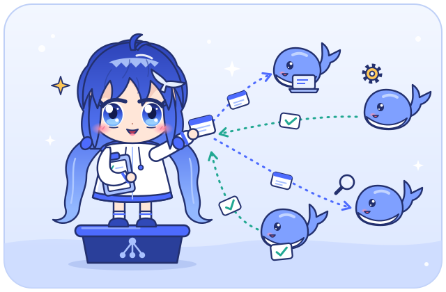
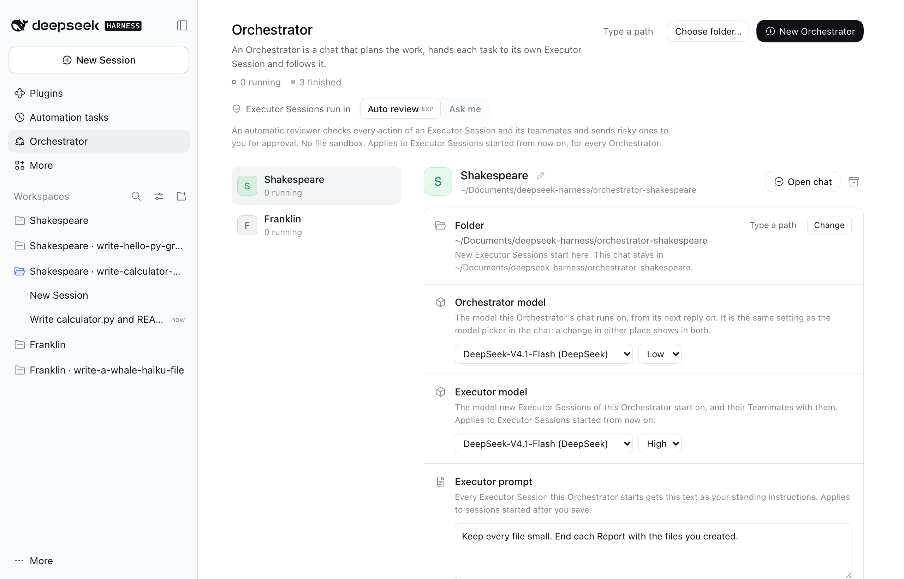
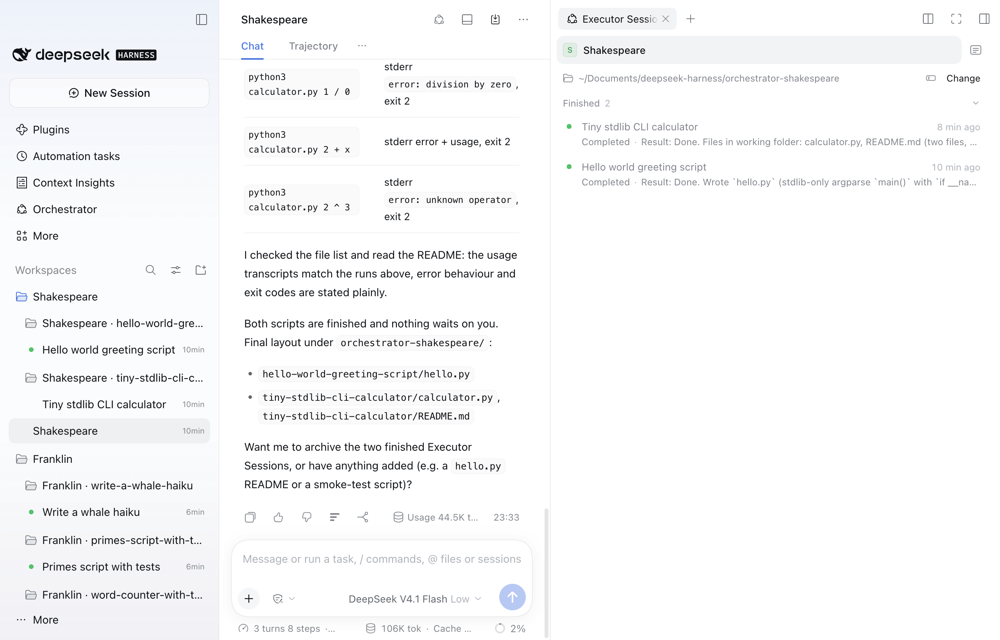
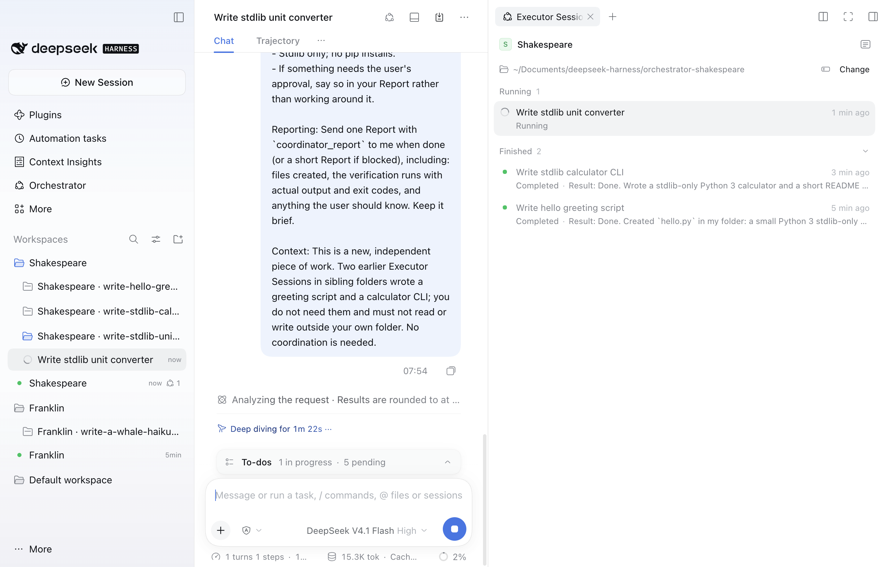
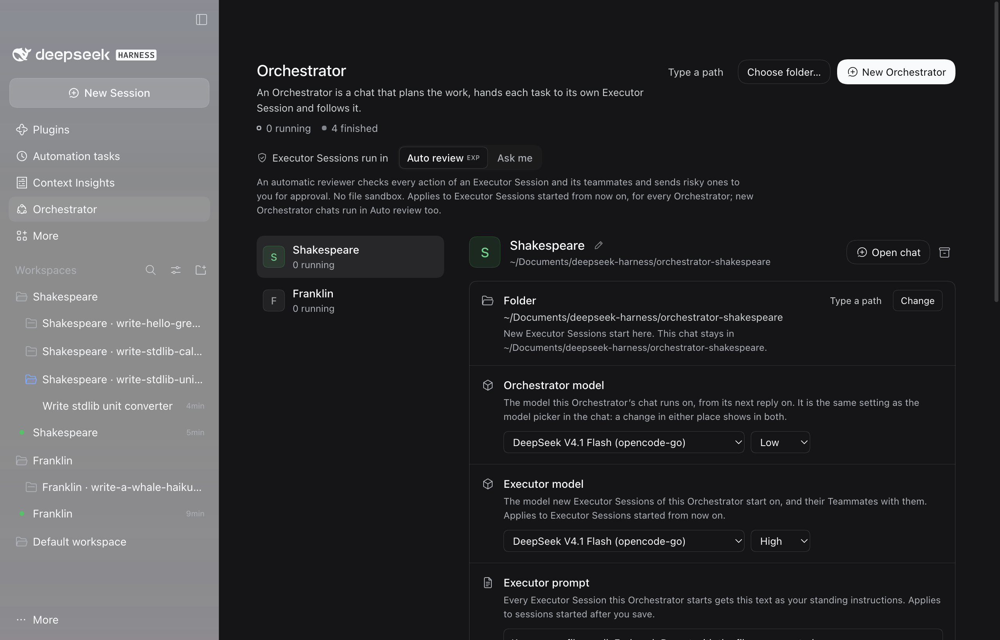

<p align="center">
  
</p>

<p align="center"><a href="README.md">English</a> | <a href="README.zh-CN.md">简体中文</a> | Deutsch</p>

# Whalepod

Whalepod (Paket `dsh-whalepod`) ist ein Plugin für den DeepSeek Harness (dsh). Es fügt Orchestratoren hinzu. Ein Orchestrator ist die Haupt-Session, die Arbeit verteilt: Du beschreibst die Arbeit in seinem Chat, und sein Agent gibt jede Aufgabe an eine eigene Executor Session ab, verfolgt sie und meldet die Ergebnisse. Du kannst mehrere Orchestratoren nebeneinander betreiben, einen pro Vorhaben. Jeder Orchestrator hat einen Namen, etwa "Noether" oder "李白".

**Installation:** Öffne in DeepSeek Harness Plugins > "Plugin hinzufügen", gib `dsh-whalepod` ein und klicke auf "Installieren". Details unter [Installation](#installation).

Die Oberfläche des Plugins gibt es auf Englisch und Chinesisch. Deshalb nennt diese Anleitung Begriffe und Beschriftungen so, wie sie in der englischen Oberfläche erscheinen (Orchestrator, Executor Session, Assignment, Report, "New Orchestrator" und so weiter).

Executor Sessions arbeiten selbstständig mit eingeschalteten Agent Teams, jede in ihrem eigenen Ordner und in ihrer eigenen Seitenleisten-Gruppe neben ihrem Orchestrator. Executor Sessions desselben Orchestrators können einander Nachrichten schicken, wenn sie an einer gemeinsamen Aufgabe arbeiten; Executor Sessions verschiedener Orchestratoren können das nicht. Der Lead einer Executor Session darf seine Aufgabe auf ein Agent-Team verteilen. Die Executor Session gilt als laufend, solange ein Teammate arbeitet, und der Orchestrator erfährt es einmal, wenn das ganze Team fertig ist.

Executor Sessions laufen standardmäßig im Auto review von dsh, wenn du das dsh-Plugin "Auto authorization review" eingeschaltet hast; es hat keine Datei-Sandbox. Ohne es laufen sie in Ask me, und die Orchestrator-Seite stellt neue jederzeit auf Ask me um. [Sicherheit](#sicherheit) erklärt beide Modi und die Grenzen, die das Plugin durchsetzt.

## Screenshots

<p align="center">
  
</p>
<p align="center"><em>Die Orchestrator-Seite: Shakespeare ausgewählt, mit Ordner sowie Orchestrator- und Executor-Modell.</em></p>

<p align="center">
  
</p>
<p align="center"><em>Der Chat von Shakespeare meldet beide Aufgaben als erledigt; der Bereich listet seine Executor Sessions, die Seitenleiste zeigt eine Gruppe pro Executor Session.</em></p>

<p align="center">
  
</p>
<p align="center"><em>Eine Executor Session arbeitet an einem kleinen Einheitenumrechner, im Bereich ihr Orchestrator und zwei beendete Geschwister-Sessions.</em></p>

<p align="center">
  
</p>
<p align="center"><em>Die Orchestrator-Seite im dunklen Design.</em></p>

## Voraussetzungen

- DeepSeek Harness 0.2.2-rc.2 oder eine spätere 0.2.x-Version (`engines.dsh`).
- Git nur für den `github:`-Weg unten; der Paketname braucht nichts weiter.
- Das Paket enthält vorgebauten Code und hat keine Laufzeitabhängigkeiten. `@deepseek-ai/cordis` und `@deepseek-ai/dsh-typert-protocol` sind Peer-Abhängigkeiten, die das laufende dsh mitbringt; die Peer-Warnung von pnpm bei der Installation ist zu erwarten.

## Installation

Whalepod ist auf npm als `dsh-whalepod` veröffentlicht. Keiner der folgenden Wege baut etwas auf deinem Rechner; das Paket enthält den fertigen Code.

**In der App.** Öffne Plugins, wähle "Plugin hinzufügen", tippe `dsh-whalepod` in das Feld "Name oder Adresse des Pakets" und klicke auf "Installieren". Das Auswahlfeld "Registry" kann auf der offiziellen npm-Registry bleiben. Wenn die Installation fertig ist, wähle "Jetzt aktivieren". Sagt der Dialog, dass DSH neu gestartet werden muss, beende die App und starte sie wieder. (In einer anderen Sprache der App heißen die Schaltflächen entsprechend, auf Englisch etwa "Add plugin", "Install" und "Enable now".)

**Über die Kommandozeile.** Beende die App zuerst, wenn du in das Desktop-Profil installierst, und starte sie danach wieder. Das Desktop-Profil muss existieren, also öffne die Desktop-App vor der ersten Installation einmal. Für `dsh web` nimm `--profile web` und starte `dsh web` neu.

```sh
dsh plugin --profile desktop add dsh-whalepod
```

**Der neueste Code von GitHub.** Um den aktuellen Stand des Repositorys statt des veröffentlichten Pakets zu installieren, nimm an beiden Stellen `github:simveit/dsh-whalepod`. Dafür braucht es Git:

```sh
dsh plugin --profile desktop add github:simveit/dsh-whalepod
```

Das ist die ganze Installation. Der Eintrag "Orchestrator" erscheint in der Seitenleiste, und die Orchestrator-Werkzeuge sind verfügbar. Das Plugin fügt kein Agent-Preset hinzu: Executor Sessions und Orchestratoren laufen auf deinem Standard-Preset.

Eine neuere Version installierst du, indem du das Plugin entfernst (siehe [Deinstallation](#deinstallation)) und die neue Version hinzufügst. Orchestratoren, Executor Sessions und der Plugin-Zustand bleiben erhalten.

Auto review kommt aus dem optionalen dsh-Plugin "Auto authorization review" (`@deepseek-ai/dsh-experimental-auto-review`), das mit dsh ausgeliefert wird. Um es zu nutzen, schalte es unter Plugins ein; heruntergeladen wird nichts. Ohne es laufen Executor Sessions in Ask me (`workspace-write`), und die Orchestrator-Seite nennt den Grund. Version 0.1.0 dieses Plugins hat dessen Komponente selbst eingeschaltet; 0.1.1 überlässt das dir, weil die Deinstallation in der App Whalepod nicht entfernen konnte, solange Auto authorization review ebenfalls eingeschaltet war.

## Schnellstart

1. Öffne den Eintrag "Orchestrator" in der linken Seitenleiste und klicke auf "New Orchestrator". Zuerst öffnet sich ein Einrichtungsschritt: Er schlägt einen Namen vor und zeigt das Modell für den Orchestrator und das Modell für seine Executors. Ändere, was du möchtest, und drücke Enter oder "Create". Dann legt das Plugin den Ordner des Orchestrators an und öffnet seinen Chat.
2. Beschreibe die Arbeit im Chat, zum Beispiel "Write a CSV word counter in Python and in Go, in two parallel Executor Sessions". Bei größerer Arbeit schlägt der Orchestrator womöglich zuerst eine Aufteilung vor. Dann startet er eine Executor Session pro Teilaufgabe.
3. Verfolge die Executor Sessions im Bereich rechts neben dem Chat oder auf der Orchestrator-Seite. Freigaben, Fragen und Ordnerbestätigungen kommen zu dir, in der Zeile der Executor Session und im Orchestrator-Chat.
4. Der Orchestrator meldet jedes Ergebnis in seinem Chat. Öffne eine beliebige Executor Session, um hineinzuschauen oder direkt mit ihrem Lead zu sprechen.
5. Ist die Arbeit erledigt, klicke auf der Orchestrator-Seite auf "Archive Orchestrator". Gelöscht wird nichts.

## Orchestratoren und ihre Ordner

**Einen anlegen.** Klicke auf der Orchestrator-Seite auf "New Orchestrator". Unter dem Seitenkopf öffnet sich ein Einrichtungsschritt, und noch wird nichts angelegt. Er hat drei Felder. "Name for the new Orchestrator" zeigt in Grau einen vorgeschlagenen Namen: Lass das Feld leer, dann bekommt der Orchestrator genau diesen Namen, oder tippe einen eigenen ein. "Orchestrator model" und "Executor model" sind die beiden Einstellungen, die weiter unten unter Modelle beschrieben sind, bereits mit ihren Vorgaben gefüllt; ändere sie hier oder später auf der Seite. Drücke Enter oder "Create", um den Orchestrator anzulegen (Esc schließt den Schritt). Ein abgelehnter Name, Ordner oder ein abgelehntes Modell legt nichts an, und der Schritt nennt den Grund. Das Plugin legt dann für den Orchestrator einen Ordner neben dem Standard-Workspace von dsh an (auf einem üblichen Mac etwa `~/Documents/deepseek-harness/orchestrator-noether` oder `orchestrator-li-bai`; bei einem eigenen Namen `coordinator-` und die lateinischen Buchstaben und Ziffern des Namens, oder nur `orchestrator`, wenn er keine enthält), fügt diesen Ordner der Seitenleiste als Workspace mit dem Titel "Noether" hinzu und öffnet dort den Orchestrator-Chat mit demselben Titel. "Choose folder..." macht dasselbe in einem Ordner, den du im Ordnerdialog wählst, und "Type a path" daneben lässt dich den Ordner stattdessen eintippen. Ein Ordner, der bereits ein Workspace mit deinen eigenen Sessions ist, wird abgelehnt, ebenso ein Ordner in oder um den Ordner eines anderen Orchestrators. "Open chat" bei einem Orchestrator öffnet ihn wieder. Gibt es noch keinen Orchestrator, bietet die Seite "New Orchestrator" an, das denselben Einrichtungsschritt öffnet; dein erster Orchestrator wird also genauso eingerichtet. Liegt unter dem vorgeschlagenen Namen noch ein Ordner mit Dateien von einem früheren Orchestrator, behält der neue Orchestrator den Namen und bekommt den nächsten freien Ordner (`orchestrator-li-bai-2`); der alte Ordner wird nicht angefasst. Lässt sich der Chat nicht öffnen, nachdem der Orchestrator angelegt wurde, schließt sich der Schritt trotzdem, und ein Hinweis sagt es: Der Orchestrator steht in der Liste, mit seinem Knopf "Open chat".

**Namen.** Jeder Orchestrator hat einen Namen, den kein anderer aktiver Orchestrator trägt. Du kannst ihn in dem Formular eintippen, das "New Orchestrator" öffnet; für einen eingetippten Namen gelten die Regeln des Umbenennens weiter unten, und ein abgelehnter Name legt nichts an. Lässt du das Feld leer, bekommt der Orchestrator den Namen, den das Feld in Grau vorschlägt, oder einen anderen freien, falls inzwischen ein Orchestrator diesen Namen trägt. Der Vorschlag, und der Name überall dort, wo ein Orchestrator ohne dieses Formular entsteht, wird zufällig gewählt aus einer eingebauten Liste berühmter Philosophinnen und Philosophen, Forschender, Mathematikerinnen und Mathematiker, Romanciers und Dichter: englischsprachige, deutschsprachige und chinesische Namen und einige von anderswo. Chinesische Namen stehen in jeder Sprache der Seite in chinesischen Schriftzeichen (李白, 老子, 鲁迅). Sind alle Namen vergeben, kommt eine Zahl dazu ("Noether 2"). Zum Umbenennen klickst du auf der Orchestrator-Seite auf den Stift hinter dem Namen, tippst den neuen Namen und drückst Enter (Esc bricht ab). Ein Name hat 1 bis 40 Zeichen, keine Steuerzeichen und keinen Mittelpunkt (·), besteht nicht nur aus Ziffern und muss sich von den Namen aller anderen aktiven Orchestratoren unterscheiden. Unsichtbare Zeichen werden entfernt, und Namen, die sich nur in Groß- und Kleinschreibung, Zeichenbreite oder unsichtbaren Zeichen unterscheiden, gelten als derselbe Name. Chat und Seitenleisten-Gruppe tragen den bloßen Namen und ziehen beim Umbenennen mit, solange sie noch den Titel des Plugins tragen; einen Titel, den du dem Chat selbst gegeben hast, behält er. Umbenennen verschiebt nie den Ordner.

**Neue Session in der Gruppe eines Orchestrators.** Eine neue Session, die du in der Seitenleisten-Gruppe eines Orchestrators startest (über die Schaltfläche "New Session" der Gruppe), wird mit der ersten Nachricht, die du darin tippst, zu einem weiteren Orchestrator in diesem Ordner. Bis dahin listet sie zwar schon die Werkzeuge eines Orchestrators, verweigert aber ihre Nutzung; ein Zeitplan, ein Workflow oder etwas anderes, das dort eine Session öffnet, kann also keine Executor Sessions starten. Sobald sie ein Orchestrator ist, bekommt sie einen Namen, ihr Chat heißt dann so, und sie läuft auf `workspace-write` wie die Chats, die "New Orchestrator" anlegt. Sie zeigt keine Begrüßung. Sie behält das Modell, mit dem du sie gestartet hast, und bekommt keine Modell-Einstellungen; die Vorgaben sind nur das, was der Einrichtungsschritt von "New Orchestrator" vorschlägt. Höchstens 20 Orchestratoren können gleichzeitig aktiv sein.

Eine Session im Ordner eines Orchestrators, die kein Orchestrator wird, darf nur lesen und suchen und hat keine Plugin-Werkzeuge. Das gilt für eine Session, die schon Runden hatte, als sie dorthin kam, für eine jenseits der Grenze von 20, für einen Fork eines Orchestrator-Chats und für einen früheren Orchestrator-Chat, den du aus dem Archiv holst. Wer fremde Chats im Ordner eines Orchestrators aufbewahrt, findet sie so eingeschränkt vor.

**Sein Ordner.** Der Chat eines Orchestrators bleibt in dem Ordner, in dem er angelegt wurde. Sein Ordner für neue Arbeit ist anfangs derselbe Ordner: Jede neue Executor Session bekommt dort einen frischen Unterordner, benannt nach ihrem Titel. Die Orchestrator-Seite und der Bereich "Executor Sessions" zeigen den Ordner mit "Change" und "Type a path". "Change" öffnet den Ordnerdialog, "Type a path" ein Eingabefeld für den Pfad. Solange der Dialog offen ist, sagt die Seite das und bietet "Type a path" und "Cancel" an. Hat der Dialog nach 8 Sekunden nicht geantwortet, weist die Seite darauf hin, dass er womöglich hinter diesem Fenster liegt; nach 60 Sekunden gibt sie auf und öffnet das Eingabefeld. Nur danach gestartete Executor Sessions verwenden den neuen Ordner. Bestehende behalten ihren, und der Chat bleibt, wo er ist.

**Welche Ordner nachfragen.** Ein neuer Ordner unterhalb des Ordners des Orchestrators startet ohne Rückfrage, wenn sein nächster vorhandener Elternordner der Ordner des Orchestrators oder ein vom Plugin für eine Executor Session angelegter Ordner ist. Jeder andere Ordner braucht den Pfad, von dir im eigenen Chat dieses Orchestrators getippt, und danach deine Bestätigung: ein Ordner außerhalb des Ordners des Orchestrators, ein vorhandener Ordner darunter und ein neuer Ordner innerhalb eines Ordners, den nicht das Plugin angelegt hat, etwa eines deiner Repositorys. Auch ein Ordner in oder um den Ordner einer anderen laufenden Executor Session braucht deine Bestätigung. Ordner im Home eines anderen Orchestrators, Ordner, die den Ordner eines Orchestrators enthalten, der Home-Ordner, Punkt-Ordner, Systemordner und das dsh-Home werden immer abgelehnt. Die Karte mit Reject, Allow once und Always allow erscheint im Orchestrator-Chat, sobald die Runde des Orchestrators beendet ist, nie zusammen mit einer Frage, die der Orchestrator dir stellt; dieselben Schaltflächen in der Zeile der Executor Session auf der Seite und im Bereich funktionieren immer. "Always allow" setzt den Ordner auf die Liste der erlaubten Ordner auf der Orchestrator-Seite und gilt für alle Orchestratoren; Karte und Zeile sagen das. Nach einem Neustart stehen die erlaubten Ordner weiter auf der Liste, aber ein Ordner darunter fragt erneut, bis du für ihn wieder "Always allow" wählst. Karte, Seite und Fehlermeldungen zeigen Pfade mit deinem Home-Ordner als `~`.

**Modelle.** Jeder Orchestrator hat auf der Orchestrator-Seite unter seinem Ordner zwei Modell-Einstellungen. "Orchestrator model" ist das Modell, auf dem sein Chat läuft, ab der nächsten Antwort des Orchestrators. Es ist dieselbe Einstellung wie die Modellauswahl im Chat: Eine Änderung an einer der beiden Stellen zeigt sich an beiden. "Executor model" ist das Modell, auf dem seine neuen Executor Sessions starten; die erste Auswahl ist "Same as Orchestrator". Der Einrichtungsschritt von "New Orchestrator" schlägt beide Einstellungen vor, wenn DeepSeek Harness DeepSeek V4.1 Flash anbietet: das Orchestrator model mit der Stufe "Low", das Executor model mit der Stufe "High". Nichts wird gesetzt, bevor du "Create" drückst, und du kannst beide dort ändern. Bieten mehrere Anbieter dieses Modell an, wird der Anbieter deines Standardmodells genommen, und jeder Eintrag der Auswahl nennt seinen Anbieter. Eine Auswahl beginnt leer ("Not set" beim Orchestrator, "Same as Orchestrator" bei den Executors), wenn das Modell nicht verfügbar ist, wenn das Modell die für diese Auswahl gedachte Stufe nicht anbietet (es wird keine andere Stufe an ihrer Stelle genommen) oder wenn die Modelle des Anbieters deines Standardmodells nicht geladen werden konnten. Konnte der Schritt seine Vorschläge gar nicht laden, sagt er das, und ein Orchestrator, den du dann anlegst, hat keine Modell-Einstellungen. Orchestratoren, die du schon hast, werden nicht geändert. Beide Auswahlen listen die Modelle, die DeepSeek Harness anbietet, nach Anbieter gruppiert, und daneben die Reasoning-Stufe ("Effort"), wenn das Modell eine hat, wie im Eingabefeld des Chats. Eine Änderung wird sofort gespeichert. Das Executor model gilt für Executor Sessions, die danach gestartet werden. Laufende behalten das Modell, mit dem sie gestartet sind, ebenso eine, deren Modell du in ihrem eigenen Chat von Hand geändert hast. Teammates laufen auf dem Modell ihres Leads. Wählst du ein Modell auf der Seite, ändert das nicht das Modell, auf dem deine anderen Sessions in DeepSeek Harness starten. Wählst du eines in der Modellauswahl eines Chats, ändert es das schon, weil DeepSeek Harness diese Wahl als seinen Standard speichert. Ist ein gewähltes Modell nicht mehr verfügbar, etwa nachdem du dich bei seinem Anbieter abgemeldet hast, bleibt es mit einem Hinweis ausgewählt. Neue Executor Sessions starten dann auf dem Modell des Orchestrators oder auf dem Standard von DeepSeek Harness, bis du ein anderes wählst, und der Orchestrator erfährt es, wenn er eine startet. Kann DeepSeek Harness das Executor model in diesem Moment nicht prüfen, weil die Modellliste seines Anbieters fehlschlägt, startet keine Executor Session ersatzweise auf einem anderen Modell: Der Orchestrator erfährt, dass er es erneut versuchen soll, und die Seite zeigt, dass das Modell nicht geprüft werden konnte. Nur du änderst die beiden Einstellungen: Kein Tool eines Orchestrators oder einer Executor Session liest oder setzt sie. Jede neue Executor Session und jedes ihrer Teammates nutzt das Executor model; ein teureres Modell dort erhöht also die Kosten von allen.

**Executor prompt.** Jeder Orchestrator hat auf der Orchestrator-Seite unter seinem Ordner einen "Executor prompt": dauerhafte Anweisungen, die jede Executor Session erhält, die dieser Orchestrator startet, zum Beispiel "schreibe Tests, bevor du Code änderst, und frage, bevor du eine Abhängigkeit hinzufügst". Der Lead bekommt den Text als deine Anweisungen, mit deiner Autorität über dem Assignment und über Nachrichten des Orchestrators; Teammates erhalten das Wichtige über ihren Lead. Ein gespeicherter Prompt gilt für Executor Sessions, die nach dem Speichern starten; laufende behalten den Text, mit dem sie gestartet sind. Er hat bis zu 4000 Zeichen, Cmd+Enter oder Strg+Enter speichert, Esc verwirft die Änderung, und ein leeres Feld zu speichern löscht ihn. Nur du kannst ihn auf der Seite ändern: Der Orchestrator weiß, dass es ihn gibt, kann ihn aber weder lesen noch ändern, und kein Werkzeug eines Modells kann das.

**Memory.** Jeder Orchestrator hat ein Gedächtnis ("Memory"): eine kurze Seite mit Notizen, die er mit seinen Executor Sessions teilt. Darin steht, was ein neuer Orchestrator oder eine neue Executor Session dich sonst noch einmal fragen müsste: deine dauerhaften Vorlieben und Regeln, Entscheidungen, wie du eine Art von Arbeit erledigt, aufgeteilt und berichtet haben möchtest, und bleibende Fakten über deine Projekte und Ordner, aber nicht den Stand laufender Arbeit. Der Orchestrator und die Leads seiner Executor Sessions halten die Seite selbst aktuell, in der Runde, in der sie etwas erfahren, und sie übersteht die Kompaktierung und Neustarts. Sag dem Orchestrator in seinem Chat, dass er sich etwas merken oder etwas vergessen soll, und er tut es in derselben Runde. Der Orchestrator hat die Seite immer vor sich. Eine Executor Session beginnt ohne sie: Der Orchestrator schreibt die wichtigen Teile ins Assignment, und der Lead kann die ganze Seite lesen (`memory_read`) und speichern, was du ihm in seiner Session sagst (`memory_update`); Teammates können das nicht. Jedes Schreiben ersetzt die ganze Seite und nennt die Revision, auf der es beruht. Hat inzwischen jemand anderes die Seite geändert, wird nichts gespeichert, und der Schreiber führt beide Stände zusammen und sendet erneut. Die Zeile "Memory" auf der Orchestrator-Seite, unter dem Executor prompt, zeigt das Gedächtnis, wer es zuletzt geändert hat (du, der Orchestrator oder eine Executor Session), welche Executor Sessions es geändert haben, seit du es dort zuletzt gespeichert hast, und einen Zähler bis 6000 Zeichen; das ist eine Sicherheitsgrenze, die Seite soll kurz bleiben. Die Zeile folgt dem Gedächtnis von selbst: Ändert der Orchestrator oder eine Executor Session es, aktualisiert sich der Text einfach, und du musst nichts tun. Dort kannst du es bearbeiten (Revert und Save). Nur wenn es geändert wird, während du ungespeicherte Änderungen hast, sagt die Seite das und behält deinen Entwurf. Die Liste der Executor Sessions, die die Seite geändert haben, dient deiner Information. "Mark as reviewed" daneben leert die Liste, ebenso ein Save deiner eigenen Änderung. "Use memory" schaltet das Gedächtnis eines Orchestrators aus: Der Orchestrator und seine Executor Sessions bekommen die Notizen dann nicht und können sie nicht ändern, und der Text bleibt erhalten, bis du es wieder einschaltest. Der Orchestrator achtet auch darauf, dass sich seine Executor Sessions an das Gedächtnis halten: Zeigt ein Report oder ein Hinweis, dass eine Executor Session gegen eine Regel oder Vorliebe daraus arbeitet, erinnert der Orchestrator sie daran, wie du es haben möchtest, stoppt sie bei Bedarf und sagt dir Bescheid. Das Gedächtnis sind nur Notizen: Es gilt nie als deine Anweisung und kann keinen Ordner freigeben, einem Assignment nicht deine Autorität geben und keine Freigabe beantworten. Was du in einer Executor Session schreibst, geht dort dem Gedächtnis und dem Executor prompt vor; was du im Chat des Orchestrators sagst, geht dem Gedächtnis vor.

**Look-ins.** Hinweise kommen, wenn eine Executor Session berichtet, fertig wird, fragt oder scheitert. Hat das Gedächtnis Regeln für ihre Arbeit, kann der Orchestrator außerdem zwischendurch hineinschauen, zu Zeitpunkten, die er selbst wählt: zuerst nach 10 bis 20 Minuten, dann in wachsenden Abständen, solange alles passt, und nach zwei oder drei Look-ins ohne Änderung hört er auf. Ein Look-in zeigt kurze Vorschauen dessen, was die Executor Session geschrieben hat: ihre letzte Nachricht, ihre letzten Reports und ihre Aufgabenliste. Verstößt die Arbeit gegen eine Regel, erinnert der Orchestrator sie daran, wie du es haben möchtest, und sagt es dir in einer Zeile; sonst endet er still, und der Chat zeigt nur eine eingeklappte Zeile "… is still working (your look-in)" und eine beendete Runde ohne Antwort. Executor Sessions führen eine Aufgabenliste und senden einen kurzen Fortschritts-Report, wenn sie eine Entscheidung treffen, die die Arbeit prägt, etwa ein Werkzeug oder ein Vorgehen; beides weckt den Orchestrator nicht und erscheint beim nächsten Look-in oder Hinweis. Ohne Regeln im Gedächtnis gibt es keine Look-ins und keine Zusatzkosten. Der Host erlaubt 6 Look-ins pro Executor Session (`checkLaterMaxPerExecutor`), bis du wieder schreibst, im Chat des Orchestrators oder in der Executor Session; so können Look-ins und Erinnerungen nicht ohne dich weiterlaufen. Ein noch ausstehendes Look-in geht verloren, wenn das Plugin neu geladen oder die App neu gestartet wird; der Orchestrator kann beim nächsten Hinweis ein neues planen.

**Wo Executor Sessions erscheinen.**

- Die Orchestrator-Seite listet die Orchestratoren mit ihren Namen. Wähle einen aus, um seinen Ordner, seinen Executor prompt, sein Gedächtnis und seine Executor Sessions zu sehen, gruppiert als "Needs you", "Running", "Standing by" und "Finished".
- Neben einem Orchestrator-Chat listet der Bereich "Executor Sessions" in der rechten Seitenleiste die Executor Sessions dieses Orchestrators. Neben einer Executor Session listet er die anderen Executor Sessions desselben Orchestrators, mit dem Orchestrator ganz oben. Die Schaltfläche in der Kopfzeile blendet den Bereich ein und aus.
- In der linken Seitenleiste zeigt die Zeile eines Orchestrators, wie viele seiner Executor Sessions dich brauchen oder laufen, und ihre Hover-Karte nennt den Orchestrator und die Zahlen.
- Jede Executor Session steht in einer eigenen Seitenleisten-Gruppe an ihrem Ordner, mit dem Titel "<Orchestrator-Name> · <Ordnername>" (zum Beispiel "Orwell · write-the-parser"), direkt nach der Gruppe ihres Orchestrators und eingeklappt, bis du sie öffnest. Die Gruppe zieht mit, wenn der Orchestrator umbenannt wird. In der dsh-Ansicht "Group by workspace tree" hängen diese Gruppen unter der Gruppe des Orchestrators, wenn der Ordner der Executor Session unterhalb des Ordners des Orchestrators liegt. Arbeitet eine Executor Session in einem Ordner, der schon einer deiner Workspaces ist, tritt sie diesem Workspace bei; das Plugin benennt ihn nie um und entfernt ihn nie. Eine neue Session, die du in der Gruppe einer Executor Session öffnest, ist deine eigene gewöhnliche Session: Das Plugin fasst sie nicht an.
- Der Eintrag "Orchestrator" in der Seitenleiste zählt die Executor Sessions aller Orchestratoren, die dich brauchen.

Eine Executor Session steht auf "Standing by", wenn ihre letzte Runde ohne Ergebnis endete und sie auf die nächste Nachricht wartet.

**Titel von Executor Sessions.** Eine neue Executor Session beginnt mit dem Arbeitstitel, den ihr Orchestrator ihr gegeben hat. Ist der Titelgenerator von dsh eingeschaltet ("Conversation-following titles"), benennt dsh die Session danach anhand ihres Assignments neu, und später anhand dessen, was du darin tippst; ohne den Generator bleibt der Arbeitstitel. Seite, Bereich, Benachrichtigungen und die Werkzeuge des Orchestrators zeigen den aktuellen Titel. Eine Executor Session darf nicht wie ein Orchestrator heißen, und ein erzeugter Titel, der wie einer aussieht, wird nicht übernommen; eingeschleuster Text kann eine Executor Session also nicht als Orchestrator ausgeben.

**Reports.** Ein Ergebnis eines Leads erreicht seinen Orchestrator einmal; dasselbe Ergebnis noch einmal gesendet wird gespeichert, aber nicht zweimal zugestellt. Ein Hinweis, der den Orchestrator wecken würde, während dieser arbeitet, wartet, bis der Orchestrator seine Runde beendet hat, und eröffnet dann die nächste. Er erscheint nie in der Warteschlange über dem Eingabefeld des Chats, und eine Nachricht, die du inzwischen schreibst, kommt zuerst. Nach einer Runde, die du gestoppt hast oder die fehlgeschlagen ist, bleiben wartende Hinweise zurück: Deine nächste Nachricht läuft ohne sie, und sie eröffnen eine eigene Runde, sobald eine Runde des Orchestrators normal geendet hat, oder zusammen mit dem nächsten Hinweis, der ihn weckt.

**Archivieren.** "Archive Orchestrator" auf der Orchestrator-Seite archiviert seinen Chat und seine beendeten Executor Sessions; gelöscht wird nichts. Arbeiten noch Executor Sessions, listet die Bestätigung sie auf und bietet "Stop and archive" an. Hake "Also remove its workspace from the sidebar" an, um auch die Seitenleisten-Gruppe des Orchestrators zu entfernen; die Dateien auf der Festplatte bleiben erhalten. Die Gruppe bleibt, wenn ein anderer Orchestrator sie nutzt, wenn sie weitere Sessions enthält oder wenn nicht das Plugin sie angelegt hat, und die Seite sagt, warum. Schlägt das Entfernen der Gruppe fehl, wird der Orchestrator trotzdem archiviert, und die Seite sagt, dass du die Gruppe in der Seitenleiste entfernen kannst. Wird eine Executor Session archiviert, oder ein Orchestrator mit seinen Executor Sessions, entfernt das Plugin deren Gruppen, wenn nichts anderes mehr darin liegt; deine eigenen Workspaces entfernt es nie. Die archivierten Executor Sessions eines Orchestrators stehen schreibgeschützt in einer eingeklappten Gruppe "Archived" unter seinen Executor Sessions; öffnen kannst du sie über das Archiv der Seitenleiste. Ein archivierter Orchestrator bleibt schreibgeschützt auf der Seite; "Reopen" holt ihn mit einem neuen Chat zurück, und seine archivierten Executor Sessions bleiben archiviert. Hat inzwischen ein anderer Orchestrator seinen Namen übernommen, bekommt er einen neuen. Wird "Reopen" abgelehnt (20 Orchestratoren sind offen, oder sein Ordner wird abgelehnt), sagt die Seite, warum. "Delete Orchestrator" (der Papierkorb eines archivierten Orchestrators) entfernt nur seinen Eintrag von der Seite; seine Sessions, Ordner und Dateien bleiben.

Löschst du einen Orchestrator-Chat stattdessen in der linken Seitenleiste, behält der Orchestrator seine Executor Sessions, und ihre Benachrichtigungen warten auf ihn. Die Seite zeigt dann den Zustand des Chats: "Chat archived", "Chat deleted", wenn die Session nicht mehr existiert, oder "No chat yet". "Reopen chat" (oder "Start chat", wenn es nie einen gab) legt im Ordner des Orchestrators einen neuen Chat für denselben Orchestrator an und übergibt, was gewartet hat.

**Gemeinsame Einstellungen.** "Executor Sessions run in", die erlaubten Ordner und die Obergrenze gleichzeitig laufender Executor Sessions (`maxRunningThreads`) gelten für alle Orchestratoren zusammen. Ebenso der Schalter "Matriarc in Executor Sessions", der nur unter "Executor Sessions run in" erscheint, und nur, wenn das Plugin Matriarc installiert ist. Er ist standardmäßig an: Jede neue Executor Session startet mit Matriarc, und Orchestrator-Chats bekommen Matriarc nie, auch wenn man es in einem einschaltet. Aus lässt Whalepod Matriarc in Ruhe. Whalepod funktioniert mit dem Plugin Matriarc ebenso wie ohne; die Screenshots oben zeigen es ohne. Solange neue Executor Sessions in Auto review laufen und Auto review geladen ist, laufen neue Orchestrator-Chats ebenfalls in Auto review, mit denselben eingeschränkten Werkzeugen; sonst in Workspace Write. Name, die beiden Modelle, Executor prompt und Gedächtnis gehören zu jedem einzelnen Orchestrator.

## Konfiguration

Alle Schlüssel sind optional. Am einfachsten änderst du sie in den Einstellungen des Plugins: Öffne Plugins, klicke auf Whalepod und bearbeite das Formular unter der kurzen Einführung. Es enthält jeden Schlüssel außer dem veralteten `threadsRoot`, prüft jeden Wert schon bei der Eingabe und speichert in die Zeile des Plugins in der `cordis.patch.yml` des Profils. Diese Zeile behält die ID `dsh-coordinator`, den Namen, den das Plugin hatte, bevor es Whalepod wurde. Änderungen gelten sofort, ohne Neustart des Plugins. "Reset to default" nimmt einen Schlüssel wieder aus dem Patch.

Du kannst diese Zeile auch von Hand schreiben:

```yaml
- id: dsh-coordinator
  config:
    coordinatorBase: ~/Documents/deepseek-harness
```

| Schlüssel | Standard | Bedeutung |
|---|---|---|
| `coordinatorBase` | neben dem Standard-Workspace von dsh | Wo "New Orchestrator" den eigenen Ordner jedes Orchestrators anlegt (`orchestrator-<Name>`, mit `-2`, wenn dieser Ordner schon belegt ist). Ohne diesen Schlüssel das übergeordnete Verzeichnis des registrierten Standard-Workspace von dsh, sonst `~/Documents/deepseek-harness`. Der Home-Ordner, Punkt-Ordner, Systemordner und Ordner, die das dsh-Home enthalten, werden abgelehnt; die Seite sagt das dann, und "New Orchestrator" ist deaktiviert. |
| `threadsRoot` | `~/dsh-threads` | Veraltet. Zeigt nur, wo der Chat des Orchestrators aus der Zustandsdatei einer früheren Version liegt. Neue Executor Sessions starten dort nie, außer der Ordner für neue Orchestratoren ist abgelehnt. |
| `maxRunningThreads` | `128` | Gleichzeitig laufende Executor Sessions über alle Orchestratoren; weitere Starts und Weckrufe warten in einer Schlange |
| `noticeDebounceMs` | `3000` | Ruhezeit, bevor ein Stapel von Benachrichtigungen einer Executor Session ihren Orchestrator erreicht |
| `noticeMaxDelayMs` | `15000` | Längste Wartezeit einer Benachrichtigung auf ihren Stapel |
| `checkLaterMinMinutes` | `5` | Kürzester Abstand in Minuten, den ein Orchestrator für ein Look-in wählen darf; mindestens 1, und ein Wert über 240 zählt als 240 |
| `checkLaterMaxPerExecutor` | `6` | Look-ins, die eine Executor Session bekommen kann, bis du wieder schreibst, im Chat des Orchestrators oder in der Executor Session; mindestens 1 |
| `briefAs` | `user` | `user`: Das Assignment ist ein Nutzer-Prompt (Auto review behandelt es als Aufgabe), wenn der Nutzer die Runde des Orchestrators begonnen hat; `notice`: immer eine Agent-Nachricht |
| `wakeMaxPerThread`, `wakeWindowMs` | `60`, `600000` | Wie oft eine Executor Session ihren Orchestrator wecken darf; darüber hinaus pausiert sie, bis du sie fortsetzt |
| `threadTurnBudget` | `0` | Runden pro Executor Session in 24 Stunden, die die Executor Session, ihr Orchestrator, ein Peer oder ein Zeitplan startet (deine eigenen Runden zählen nicht); darüber hinaus pausiert sie, bis du sie fortsetzt. `0` heißt: kein Tagesbudget |
| `coordinatorExtraTools` | `[]` | Zusätzliche Werkzeuge anderer Plugins oder MCP-Server, die die Orchestratoren nutzen dürfen, nach Namen. Werkzeuge, die Code ausführen, Dateien schreiben, Arbeit abzweigen, die Logs anderer Sessions lesen (`session_search` und ähnliche), Plugins verwalten oder Terminals, Browser oder Office-Dokumente bedienen, kommen nie dazu |
| `peerMaxPerPair`, `peerMaxPerThread`, `peerWindowMs` | `40`, `200`, `600000` | Grenzen für `executor_send` pro Paar von Executor Sessions (beide Richtungen) und pro Absender. Die Nachricht über einer Grenze wird abgelehnt; die Paargrenze pausiert beide Executor Sessions, die Absendergrenze den Absender, bis du sie fortsetzt |
| `matriarc` | `on` | Der Matriarc-Schalter, bis der Nutzer ihn auf der Orchestrator-Seite ändert: `on` (neue Executor Sessions starten mit Matriarc, Orchestrator-Chats bekommen es nie) oder `off` (Whalepod lässt Matriarc in Ruhe). Wirkt nur, solange Matriarc installiert ist. |
| `threadPermission` | `auto` | Wie neue Executor Sessions laufen, bis der Nutzer auf der Orchestrator-Seite wählt: `auto` (Auto review, keine Datei-Sandbox) oder `ask` (Ask me, `workspace-write`: auf den Ordner der Executor Session beschränkt, Freigaben an den Nutzer). Jeder andere Wert gilt als `auto`; das Plugin verwendet nie ein lockereres Preset. |

Die Schlüsselnamen sind dieselben wie in früheren Versionen, bestehende Patches funktionieren also weiter. Ein Wert, den ein Schlüssel ablehnt (unter seinem Minimum, eine unbekannte Auswahl), gilt als Standardwert des Schlüssels und verhindert nie das Laden des Plugins. Pro `DSH_HOME` betreibt nur ein dsh-Prozess die Orchestratoren; ein weiterer zeigt an, warum er deaktiviert ist.

Ordner, die du mit "Always allow" freigibst, stehen auf der Orchestrator-Seite unter "Allowed folders", wo du sie wieder entfernen kannst. Sie sind nicht Teil der Konfiguration. Namen, Executor prompts und Gedächtnis der Orchestratoren stellst du ebenfalls auf der Orchestrator-Seite ein, nicht in der Konfiguration.

Um ohne Auto review zu arbeiten, lass Auto authorization review unter Plugins ausgeschaltet (oder schalte es aus). Executor Sessions laufen dann in Ask me (`workspace-write`) und fragen, bevor sie außerhalb ihres Ordners handeln; der Schalter auf der Orchestrator-Seite zeigt Ask me und nennt den Grund. Das Host-Log meldet das beim Start (`auto permission preset NOT available`). Das Plugin wählt nie ein großzügigeres Preset.

## Sicherheit

Executor Sessions laufen standardmäßig im Auto review von dsh, solange Auto authorization review unter Plugins eingeschaltet ist: Ein automatischer Prüfer kontrolliert jede Aktion und schickt riskante an dich, und in diesem Modus gibt es keine Datei-Sandbox. Ohne es laufen sie in Ask me. Die Orchestrator-Seite hat einen Schalter "Executor Sessions run in: Auto review | Ask me". Mit Ask me laufen neue Executor Sessions unter dem dsh-Preset `workspace-write`: Der Lead schreibt nur im Ordner der Executor Session und fragt dich vor allem anderen; seine Teammates arbeiten in derselben Ordner-Sandbox. Teammates fragen dich in keinem der beiden Modi: Eine Aktion, die deine Freigabe bräuchte, etwa alles außerhalb des Ordners unter Ask me, wird ihnen verweigert. Der Schalter gilt für alle Orchestratoren.

Der Orchestrator hat `executor_start`, `executor_message`, `executor_list`, `executor_read`, `executor_flag_user`, `executor_stop`, `executor_archive`, `memory_read` und `memory_update` (sein Gedächtnis) und `executor_check_later` (Look-ins), dazu Werkzeuge, um Dateien zu lesen und zu durchsuchen, einen Skill zu laden (das `skill`-Werkzeug von DeepSeek Harness), dir Fragen zu stellen und eine Aufgabenliste zu führen; Shell-, Schreib-, Web- oder Browser-Werkzeuge hat er nicht, und der Host lehnt jeden Aufruf außerhalb seiner Erlaubnisliste ab. Jeder Orchestrator sieht und steuert nur die Executor Sessions, die er selbst gestartet hat. Leads haben die Standard-Werkzeuge des Nutzers (ohne den Plugin-Manager) sowie `coordinator_report`, `executor_peers`, `executor_send` und, für das Gedächtnis ihres eigenen Orchestrators, `memory_read` und `memory_update`. Die Werkzeuge nehmen das Ziel im Parameter `executor` und die erste Nachricht im Parameter `assignment`.

Die Grenzen setzt der Host-Code durch. Ausgaben einer Executor Session erreichen den Orchestrator nur als abgegrenzte Daten. Ein Ordner außerhalb des eigenen Ordners des Orchestrators, oder einer darunter, den nicht das Plugin angelegt hat, braucht die eigenen Worte des Nutzers im Chat dieses Orchestrators und danach seine Bestätigung, in der Zeile der Executor Session oder in einer Karte im Orchestrator-Chat. Ein Ordner auf der Liste der erlaubten Ordner überspringt die Bestätigung erst, wenn du im laufenden Betrieb der App für ihn "Always allow" gewählt hast. Ein Assignment gilt nur dann als Anweisung des Nutzers, wenn der Nutzer die Arbeit selbst verlangt hat. Das Gedächtnis eines Orchestrators schreiben Modelle: sein eigenes und die der Leads seiner Executor Sessions. Es liegt im Zustand des Plugins und ändert sich nur über die beiden Memory-Werkzeuge und die Orchestrator-Seite, und eine Executor Session erreicht nur das Gedächtnis ihres eigenen Orchestrators. Keine Prüfung des Hosts nimmt das Gedächtnis anstelle deiner eigenen Worte an, sodass Text, den eine Executor Session dort hineingeschrieben hat, für sich allein nichts freigeben kann. Er kann aber beeinflussen, was der Orchestrator und andere Executor Sessions desselben Orchestrators tun. Ändert eine Executor Session das Gedächtnis, während der Orchestrator an deiner Anfrage arbeitet, oder liest der Orchestrator ein Gedächtnis, das Executor Sessions seit deinem letzten Speichern geändert haben, gelten die Assignments, die er im Rest dieser Runde schreibt, nicht als deine Anweisung. In einer späteren von dir eröffneten Runde gelten sie wieder als deine Anweisung, auch wenn eine Notiz im Gedächtnis sie geprägt hat. Die Zeile "Memory" zeigt, wer das Gedächtnis zuletzt geändert hat und welche Executor Sessions es seit deinem letzten Speichern geändert haben. Prüfe und bearbeite es auf der Orchestrator-Seite oder schalte es dort aus, vor allem vor unbeaufsichtigter Arbeit mit nicht vertrauenswürdigen Inhalten. Das Plugin verweigert Orchestratoren, Executor Sessions und ihren Teammates seinen eigenen Zustandsordner (`storages/dsh-coordinator` im dsh-Home), in dem Executor-Prompts, Gedächtnisse und Modelleinstellungen liegen. Ihre Datei- und Suchwerkzeuge erreichen ihn unter keinem Namen, den der Ordner hat. Einen Shell-Befehl einer Executor Session lehnt das Plugin nur in den Schreibweisen ab, die es erkennt; dort bleiben die Sandbox und das Auto review von DeepSeek Harness die Kontrolle. Im übrigen dsh-Home werden sie wie jede andere deiner Sessions behandelt, von der Sandbox und dem Auto review von DeepSeek Harness und nicht vom Plugin: Sie können deine Skills nutzen, und sie können auch die Zugangsdaten-Datei, die Profile und die Session-Logs lesen, wie jede Session. Ein Orchestrator lädt einen Skill, um das Assignment zu schreiben, und nennt ihn dort; die Executor Session wendet ihn an. Ein Skill ist Text, den der Orchestrator als Anweisung nimmt. Hat das Projekt des Orchestrators einen eigenen Skills-Ordner (`.dsh/skills` oder `.agents/skills`), in den eine Executor Session geschrieben haben kann, gelten die Assignments, die der Orchestrator in dieser Runde nach dem Laden eines Skills schreibt, nicht als deine Anweisung. Eine Executor Session, die ihren Orchestrator zu oft weckt, oder zwei Executor Sessions, die einander zu oft schreiben, pausieren, bis du sie fortsetzt. Ein Tagesbudget für Runden lässt sich einstellen, ist aber standardmäßig aus; da bis zu 128 Executor Sessions gleichzeitig laufen, solltest du für unbeaufsichtigten Betrieb eines setzen, sonst sind Modellkosten und die Ratenlimits des Anbieters schnell erreicht.

[docs/security.md](docs/security.md) beschreibt das Bedrohungsmodell, was der Host durchsetzt und was auf Prompts beruht, sowie die bekannten Grenzen. Wie du eine Schwachstelle meldest, steht in [SECURITY.md](SECURITY.md).

## Aktualisierung von einer früheren Version

**Von 0.1.0 auf 0.1.1.** Ist Auto authorization review unter Plugins eingeschaltet, verweigert dsh in der App das Deinstallieren oder Aktualisieren von Whalepod 0.1.0 ("Other configuration still uses this bundle's components"). Schalte entweder Auto authorization review aus, aktualisiere oder deinstalliere Whalepod und schalte es wieder ein; oder führe bei beendeter App `dsh plugin --profile desktop remove dsh-whalepod` aus und füge die neue Version hinzu (siehe [Installation](#installation)). Hast du Auto review genutzt, ohne Auto authorization review selbst einzuschalten, schalte es nach dem Update ein; bis dahin laufen Executor Sessions in Ask me, und die zuletzt in Auto review gelaufenen warten, bis es wieder da ist. Orchestratoren, Executor Sessions, der Plugin-Zustand und die Einstellungen bleiben erhalten.

**Vom Paket `dsh-coordinator`.** Das Plugin hieß `dsh-coordinator`, bevor es zu Whalepod (Paket `dsh-whalepod`) wurde. dsh installiert Plugins nach Paketnamen, also entferne das alte Paket und füge das neue hinzu, bei beendeter App (oder gestopptem `dsh web`):

```sh
dsh plugin --profile desktop remove dsh-coordinator          # oder: --profile web
dsh plugin --profile desktop add dsh-whalepod                # oder github:simveit/dsh-whalepod, siehe Installation
```

Orchestratoren, Executor Sessions und der Plugin-Zustand bleiben erhalten: Die Plugin-ID, der Zustandsordner (`$DSH_HOME/storages/dsh-coordinator/`) und die Markierungen in den Session-Logs behalten den alten Namen. Einstellungen von der Plugins-Seite bleiben ebenfalls, aber dsh überspringt eine Einstellungszeile, deren `name` das alte Paket nennt. Enthält die `cordis.patch.yml` des Profils eine Zeile mit `id: dsh-coordinator` und `name: dsh-coordinator`, ändere diese Zeile vor dem nächsten Start in `name: dsh-whalepod` (oder lösche sie). Eine Zeile nur mit `id: dsh-coordinator` braucht keine Änderung.

**Von einer früheren Version des Plugins.** Es geht nichts verloren. Beim ersten Start:

- Dein bisheriger Orchestrator wird der erste Orchestrator auf der Seite, mit seinem Chat, allen seinen Executor Sessions (auch den archivierten), den erlaubten Ordnern und deiner Wahl bei "run in". Seine neuen Executor Sessions starten in einem neuen Ordner neben dem Standard-Workspace von dsh (`~/Documents/deepseek-harness/orchestrator-<Name>`), wie bei einem neuen Orchestrator. Sein Chat bleibt, wo er ist; ohne Chat legt Reopen den Chat in diesem neuen Ordner an. Bestehende Executor Sessions behalten ihre Ordner. Der Ordner entsteht, wenn dort die erste neue Executor Session startet. Du kannst ihn auf der Seite ändern. Ist der Ordner für neue Orchestratoren abgelehnt, bleibt das alte `threadsRoot` in Gebrauch, und die Seite sagt warum.
- Jeder vorhandene Orchestrator bekommt einen Namen. Ein Chat oder eine Seitenleisten-Gruppe, die noch "Coordinator", "Coordinator 2" oder "Coordinator <Name>" heißt, wird einmal auf den bloßen Namen umbenannt. Vorhandene Ordner werden nicht umbenannt.
- Die erlaubten Ordner bleiben auf der Liste, aber jeder fragt erneut nach deiner Bestätigung, bis du für ihn wieder "Always allow" wählst.
- Bevor die Zustandsdatei zum ersten Mal im neuen Format geschrieben wird, wird sie einmal als `state.v1.json` daneben kopiert (`$DSH_HOME/storages/dsh-coordinator/`). Diese Kopie wird nie überschrieben.
- Jede laufende Executor Session bekommt ihre eigene Seitenleisten-Gruppe neben ihrem Orchestrator. Eine Gruppe, die eine frühere Version für sie angelegt hat, bleibt und bekommt den aktuellen Titel und Platz. Executor Sessions in deinen eigenen Workspaces bleiben dort, archivierte werden nicht angefasst.
- Neue Orchestratoren landen im Ordner neben dem Standard-Workspace von dsh, nicht in `threadsRoot`.
- Sessions auf den alten Presets `thread` und `coordinator` werden auf Standard umgestellt.
- Die Werkzeuge heißen jetzt `executor_*` (vorher `thread_*`). Die alten Parameternamen `thread` und `brief` funktionieren weiter, und Session-Logs von vor der Umbenennung werden weiterhin richtig gelesen.

Der Wechsel zurück auf eine frühere Version verliert Einstellungen ohne Hinweis. Die Zustandsdatei hat seit 0.1.0 dasselbe Format. Eine frühere Version liest sie deshalb, behält nur die Felder, die sie kennt, und schreibt die Datei beim ersten Speichern ohne die übrigen: 0.1.1 verwirft das Gedächtnis und die Modell-Einstellungen jedes Orchestrators, 0.2.x und 0.3.0 verwerfen die Modell-Einstellungen. Sichere `state.json`, bevor du eine frühere Version installierst. Ein Vorab-Build von vor 0.1.0 kann die Datei gar nicht lesen: Er läuft dann ohne zu speichern und lässt die Datei unverändert. Findet diese Version eine Zustandsdatei, die sie nicht lesen kann, schiebt sie sie beiseite; findet sie eine aus einer neueren Version, lässt sie sie unverändert und läuft ohne zu speichern. In beiden Fällen sagt die Seite das, und Chats mit den Markierungen des Plugins bleiben auf Lesen beschränkt. Das Plugin merkt sich das Zurücksetzen, deshalb bleibt der Hinweis auch bei späteren Starts, bis du einen Orchestrator öffnest oder anlegst. Sessions, die das Plugin nicht kennt, werden immer anhand der Plugin-Markierungen in ihren Logs eingeordnet; auch das Löschen von Einträgen aus der Zustandsdatei hebt diese Beschränkungen also nicht auf.

## Deinstallation

In der App öffnest du Plugins und wählst bei Whalepod "Deinstallieren". Auf der Kommandozeile:

```sh
dsh plugin --profile desktop remove dsh-whalepod   # oder: --profile web
```

Das entfernt das Paket und seine Ebene. Auto authorization review bleibt unberührt, ein- oder ausgeschaltet, wie du es eingestellt hast. Beim Entladen stellt das Plugin seine Executor Sessions zuerst auf `workspace-write` um, denn das Auto-review-Plugin von dsh schaltet `auto`-Sessions auf vollen Zugriff, wenn es verschwindet.

Die Orchestrator-Chats und die Executor Sessions bleiben erhalten und funktionieren als gewöhnliche Standard-Sessions weiter, nur ohne die Rollenanweisung und die Werkzeuge des Orchestrators. Ein ehemaliger Orchestrator-Chat hat dann wieder Shell- und Schreibwerkzeuge, mit den Ausgaben der Executor Sessions, die er gelesen hat, noch im Verlauf, und neue Sessions in der Gruppe eines Orchestrators bleiben gewöhnliche Sessions. Eine Executor Session, deren Session zuletzt in `auto` lief und beim Entfernen des Plugins nicht geladen war, lässt sich nur öffnen, solange Auto review eingeschaltet ist. Die Ordner der Executor Sessions und ihre Seitenleisten-Gruppen, die Seitenleisten-Workspaces und Ordner der Orchestratoren sowie der Plugin-Zustand (`state.json`, nach einer Aktualisierung auch `state.v1.json`) bleiben erhalten. Um auch den Zustand zu löschen, bei beendeter App bzw. beendetem `dsh web` (der Zustandsordner behält den früheren Namen des Plugins):

```sh
rm -r "$DSH_HOME/storages/dsh-coordinator"   # DSH_HOME ist standardmäßig ~/.dsh
```

Entferne die Workspaces der Orchestratoren und Executor Sessions aus der Seitenleiste, wenn du sie nicht mehr brauchst; ihre Ordner und die Ordner der Executor Sessions kannst du behalten oder löschen.

## Entwicklung

Der Build nutzt Node und pnpm aus der App, global wird also nichts installiert:

```sh
R="/Applications/DeepSeek Harness.app/Contents/Resources/runtime/primary-runtime/dependencies"
export PATH="$R/node/bin:$PATH"
pnpm() { node "$R/pnpm/bin/pnpm.cjs" "$@"; }
pnpm install
pnpm run build       # tsc für den Host (lib/), tsdown für den Client (lib/client.js)
pnpm run typecheck
pnpm test
pnpm check           # Typprüfung, Tests, Build und ein Probelauf von pack
pnpm pack            # baut und schreibt dsh-whalepod-<version>.tgz
```

`lib/` ist als Release-Build eingecheckt, damit eine `github:`-Installation keinen Build-Schritt braucht. Baue es mit `pnpm run build` neu und committe es zusammen mit jeder Änderung an `src/`; die CI prüft, dass das eingecheckte `lib/` einem frischen Build entspricht.

Um deinen eigenen Build in der App auszuprobieren, installiere die gepackte Datei (beim Desktop-Profil die App vorher beenden):

```sh
dsh plugin --profile desktop add ./dsh-whalepod-<version>.tgz   # oder: --profile web
```

tsdown läuft auf dem WebAssembly-Binding von rolldown, weil das Node der App native Addons anderer Hersteller ablehnt. `pnpm-workspace.yaml` fügt deshalb `wasm32` hinzu.

`scripts/dev.sh` baut, verknüpft diesen Ordner mit `dsh plugin --profile web add link:<dir>` in das `web`-Profil eines Entwicklungs-Homes und startet `dsh web` auf 127.0.0.1. Setze `DSH_HOME` (Standard `.dsh-home` in diesem Ordner, nie `~/.dsh`) und `PORT` (Standard 4317). Neue Orchestratoren eines Entwicklungsservers und ihre Executor Sessions landen in `dev-threads` in diesem Ordner (`DSH_COORDINATOR_BASE`, und `DSH_COORDINATOR_THREADS_ROOT` für das veraltete Wurzelverzeichnis), sodass ein Entwicklungsserver nie in `~/Documents` schreibt. Beide Ordner stehen in `.gitignore`, die gesamte Plugin-Arbeit bleibt also in diesem Ordner. `DSH_COORDINATOR_SKIP_BUILD=1` überspringt Installation und Build, wenn `lib/` schon gebaut ist. Der Kopf des Skripts listet die reinen Entwicklungsvariablen. Host-Logzeilen beginnen mit `[dsh-coordinator]`, dem früheren Namen des Plugins, den das Log-Präfix wie die Plugin-ID behält. Eine Änderung am Client braucht einen neuen Build und ein Neuladen der Seite; eine Änderung am Host braucht einen Neustart.

`src/client/remote.ts` ist eine handgeschriebene Kopie der Client-Spezifikation für den Remote-Namensraum `coordinator`. Halte sie mit den `@Remote`-Methoden in `src/index.ts` synchron.

Hilfen nur für die Entwicklung, nicht im Paket: `dev/mock-llm.mjs` ist ein geskriptetes lokales Modell, und `dev/rpc.mjs` ruft Remote-Methoden eines lokalen `dsh web` auf. `scripts/dev.sh` baut mit `DSH_COORDINATOR_DEV=1`, was die Fake-Datenquelle des Clients einkompiliert (`?coordinatorSource=fake`, zwei Orchestratoren; `?coordinatorSource=real` schaltet zurück); `pnpm run build` und `pnpm pack` bauen ohne sie. Committe nie ein `lib/`, das `scripts/dev.sh` gebaut hat. Der localStorage-Schlüssel `dsh-coordinator:fake-scenario` wählt einen Ausgangszustand für die Fake-Daten: `empty`, `validating`, `archived`, `slow-pick` oder `readme` (neutrale Demodaten).

Ohne Modell-Zugangsdaten starten:

```sh
node dev/mock-llm.mjs --port 4319 &
DSH_COORDINATOR_MOCK_URL=http://127.0.0.1:4319/v1 scripts/dev.sh
```

## Rückmeldungen und Beiträge

Fehlerberichte, Fragen und Ideen sind als [GitHub-Issues](https://github.com/simveit/dsh-whalepod/issues) sehr willkommen. Pull Requests nehmen wir vorerst nicht an: Dies ist ein Nebenprojekt, der Maintainer möchte das Design fokussiert halten und hat keine Kapazität, Beiträge zu prüfen. Eröffne stattdessen bitte ein Issue. Was hineingehört, steht in [CONTRIBUTING.md](CONTRIBUTING.md), Sicherheitsprobleme behandelt [SECURITY.md](SECURITY.md).

## Lizenz

MIT. Teile stammen aus dsh-superagent-prototype (MIT) und aus DeepSeek Harness (MIT); siehe [LICENSE](LICENSE). Das Maskottchen ist eigens für dieses Projekt gezeichnet und steht unter derselben Lizenz.

Dies ist ein unabhängiges Plugin. Es stammt nicht von DeepSeek und wird nicht von DeepSeek unterstützt.
