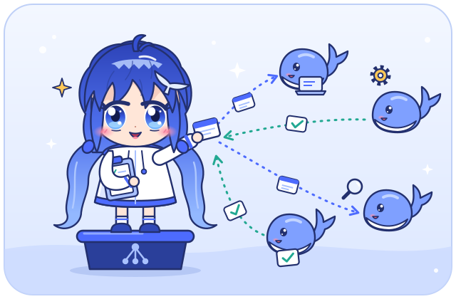
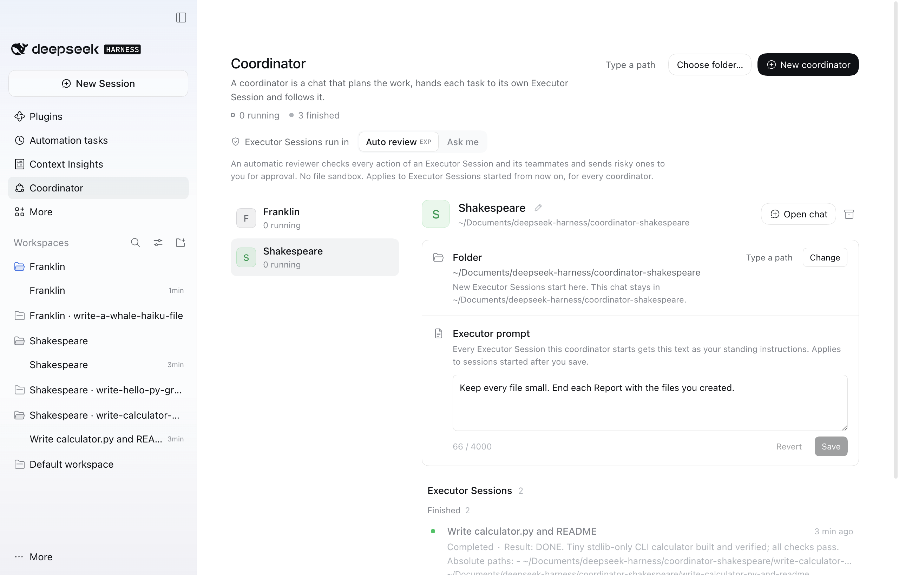
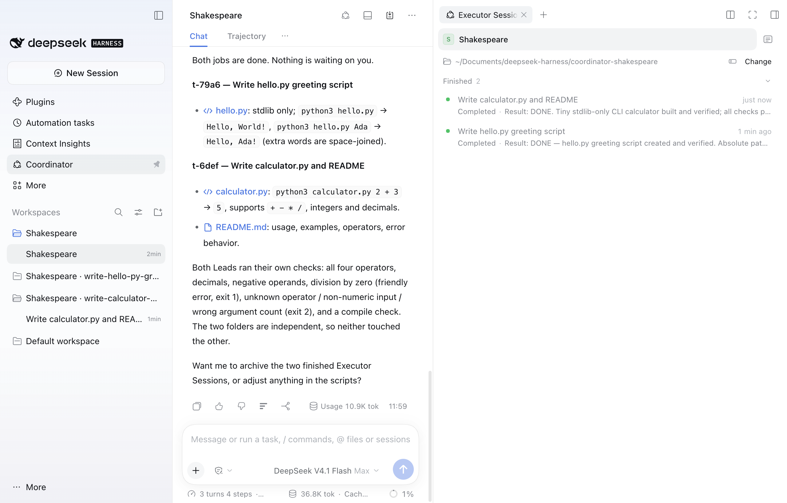
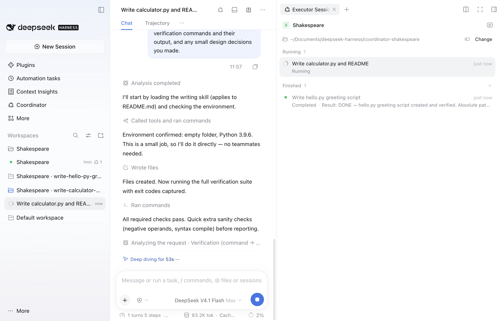
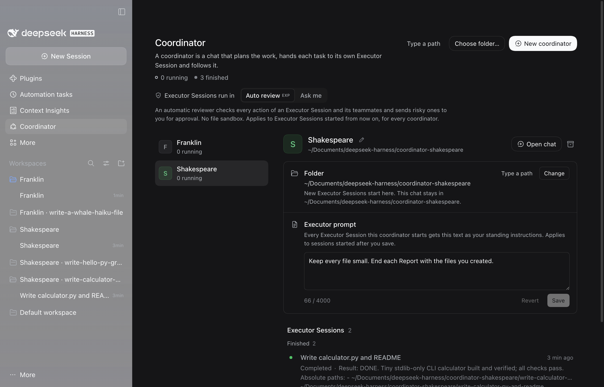

<p align="center">
  
</p>

<p align="center"><a href="README.md">English</a> | <a href="README.zh-CN.md">简体中文</a> | Deutsch</p>

# Whalepod

Whalepod (Paket `dsh-whalepod`) ist ein Plugin für den DeepSeek Harness (dsh). Es fügt Coordinators hinzu. Ein Coordinator ist die Haupt-Session, die Arbeit verteilt: Du beschreibst die Arbeit in seinem Chat, und sein Agent gibt jede Aufgabe an eine eigene Executor Session ab, verfolgt sie und meldet die Ergebnisse. Du kannst mehrere Coordinators nebeneinander betreiben, einen pro Vorhaben. Jeder Coordinator hat einen Namen, etwa "Noether" oder "李白".

**Installation:** Öffne in DeepSeek Harness Plugins > "Plugin hinzufügen", gib `dsh-whalepod` ein und klicke auf "Installieren". Details unter [Installation](#installation).

Die Oberfläche des Plugins gibt es auf Englisch und Chinesisch. Deshalb nennt diese Anleitung Begriffe und Beschriftungen so, wie sie in der englischen Oberfläche erscheinen (Coordinator, Executor Session, Assignment, Report, "New coordinator" und so weiter).

Executor Sessions arbeiten selbstständig mit eingeschalteten Agent Teams, jede in ihrem eigenen Ordner und in ihrer eigenen Seitenleisten-Gruppe neben ihrem Coordinator. Executor Sessions desselben Coordinators können einander Nachrichten schicken, wenn sie an einer gemeinsamen Aufgabe arbeiten; Executor Sessions verschiedener Coordinators können das nicht. Der Lead einer Executor Session darf seine Aufgabe auf ein Agent-Team verteilen. Die Executor Session gilt als laufend, solange ein Teammate arbeitet, und der Coordinator erfährt es einmal, wenn das ganze Team fertig ist.

Executor Sessions laufen standardmäßig im Auto review von dsh, der keine Datei-Sandbox hat; die Coordinator-Seite stellt neue auf Ask me um. [Sicherheit](#sicherheit) erklärt beide Modi und die Grenzen, die das Plugin durchsetzt.

## Screenshots

<p align="center">
  
</p>
<p align="center"><em>Die Coordinator-Seite: Shakespeare ausgewählt, mit Ordner, Executor prompt und zwei beendeten Executor Sessions.</em></p>

<p align="center">
  
</p>
<p align="center"><em>Der Chat von Shakespeare meldet beide Aufgaben als erledigt; der Bereich listet seine Executor Sessions, die Seitenleiste zeigt eine Gruppe pro Executor Session.</em></p>

<p align="center">
  
</p>
<p align="center"><em>Eine Executor Session arbeitet an einem kleinen Rechner, im Bereich ihr Coordinator und die beendete Geschwister-Session.</em></p>

<p align="center">
  
</p>
<p align="center"><em>Die Coordinator-Seite im dunklen Design.</em></p>

## Voraussetzungen

- DeepSeek Harness 0.2.2-rc.2 oder eine spätere 0.2.x-Version (`engines.dsh`).
- Git nur für den `github:`-Weg unten; der Paketname braucht nichts weiter.
- Das Paket enthält vorgebauten Code und hat keine Laufzeitabhängigkeiten. `@deepseek-ai/cordis` und `@deepseek-ai/dsh-typert-protocol` sind Peer-Abhängigkeiten, die das laufende dsh mitbringt; die Peer-Warnung von pnpm bei der Installation ist zu erwarten.

## Installation

Whalepod ist auf npm als `dsh-whalepod` veröffentlicht. Keiner der folgenden Wege baut etwas auf deinem Rechner; das Paket enthält den fertigen Code.

**In der App.** Öffne Plugins, wähle "Plugin hinzufügen", tippe `dsh-whalepod` in das Feld "Name oder Adresse des Pakets" und klicke auf "Installieren". Das Auswahlfeld "Registry" kann auf der offiziellen npm-Registry bleiben. Wenn die Installation fertig ist, wähle "Jetzt aktivieren". Sagt der Dialog, dass DSH neu gestartet werden muss, beende die App und starte sie wieder. (In einer anderen Sprache der App heißen die Schaltflächen entsprechend, auf Englisch etwa "Add plugin", "Install" und "Enable now".)

**Über die Kommandozeile.** Beende die App zuerst, wenn du in das Desktop-Profil installierst, und starte sie danach wieder. Das Desktop-Profil muss existieren, also öffne die Desktop-App vor der ersten Installation einmal. Für `dsh web` nimm `--profile web` und starte `dsh web` neu.

```sh
dsh plugin --profile desktop add dsh-whalepod
```

**Der neueste Code von GitHub.** Um den aktuellen Stand des Repositorys statt des veröffentlichten Pakets zu installieren, nimm an beiden Stellen `github:simveit/dsh-whalepod`. Dafür braucht es Git:

```sh
dsh plugin --profile desktop add github:simveit/dsh-whalepod
```

Das ist die ganze Installation. Der Eintrag "Coordinator" erscheint in der Seitenleiste, und die Coordinator-Werkzeuge sowie Auto review sind verfügbar. Das Plugin fügt kein Agent-Preset hinzu: Executor Sessions und Coordinators laufen auf deinem Standard-Preset.

Eine neuere Version installierst du, indem du das Plugin entfernst (siehe [Deinstallation](#deinstallation)) und die neue Version hinzufügst. Coordinators, Executor Sessions und der Plugin-Zustand bleiben erhalten.

Auto review kommt aus dem mitgelieferten optionalen Bundle `@deepseek-ai/dsh-experimental-auto-review`. dsh hat kein Feld für Bundle-Abhängigkeiten, deshalb fügt die Bundle-Ebene dieses Plugins die einzige `auto-review`-Zeile dieses Bundles selbst ein. Der Code ist Teil der dsh-Installation; heruntergeladen wird nichts. Schaltest du das Bundle zusätzlich im Plugin-Manager ein, fügen beide Ebenen dieselbe Zeile ein, und dsh lädt sie einmal. Der Plugin-Manager kann das Bundle weiterhin als ausgeschaltet anzeigen, obwohl es über dieses Plugin aktiv ist.

## Schnellstart

1. Öffne den Eintrag "Coordinator" in der linken Seitenleiste und klicke auf "New coordinator". Das Plugin gibt dem Coordinator einen Namen, legt seinen Ordner an und öffnet seinen Chat.
2. Beschreibe die Arbeit im Chat, zum Beispiel "Write a CSV word counter in Python and in Go, in two parallel Executor Sessions". Bei größerer Arbeit schlägt der Coordinator womöglich zuerst eine Aufteilung vor. Dann startet er eine Executor Session pro Teilaufgabe.
3. Verfolge die Executor Sessions im Bereich rechts neben dem Chat oder auf der Coordinator-Seite. Freigaben, Fragen und Ordnerbestätigungen kommen zu dir, in der Zeile der Executor Session und im Coordinator-Chat.
4. Der Coordinator meldet jedes Ergebnis in seinem Chat. Öffne eine beliebige Executor Session, um hineinzuschauen oder direkt mit ihrem Lead zu sprechen.
5. Ist die Arbeit erledigt, klicke auf der Coordinator-Seite auf "Archive coordinator". Gelöscht wird nichts.

## Coordinators und ihre Ordner

**Einen anlegen.** Klicke auf der Coordinator-Seite auf "New coordinator". Das Plugin wählt einen Namen, legt dafür einen Ordner neben dem Standard-Workspace von dsh an (auf einem üblichen Mac etwa `~/Documents/deepseek-harness/coordinator-noether` oder `coordinator-li-bai`), fügt diesen Ordner der Seitenleiste als Workspace mit dem Titel "Noether" hinzu und öffnet dort den Coordinator-Chat mit demselben Titel. "Choose folder..." macht dasselbe in einem Ordner, den du im Ordnerdialog wählst, und "Type a path" daneben lässt dich den Ordner stattdessen eintippen. Ein Ordner, der bereits ein Workspace mit deinen eigenen Sessions ist, wird abgelehnt, ebenso ein Ordner in oder um den Ordner eines anderen Coordinators. "Open chat" bei einem Coordinator öffnet ihn wieder. Gibt es noch keinen Coordinator, legt "Open coordinator chat" einen an.

**Namen.** Jeder Coordinator bekommt einen Namen, den kein anderer aktiver Coordinator trägt, zufällig gewählt aus einer eingebauten Liste berühmter Philosophinnen und Philosophen, Forschender, Mathematikerinnen und Mathematiker, Romanciers und Dichter: englischsprachige, deutschsprachige und chinesische Namen und einige von anderswo. Chinesische Namen stehen in jeder Sprache der Seite in chinesischen Schriftzeichen (李白, 老子, 鲁迅). Sind alle Namen vergeben, kommt eine Zahl dazu ("Noether 2"). Zum Umbenennen klickst du auf der Coordinator-Seite auf den Stift hinter dem Namen, tippst den neuen Namen und drückst Enter (Esc bricht ab). Ein Name hat 1 bis 40 Zeichen, keine Steuerzeichen und keinen Mittelpunkt (·), besteht nicht nur aus Ziffern und muss sich von den Namen aller anderen aktiven Coordinators unterscheiden. Unsichtbare Zeichen werden entfernt, und Namen, die sich nur in Groß- und Kleinschreibung, Zeichenbreite oder unsichtbaren Zeichen unterscheiden, gelten als derselbe Name. Chat und Seitenleisten-Gruppe tragen den bloßen Namen und ziehen beim Umbenennen mit, solange sie noch den Titel des Plugins tragen; einen Titel, den du dem Chat selbst gegeben hast, behält er. Umbenennen verschiebt nie den Ordner.

**Neue Session in der Gruppe eines Coordinators.** Eine neue Session, die du in der Seitenleisten-Gruppe eines Coordinators startest (über die Schaltfläche "New Session" der Gruppe), wird mit der ersten Nachricht, die du darin tippst, zu einem weiteren Coordinator in diesem Ordner. Bis dahin listet sie zwar schon die Werkzeuge eines Coordinators, verweigert aber ihre Nutzung; ein Zeitplan, ein Workflow oder etwas anderes, das dort eine Session öffnet, kann also keine Executor Sessions starten. Sobald sie ein Coordinator ist, bekommt sie einen Namen, ihr Chat heißt dann so, und sie läuft auf `workspace-write` wie die Chats, die "New coordinator" anlegt. Sie zeigt keine Begrüßung. Höchstens 20 Coordinators können gleichzeitig aktiv sein.

Eine Session im Ordner eines Coordinators, die kein Coordinator wird, darf nur lesen und suchen und hat keine Plugin-Werkzeuge. Das gilt für eine Session, die schon Runden hatte, als sie dorthin kam, für eine jenseits der Grenze von 20, für einen Fork eines Coordinator-Chats und für einen früheren Coordinator-Chat, den du aus dem Archiv holst. Wer fremde Chats im Ordner eines Coordinators aufbewahrt, findet sie so eingeschränkt vor.

**Sein Ordner.** Der Chat eines Coordinators bleibt in dem Ordner, in dem er angelegt wurde. Sein Ordner für neue Arbeit ist anfangs derselbe Ordner: Jede neue Executor Session bekommt dort einen frischen Unterordner, benannt nach ihrem Titel. Die Coordinator-Seite und der Bereich "Executor Sessions" zeigen den Ordner mit "Change" und "Type a path". "Change" öffnet den Ordnerdialog, "Type a path" ein Eingabefeld für den Pfad. Solange der Dialog offen ist, sagt die Seite das und bietet "Type a path" und "Cancel" an. Hat der Dialog nach 8 Sekunden nicht geantwortet, weist die Seite darauf hin, dass er womöglich hinter diesem Fenster liegt; nach 60 Sekunden gibt sie auf und öffnet das Eingabefeld. Nur danach gestartete Executor Sessions verwenden den neuen Ordner. Bestehende behalten ihren, und der Chat bleibt, wo er ist.

**Welche Ordner nachfragen.** Ein neuer Ordner unterhalb des Ordners des Coordinators startet ohne Rückfrage, wenn sein nächster vorhandener Elternordner der Ordner des Coordinators oder ein vom Plugin für eine Executor Session angelegter Ordner ist. Jeder andere Ordner braucht den Pfad, von dir im eigenen Chat dieses Coordinators getippt, und danach deine Bestätigung: ein Ordner außerhalb des Ordners des Coordinators, ein vorhandener Ordner darunter und ein neuer Ordner innerhalb eines Ordners, den nicht das Plugin angelegt hat, etwa eines deiner Repositorys. Auch ein Ordner in oder um den Ordner einer anderen laufenden Executor Session braucht deine Bestätigung. Ordner im Home eines anderen Coordinators, Ordner, die den Ordner eines Coordinators enthalten, der Home-Ordner, Punkt-Ordner, Systemordner und das dsh-Home werden immer abgelehnt. Die Karte mit Reject, Allow once und Always allow erscheint im Coordinator-Chat, sobald die Runde des Coordinators beendet ist, nie zusammen mit einer Frage, die der Coordinator dir stellt; dieselben Schaltflächen in der Zeile der Executor Session auf der Seite und im Bereich funktionieren immer. "Always allow" setzt den Ordner auf die Liste der erlaubten Ordner auf der Coordinator-Seite und gilt für alle Coordinators; Karte und Zeile sagen das. Nach einem Neustart stehen die erlaubten Ordner weiter auf der Liste, aber ein Ordner darunter fragt erneut, bis du für ihn wieder "Always allow" wählst. Karte, Seite und Fehlermeldungen zeigen Pfade mit deinem Home-Ordner als `~`.

**Executor prompt.** Jeder Coordinator hat auf der Coordinator-Seite unter seinem Ordner einen "Executor prompt": dauerhafte Anweisungen, die jede Executor Session erhält, die dieser Coordinator startet, zum Beispiel "schreibe Tests, bevor du Code änderst, und frage, bevor du eine Abhängigkeit hinzufügst". Der Lead bekommt den Text als deine Anweisungen, mit deiner Autorität über dem Assignment und über Nachrichten des Coordinators; Teammates erhalten das Wichtige über ihren Lead. Ein gespeicherter Prompt gilt für Executor Sessions, die nach dem Speichern starten; laufende behalten den Text, mit dem sie gestartet sind. Er hat bis zu 4000 Zeichen, Cmd+Enter oder Strg+Enter speichert, Esc verwirft die Änderung, und ein leeres Feld zu speichern löscht ihn. Nur du kannst ihn auf der Seite ändern: Der Coordinator weiß, dass es ihn gibt, kann ihn aber weder lesen noch ändern, und kein Werkzeug eines Modells kann das.

**Wo Executor Sessions erscheinen.**

- Die Coordinator-Seite listet die Coordinators mit ihren Namen. Wähle einen aus, um seinen Ordner, seinen Executor prompt und seine Executor Sessions zu sehen, gruppiert als "Needs you", "Running", "Standing by" und "Finished".
- Neben einem Coordinator-Chat listet der Bereich "Executor Sessions" in der rechten Seitenleiste die Executor Sessions dieses Coordinators. Neben einer Executor Session listet er die anderen Executor Sessions desselben Coordinators, mit dem Coordinator ganz oben. Die Schaltfläche in der Kopfzeile blendet den Bereich ein und aus.
- In der linken Seitenleiste zeigt die Zeile eines Coordinators, wie viele seiner Executor Sessions dich brauchen oder laufen, und ihre Hover-Karte nennt den Coordinator und die Zahlen.
- Jede Executor Session steht in einer eigenen Seitenleisten-Gruppe an ihrem Ordner, mit dem Titel "<Coordinator-Name> · <Ordnername>" (zum Beispiel "Orwell · write-the-parser"), direkt nach der Gruppe ihres Coordinators und eingeklappt, bis du sie öffnest. Die Gruppe zieht mit, wenn der Coordinator umbenannt wird. In der dsh-Ansicht "Group by workspace tree" hängen diese Gruppen unter der Gruppe des Coordinators, wenn der Ordner der Executor Session unterhalb des Ordners des Coordinators liegt. Arbeitet eine Executor Session in einem Ordner, der schon einer deiner Workspaces ist, tritt sie diesem Workspace bei; das Plugin benennt ihn nie um und entfernt ihn nie. Eine neue Session, die du in der Gruppe einer Executor Session öffnest, ist deine eigene gewöhnliche Session: Das Plugin fasst sie nicht an.
- Der Eintrag "Coordinator" in der Seitenleiste zählt die Executor Sessions aller Coordinators, die dich brauchen.

Eine Executor Session steht auf "Standing by", wenn ihre letzte Runde ohne Ergebnis endete und sie auf die nächste Nachricht wartet.

**Titel von Executor Sessions.** Eine neue Executor Session beginnt mit dem Arbeitstitel, den ihr Coordinator ihr gegeben hat. Ist der Titelgenerator von dsh eingeschaltet ("Conversation-following titles"), benennt dsh die Session danach anhand ihres Assignments neu, und später anhand dessen, was du darin tippst; ohne den Generator bleibt der Arbeitstitel. Seite, Bereich, Benachrichtigungen und die Werkzeuge des Coordinators zeigen den aktuellen Titel. Eine Executor Session darf nicht wie ein Coordinator heißen, und ein erzeugter Titel, der wie einer aussieht, wird nicht übernommen; eingeschleuster Text kann eine Executor Session also nicht als Coordinator ausgeben.

**Reports.** Ein Ergebnis eines Leads erreicht seinen Coordinator einmal; dasselbe Ergebnis noch einmal gesendet wird gespeichert, aber nicht zweimal zugestellt.

**Archivieren.** "Archive coordinator" auf der Coordinator-Seite archiviert seinen Chat und seine beendeten Executor Sessions; gelöscht wird nichts. Arbeiten noch Executor Sessions, listet die Bestätigung sie auf und bietet "Stop and archive" an. Hake "Also remove its workspace from the sidebar" an, um auch die Seitenleisten-Gruppe des Coordinators zu entfernen; die Dateien auf der Festplatte bleiben erhalten. Die Gruppe bleibt, wenn ein anderer Coordinator sie nutzt, wenn sie weitere Sessions enthält oder wenn nicht das Plugin sie angelegt hat, und die Seite sagt, warum. Schlägt das Entfernen der Gruppe fehl, wird der Coordinator trotzdem archiviert, und die Seite sagt, dass du die Gruppe in der Seitenleiste entfernen kannst. Wird eine Executor Session archiviert, oder ein Coordinator mit seinen Executor Sessions, entfernt das Plugin deren Gruppen, wenn nichts anderes mehr darin liegt; deine eigenen Workspaces entfernt es nie. Die archivierten Executor Sessions eines Coordinators stehen schreibgeschützt in einer eingeklappten Gruppe "Archived" unter seinen Executor Sessions; öffnen kannst du sie über das Archiv der Seitenleiste. Ein archivierter Coordinator bleibt schreibgeschützt auf der Seite; "Reopen" holt ihn mit einem neuen Chat zurück, und seine archivierten Executor Sessions bleiben archiviert. Hat inzwischen ein anderer Coordinator seinen Namen übernommen, bekommt er einen neuen. Wird "Reopen" abgelehnt (20 Coordinators sind offen, oder sein Ordner wird abgelehnt), sagt die Seite, warum. "Delete coordinator" (der Papierkorb eines archivierten Coordinators) entfernt nur seinen Eintrag von der Seite; seine Sessions, Ordner und Dateien bleiben.

Löschst du einen Coordinator-Chat stattdessen in der linken Seitenleiste, behält der Coordinator seine Executor Sessions, und ihre Benachrichtigungen warten auf ihn. Die Seite zeigt dann den Zustand des Chats: "Chat archived", "Chat deleted", wenn die Session nicht mehr existiert, oder "No chat yet". "Reopen chat" (oder "Start chat", wenn es nie einen gab) legt im Ordner des Coordinators einen neuen Chat für denselben Coordinator an und übergibt, was gewartet hat.

**Gemeinsame Einstellungen.** "Executor Sessions run in", die erlaubten Ordner und die Obergrenze gleichzeitig laufender Executor Sessions (`maxRunningThreads`) gelten für alle Coordinators zusammen. Name und Executor prompt gehören zu jedem einzelnen Coordinator.

## Konfiguration

Alle Schlüssel sind optional. Am einfachsten änderst du sie in den Einstellungen des Plugins: Öffne Plugins, klicke auf Whalepod und bearbeite das Formular unter der kurzen Einführung. Es enthält jeden Schlüssel außer dem veralteten `threadsRoot`, prüft jeden Wert schon bei der Eingabe und speichert in die Zeile des Plugins in der `cordis.patch.yml` des Profils. Diese Zeile behält die ID `dsh-coordinator`, den Namen, den das Plugin hatte, bevor es Whalepod wurde. Änderungen gelten sofort, ohne Neustart des Plugins. "Reset to default" nimmt einen Schlüssel wieder aus dem Patch.

Du kannst diese Zeile auch von Hand schreiben:

```yaml
- id: dsh-coordinator
  config:
    coordinatorBase: ~/Documents/deepseek-harness
```

| Schlüssel | Standard | Bedeutung |
|---|---|---|
| `coordinatorBase` | neben dem Standard-Workspace von dsh | Wo "New coordinator" den eigenen Ordner jedes Coordinators anlegt (`coordinator-<Name>`, mit `-2`, wenn dieser Ordner schon belegt ist). Ohne diesen Schlüssel das übergeordnete Verzeichnis des registrierten Standard-Workspace von dsh, sonst `~/Documents/deepseek-harness`. Der Home-Ordner, Punkt-Ordner, Systemordner und Ordner, die das dsh-Home enthalten, werden abgelehnt; die Seite sagt das dann, und "New coordinator" ist deaktiviert. |
| `threadsRoot` | `~/dsh-threads` | Veraltet. Zeigt nur, wo der Chat des Coordinators aus der Zustandsdatei einer früheren Version liegt. Neue Executor Sessions starten dort nie, außer der Ordner für neue Coordinators ist abgelehnt. |
| `maxRunningThreads` | `128` | Gleichzeitig laufende Executor Sessions über alle Coordinators; weitere Starts und Weckrufe warten in einer Schlange |
| `noticeDebounceMs` | `3000` | Ruhezeit, bevor ein Stapel von Benachrichtigungen einer Executor Session ihren Coordinator erreicht |
| `noticeMaxDelayMs` | `15000` | Längste Wartezeit einer Benachrichtigung auf ihren Stapel |
| `briefAs` | `user` | `user`: Das Assignment ist ein Nutzer-Prompt (Auto review behandelt es als Aufgabe), wenn der Nutzer die Runde des Coordinators begonnen hat; `notice`: immer eine Agent-Nachricht |
| `wakeMaxPerThread`, `wakeWindowMs` | `60`, `600000` | Wie oft eine Executor Session ihren Coordinator wecken darf; darüber hinaus pausiert sie, bis du sie fortsetzt |
| `threadTurnBudget` | `0` | Runden pro Executor Session in 24 Stunden, die die Executor Session, ihr Coordinator, ein Peer oder ein Zeitplan startet (deine eigenen Runden zählen nicht); darüber hinaus pausiert sie, bis du sie fortsetzt. `0` heißt: kein Tagesbudget |
| `coordinatorExtraTools` | `[]` | Zusätzliche Werkzeuge anderer Plugins oder MCP-Server, die die Coordinators nutzen dürfen, nach Namen. Werkzeuge, die etwas ausführen, schreiben, Arbeit abzweigen, andere Sessions lesen (`session_search`), Plugins oder Skills verwalten oder Terminals oder Office-Dokumente bedienen, kommen nie dazu |
| `peerMaxPerPair`, `peerMaxPerThread`, `peerWindowMs` | `40`, `200`, `600000` | Grenzen für `executor_send` pro Paar von Executor Sessions (beide Richtungen) und pro Absender. Die Nachricht über einer Grenze wird abgelehnt; die Paargrenze pausiert beide Executor Sessions, die Absendergrenze den Absender, bis du sie fortsetzt |
| `threadPermission` | `auto` | Wie neue Executor Sessions laufen, bis der Nutzer auf der Coordinator-Seite wählt: `auto` (Auto review, keine Datei-Sandbox) oder `ask` (Ask me, `workspace-write`: auf den Ordner der Executor Session beschränkt, Freigaben an den Nutzer). Jeder andere Wert gilt als `auto`; das Plugin verwendet nie ein lockereres Preset. |

Die Schlüsselnamen sind dieselben wie in früheren Versionen, bestehende Patches funktionieren also weiter. Ein Wert, den ein Schlüssel ablehnt (unter seinem Minimum, eine unbekannte Auswahl), gilt als Standardwert des Schlüssels und verhindert nie das Laden des Plugins. Pro `DSH_HOME` betreibt nur ein dsh-Prozess die Coordinators; ein weiterer zeigt an, warum er deaktiviert ist.

Ordner, die du mit "Always allow" freigibst, stehen auf der Coordinator-Seite unter "Allowed folders", wo du sie wieder entfernen kannst. Sie sind nicht Teil der Konfiguration. Namen und Executor prompts der Coordinators stellst du ebenfalls auf der Coordinator-Seite ein, nicht in der Konfiguration.

Um ohne Auto review zu arbeiten, deaktiviere dessen Zeile:

```yaml
- id: auto-review
  disabled: true
```

Executor Sessions laufen dann in Ask me (`workspace-write`) und fragen, bevor sie außerhalb ihres Ordners handeln; der Schalter auf der Coordinator-Seite zeigt Ask me und nennt den Grund. Das Host-Log meldet das beim Start (`auto permission preset NOT available`). Das Plugin wählt nie ein großzügigeres Preset.

## Sicherheit

Executor Sessions laufen standardmäßig im Auto review von dsh: Ein automatischer Prüfer kontrolliert jede Aktion und schickt riskante an dich, und in diesem Modus gibt es keine Datei-Sandbox. Die Coordinator-Seite hat einen Schalter "Executor Sessions run in: Auto review | Ask me". Mit Ask me laufen neue Executor Sessions unter dem dsh-Preset `workspace-write`: Der Lead schreibt nur im Ordner der Executor Session und fragt dich vor allem anderen; seine Teammates arbeiten in derselben Ordner-Sandbox. Teammates fragen dich in keinem der beiden Modi: Eine Aktion, die deine Freigabe bräuchte, etwa alles außerhalb des Ordners unter Ask me, wird ihnen verweigert. Der Schalter gilt für alle Coordinators.

Der Coordinator hat `executor_start`, `executor_message`, `executor_list`, `executor_read`, `executor_flag_user`, `executor_stop` und `executor_archive`, dazu Werkzeuge, um Dateien zu lesen und zu durchsuchen, dir Fragen zu stellen und eine Aufgabenliste zu führen; Shell-, Schreib-, Web- oder Browser-Werkzeuge hat er nicht, und der Host lehnt jeden Aufruf außerhalb seiner Erlaubnisliste ab. Jeder Coordinator sieht und steuert nur die Executor Sessions, die er selbst gestartet hat. Leads haben die Standard-Werkzeuge des Nutzers (ohne den Plugin-Manager) sowie `coordinator_report`, `executor_peers` und `executor_send`. Die Werkzeuge nehmen das Ziel im Parameter `executor` und die erste Nachricht im Parameter `assignment`.

Die Grenzen setzt der Host-Code durch. Ausgaben einer Executor Session erreichen den Coordinator nur als abgegrenzte Daten. Ein Ordner außerhalb des eigenen Ordners des Coordinators, oder einer darunter, den nicht das Plugin angelegt hat, braucht die eigenen Worte des Nutzers im Chat dieses Coordinators und danach seine Bestätigung, in der Zeile der Executor Session oder in einer Karte im Coordinator-Chat. Ein Ordner auf der Liste der erlaubten Ordner überspringt die Bestätigung erst, wenn du im laufenden Betrieb der App für ihn "Always allow" gewählt hast. Ein Assignment gilt nur dann als Anweisung des Nutzers, wenn der Nutzer die Arbeit selbst verlangt hat. Executor Sessions, ihre Teammates und die Coordinators können nicht auf das dsh-Home zugreifen (Zugangsdaten, Session-Logs). Eine Executor Session, die ihren Coordinator zu oft weckt, oder zwei Executor Sessions, die einander zu oft schreiben, pausieren, bis du sie fortsetzt. Ein Tagesbudget für Runden lässt sich einstellen, ist aber standardmäßig aus; da bis zu 128 Executor Sessions gleichzeitig laufen, solltest du für unbeaufsichtigten Betrieb eines setzen, sonst sind Modellkosten und die Ratenlimits des Anbieters schnell erreicht.

[docs/security.md](docs/security.md) beschreibt das Bedrohungsmodell, was der Host durchsetzt und was auf Prompts beruht, sowie die bekannten Grenzen. Wie du eine Schwachstelle meldest, steht in [SECURITY.md](SECURITY.md).

## Aktualisierung von einer früheren Version

**Vom Paket `dsh-coordinator`.** Das Plugin hieß `dsh-coordinator`, bevor es zu Whalepod (Paket `dsh-whalepod`) wurde. dsh installiert Plugins nach Paketnamen, also entferne das alte Paket und füge das neue hinzu, bei beendeter App (oder gestopptem `dsh web`):

```sh
dsh plugin --profile desktop remove dsh-coordinator          # oder: --profile web
dsh plugin --profile desktop add dsh-whalepod                # oder github:simveit/dsh-whalepod, siehe Installation
```

Coordinators, Executor Sessions und der Plugin-Zustand bleiben erhalten: Die Plugin-ID, der Zustandsordner (`$DSH_HOME/storages/dsh-coordinator/`) und die Markierungen in den Session-Logs behalten den alten Namen. Einstellungen von der Plugins-Seite bleiben ebenfalls, aber dsh überspringt eine Einstellungszeile, deren `name` das alte Paket nennt. Enthält die `cordis.patch.yml` des Profils eine Zeile mit `id: dsh-coordinator` und `name: dsh-coordinator`, ändere diese Zeile vor dem nächsten Start in `name: dsh-whalepod` (oder lösche sie). Eine Zeile nur mit `id: dsh-coordinator` braucht keine Änderung.

**Von einer früheren Version des Plugins.** Es geht nichts verloren. Beim ersten Start:

- Dein bisheriger Coordinator wird der erste Coordinator auf der Seite, mit seinem Chat, allen seinen Executor Sessions (auch den archivierten), den erlaubten Ordnern und deiner Wahl bei "run in". Seine neuen Executor Sessions starten in einem neuen Ordner neben dem Standard-Workspace von dsh (`~/Documents/deepseek-harness/coordinator-<Name>`), wie bei einem neuen Coordinator. Sein Chat bleibt, wo er ist; ohne Chat legt Reopen den Chat in diesem neuen Ordner an. Bestehende Executor Sessions behalten ihre Ordner. Der Ordner entsteht, wenn dort die erste neue Executor Session startet. Du kannst ihn auf der Seite ändern. Ist der Ordner für neue Coordinators abgelehnt, bleibt das alte `threadsRoot` in Gebrauch, und die Seite sagt warum.
- Jeder vorhandene Coordinator bekommt einen Namen. Ein Chat oder eine Seitenleisten-Gruppe, die noch "Coordinator", "Coordinator 2" oder "Coordinator <Name>" heißt, wird einmal auf den bloßen Namen umbenannt. Vorhandene Ordner werden nicht umbenannt.
- Die erlaubten Ordner bleiben auf der Liste, aber jeder fragt erneut nach deiner Bestätigung, bis du für ihn wieder "Always allow" wählst.
- Bevor die Zustandsdatei zum ersten Mal im neuen Format geschrieben wird, wird sie einmal als `state.v1.json` daneben kopiert (`$DSH_HOME/storages/dsh-coordinator/`). Diese Kopie wird nie überschrieben.
- Jede laufende Executor Session bekommt ihre eigene Seitenleisten-Gruppe neben ihrem Coordinator. Eine Gruppe, die eine frühere Version für sie angelegt hat, bleibt und bekommt den aktuellen Titel und Platz. Executor Sessions in deinen eigenen Workspaces bleiben dort, archivierte werden nicht angefasst.
- Neue Coordinators landen im Ordner neben dem Standard-Workspace von dsh, nicht in `threadsRoot`.
- Sessions auf den alten Presets `thread` und `coordinator` werden auf Standard umgestellt.
- Die Werkzeuge heißen jetzt `executor_*` (vorher `thread_*`). Die alten Parameternamen `thread` und `brief` funktionieren weiter, und Session-Logs von vor der Umbenennung werden weiterhin richtig gelesen.

Eine Version vor dieser kann die neue Zustandsdatei nicht lesen: Sie läuft dann ohne zu speichern und lässt die Datei unverändert. Findet diese Version eine Zustandsdatei, die sie nicht lesen kann, schiebt sie sie beiseite; findet sie eine aus einer neueren Version, lässt sie sie unverändert und läuft ohne zu speichern. In beiden Fällen sagt die Seite das, und Chats mit den Markierungen des Plugins bleiben auf Lesen beschränkt. Das Plugin merkt sich das Zurücksetzen, deshalb bleibt der Hinweis auch bei späteren Starts, bis du einen Coordinator öffnest oder anlegst. Sessions, die das Plugin nicht kennt, werden immer anhand der Plugin-Markierungen in ihren Logs eingeordnet; auch das Löschen von Einträgen aus der Zustandsdatei hebt diese Beschränkungen also nicht auf.

## Deinstallation

In der App öffnest du Plugins und wählst bei Whalepod "Deinstallieren". Auf der Kommandozeile:

```sh
dsh plugin --profile desktop remove dsh-whalepod   # oder: --profile web
```

Das entfernt das Paket und seine Ebene, einschließlich der hinzugefügten `auto-review`-Zeile. Auto review bleibt nur verfügbar, wenn das Auto-review-Bundle separat eingeschaltet ist. Beim Entladen stellt das Plugin seine Executor Sessions zuerst auf `workspace-write` um, denn das Auto-review-Bundle von dsh schaltet `auto`-Sessions auf vollen Zugriff, wenn es verschwindet.

Die Coordinator-Chats und die Executor Sessions bleiben erhalten und funktionieren als gewöhnliche Standard-Sessions weiter, nur ohne die Rollenanweisung und die Werkzeuge des Coordinators. Ein ehemaliger Coordinator-Chat hat dann wieder Shell- und Schreibwerkzeuge, mit den Ausgaben der Executor Sessions, die er gelesen hat, noch im Verlauf, und neue Sessions in der Gruppe eines Coordinators bleiben gewöhnliche Sessions. Eine Executor Session, deren Session zuletzt in `auto` lief und beim Entfernen des Plugins nicht geladen war, lässt sich nur öffnen, solange Auto review eingeschaltet ist. Die Ordner der Executor Sessions und ihre Seitenleisten-Gruppen, die Seitenleisten-Workspaces und Ordner der Coordinators sowie der Plugin-Zustand (`state.json`, nach einer Aktualisierung auch `state.v1.json`) bleiben erhalten. Um auch den Zustand zu löschen, bei beendeter App bzw. beendetem `dsh web` (der Zustandsordner behält den früheren Namen des Plugins):

```sh
rm -r "$DSH_HOME/storages/dsh-coordinator"   # DSH_HOME ist standardmäßig ~/.dsh
```

Entferne die Workspaces der Coordinators und Executor Sessions aus der Seitenleiste, wenn du sie nicht mehr brauchst; ihre Ordner und die Ordner der Executor Sessions kannst du behalten oder löschen.

## Entwicklung

Der Build nutzt Node und pnpm aus der App, global wird also nichts installiert:

```sh
R="/Applications/DeepSeek Harness.app/Contents/Resources/runtime/primary-runtime/dependencies"
export PATH="$R/node/bin:$PATH"
pnpm() { node "$R/pnpm/bin/pnpm.cjs" "$@"; }
pnpm install
pnpm run build       # tsc für den Host (lib/), tsdown für den Client (lib/client.js)
pnpm run typecheck
pnpm test
pnpm check           # Typprüfung, Tests, Build und ein Probelauf von pack
pnpm pack            # baut und schreibt dsh-whalepod-<version>.tgz
```

`lib/` ist als Release-Build eingecheckt, damit eine `github:`-Installation keinen Build-Schritt braucht. Baue es mit `pnpm run build` neu und committe es zusammen mit jeder Änderung an `src/`; die CI prüft, dass das eingecheckte `lib/` einem frischen Build entspricht.

Um deinen eigenen Build in der App auszuprobieren, installiere die gepackte Datei (beim Desktop-Profil die App vorher beenden):

```sh
dsh plugin --profile desktop add ./dsh-whalepod-0.1.0.tgz   # oder: --profile web
```

tsdown läuft auf dem WebAssembly-Binding von rolldown, weil das Node der App native Addons anderer Hersteller ablehnt. `pnpm-workspace.yaml` fügt deshalb `wasm32` hinzu.

`scripts/dev.sh` baut, verknüpft diesen Ordner mit `dsh plugin --profile web add link:<dir>` in das `web`-Profil eines Entwicklungs-Homes und startet `dsh web` auf 127.0.0.1. Setze `DSH_HOME` (Standard `.dsh-home` in diesem Ordner, nie `~/.dsh`) und `PORT` (Standard 4317). Neue Coordinators eines Entwicklungsservers und ihre Executor Sessions landen in `dev-threads` in diesem Ordner (`DSH_COORDINATOR_BASE`, und `DSH_COORDINATOR_THREADS_ROOT` für das veraltete Wurzelverzeichnis), sodass ein Entwicklungsserver nie in `~/Documents` schreibt. Beide Ordner stehen in `.gitignore`, die gesamte Plugin-Arbeit bleibt also in diesem Ordner. `DSH_COORDINATOR_SKIP_BUILD=1` überspringt Installation und Build, wenn `lib/` schon gebaut ist. Der Kopf des Skripts listet die reinen Entwicklungsvariablen. Host-Logzeilen beginnen mit `[dsh-coordinator]`, dem früheren Namen des Plugins, den das Log-Präfix wie die Plugin-ID behält. Eine Änderung am Client braucht einen neuen Build und ein Neuladen der Seite; eine Änderung am Host braucht einen Neustart.

`src/client/remote.ts` ist eine handgeschriebene Kopie der Client-Spezifikation für den Remote-Namensraum `coordinator`. Halte sie mit den `@Remote`-Methoden in `src/index.ts` synchron.

Hilfen nur für die Entwicklung, nicht im Paket: `dev/mock-llm.mjs` ist ein geskriptetes lokales Modell, und `dev/rpc.mjs` ruft Remote-Methoden eines lokalen `dsh web` auf. `scripts/dev.sh` baut mit `DSH_COORDINATOR_DEV=1`, was die Fake-Datenquelle des Clients einkompiliert (`?coordinatorSource=fake`, zwei Coordinators; `?coordinatorSource=real` schaltet zurück); `pnpm run build` und `pnpm pack` bauen ohne sie. Committe nie ein `lib/`, das `scripts/dev.sh` gebaut hat. Der localStorage-Schlüssel `dsh-coordinator:fake-scenario` wählt einen Ausgangszustand für die Fake-Daten: `empty`, `validating`, `archived`, `slow-pick` oder `readme` (neutrale Demodaten).

Ohne Modell-Zugangsdaten starten:

```sh
node dev/mock-llm.mjs --port 4319 &
DSH_COORDINATOR_MOCK_URL=http://127.0.0.1:4319/v1 scripts/dev.sh
```

## Rückmeldungen und Beiträge

Fehlerberichte, Fragen und Ideen sind als [GitHub-Issues](https://github.com/simveit/dsh-whalepod/issues) sehr willkommen. Pull Requests nehmen wir vorerst nicht an: Dies ist ein Nebenprojekt, der Maintainer möchte das Design fokussiert halten und hat keine Kapazität, Beiträge zu prüfen. Eröffne stattdessen bitte ein Issue. Was hineingehört, steht in [CONTRIBUTING.md](CONTRIBUTING.md), Sicherheitsprobleme behandelt [SECURITY.md](SECURITY.md).

## Lizenz

MIT. Teile stammen aus dsh-superagent-prototype (MIT) und aus DeepSeek Harness (MIT); siehe [LICENSE](LICENSE). Das Maskottchen ist eigens für dieses Projekt gezeichnet und steht unter derselben Lizenz.

Dies ist ein unabhängiges Plugin. Es stammt nicht von DeepSeek und wird nicht von DeepSeek unterstützt.
