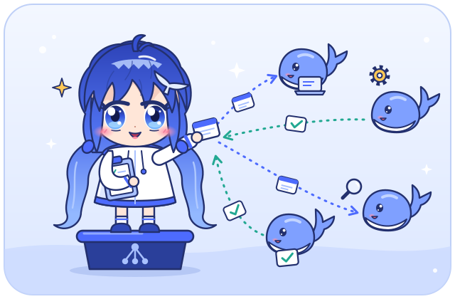
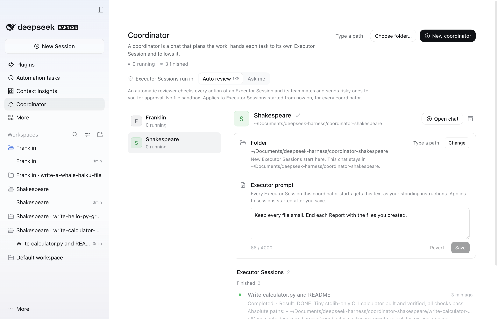
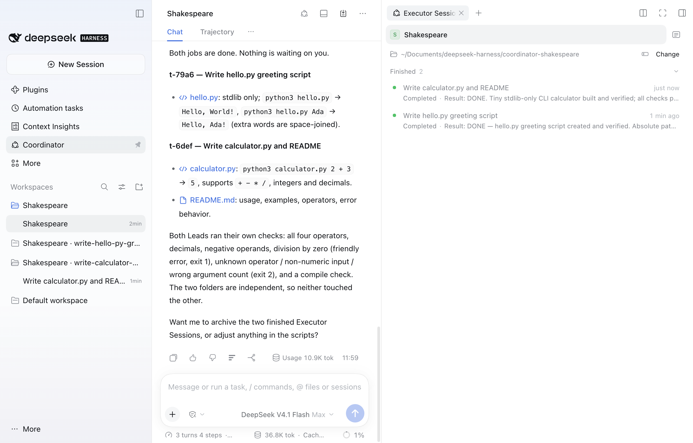
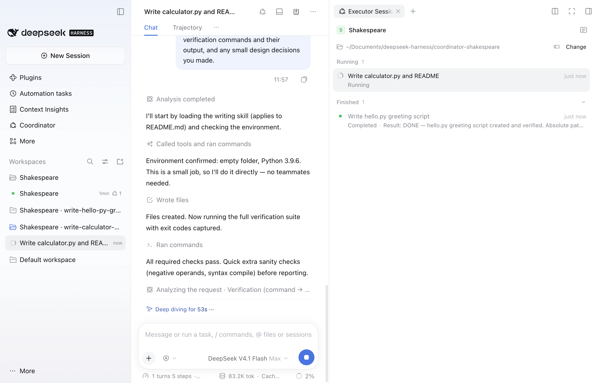
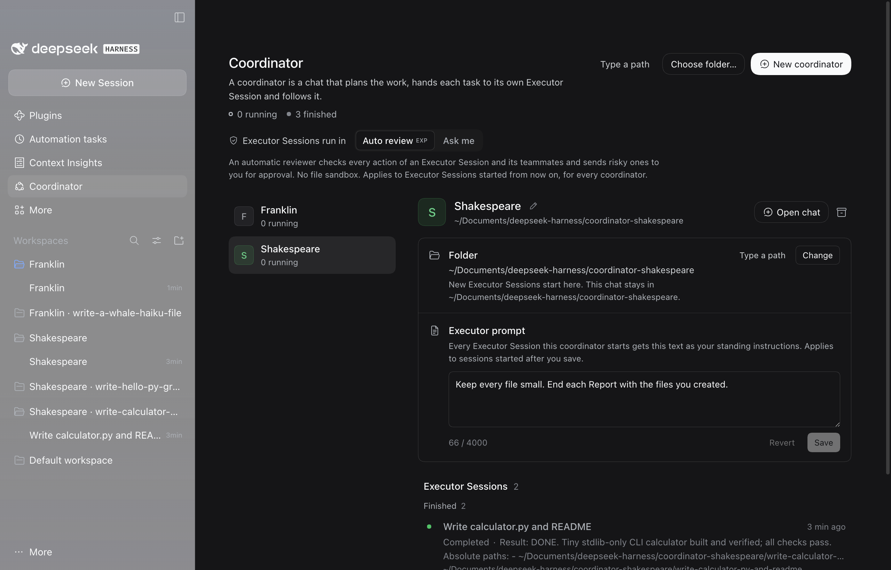

<p align="center">
  
</p>

<p align="center">English | <a href="README.zh-CN.md">简体中文</a> | <a href="README.de.md">Deutsch</a></p>

# Whalepod

Whalepod (package `dsh-whalepod`) is a plugin for the DeepSeek Harness (dsh). It adds coordinators. A coordinator is the main session that delegates: you describe the work in its chat, and its agent hands each task to its own Executor Session, follows it, and reports the results. You can run several coordinators side by side, one per piece of work. Each coordinator has a name, such as "Noether" or "李白".

**Install:** in DeepSeek Harness open Plugins > Add plugin, enter `dsh-whalepod` and press Install. Details in [Install](#install).

Executor Sessions run autonomously with Agent Teams on, each in its own folder and in its own sidebar group next to its coordinator. Executor Sessions of the same coordinator can message each other when they share a task; Executor Sessions of different coordinators cannot. The Lead of an Executor Session may split its task across an agent team. The executor shows as running while any Teammate works, and the coordinator hears once, when the whole team is done.

Executor Sessions run in dsh's Auto review by default, which has no file sandbox; the Coordinator page switches new ones to Ask me. [Security](#security) explains both modes and the boundaries the plugin enforces.

## Screenshots

<p align="center">
  
</p>
<p align="center"><em>The Coordinator page: Shakespeare selected, with its folder, its Executor prompt and its two finished Executor Sessions.</em></p>

<p align="center">
  
</p>
<p align="center"><em>Shakespeare's chat reports both jobs done; the pane lists its Executor Sessions, and the sidebar shows one group per Executor Session.</em></p>

<p align="center">
  
</p>
<p align="center"><em>An Executor Session at work on a small calculator, with its coordinator and its finished sibling in the pane.</em></p>

<p align="center">
  
</p>
<p align="center"><em>The Coordinator page in the dark theme.</em></p>

## Requirements

- DeepSeek Harness 0.2.2-rc.2 or a later 0.2.x release (`engines.dsh`).
- Git only for the `github:` install form below; the package name needs nothing else.
- The package ships prebuilt code and has no runtime dependencies. `@deepseek-ai/cordis` and `@deepseek-ai/dsh-typert-protocol` are peers that the running dsh supplies; pnpm's peer warning during install is expected.

## Install

Whalepod is published on npm as `dsh-whalepod`. None of the forms below builds anything on your machine; the package contains the built code.

**In the app.** Open Plugins, choose Add plugin, type `dsh-whalepod` into "Package name or address" and press Install. The Registry dropdown can stay at the official npm registry. When the install is done, choose Enable now. If the dialog says to restart DSH, quit the app and start it again.

**From the command line.** Quit the app first when installing into the desktop profile, and start it again afterwards. The desktop profile must exist, so open the desktop app once before the first install. For `dsh web`, use `--profile web` and restart `dsh web`.

```sh
dsh plugin --profile desktop add dsh-whalepod
```

**The latest code from GitHub.** To install the current state of the repository instead of the published package, use `github:simveit/dsh-whalepod` in either place. This needs Git:

```sh
dsh plugin --profile desktop add github:simveit/dsh-whalepod
```

That is the whole install. The Coordinator entry appears in the sidebar, and the coordinator tools and Auto review are available. The plugin adds no agent preset: Executor Sessions and coordinators run on your Standard preset.

To install a newer version, remove the plugin (see [Uninstall](#uninstall)) and add the newer version. Coordinators, Executor Sessions and the plugin state are kept.

Auto review comes from the shipped optional bundle `@deepseek-ai/dsh-experimental-auto-review`. dsh has no bundle-dependency field, so this plugin's bundle layer inserts that bundle's single `auto-review` row itself. The code is part of the dsh installation; nothing is downloaded. If you also switch the bundle on in the plugin manager, both layers insert the same row and dsh mounts it once. The plugin manager may still show the bundle as off while it is active through this plugin.

## Quick start

1. Open the Coordinator entry in the left sidebar and press New coordinator. The plugin names the coordinator, makes its folder and opens its chat.
2. Describe the work in the chat, for example "Write a CSV word counter in Python and in Go, in two parallel Executor Sessions". For larger work the coordinator may propose a split first. It then starts one Executor Session per piece of work.
3. Follow the Executor Sessions in the pane on the right of the chat or on the Coordinator page. Approvals, questions and folder confirmations come to you, on the Executor Session's row and in the coordinator chat.
4. The coordinator reports each result in its chat. Open any Executor Session to look inside or to talk to its Lead directly.
5. When the work is done, press Archive coordinator on the Coordinator page. Nothing is deleted.

## Coordinators and their folders

**Starting one.** Press New coordinator on the Coordinator page. The plugin picks a name for it, makes a folder for it next to dsh's default workspace (on a standard Mac, `~/Documents/deepseek-harness/coordinator-noether`, `coordinator-li-bai` and so on), adds that folder to the sidebar as a Workspace titled "Noether", and opens the coordinator chat there with the same title. Choose folder... does the same in a folder you pick in the folder dialog, and Type a path next to it lets you type the folder instead. A folder that is already a Workspace with your own sessions is refused, and so is a folder inside or around another coordinator's folder. Open chat on a coordinator opens it again. When no coordinator exists yet, "Open coordinator chat" creates one.

**Names.** Every coordinator gets a name no other live coordinator has, chosen at random from a built-in list of famous philosophers, scientists, mathematicians, novelists and poets, women and men: English-speaking, German-speaking and Chinese names, and a few from elsewhere. Chinese names are written in Chinese characters in every language of the page (李白, 老子, 鲁迅). When every name is in use, a number is added ("Noether 2"). To rename a coordinator, press the pencil after its name on the Coordinator page, type the new name and press Enter (Esc cancels). A name has 1 to 40 characters, no control characters and no middle dot (·), is not only digits, and must differ from every other live coordinator's name. Invisible characters are removed, and names that differ only in case, character width or invisible characters count as the same name. The chat and its sidebar group are titled with the bare name and follow a rename when they still carry the plugin's title; a title you gave the chat yourself stays. A rename never moves the folder.

**New Session in a coordinator's group.** A new session you start in a coordinator's sidebar group (the group's New Session button) becomes another coordinator in that folder with the first message you type in it. Until then it already lists the coordinator's tools, but refuses to use them, so a schedule, a workflow or anything else that opens a session there cannot start Executor Sessions. Once it is a coordinator, it gets a name, its chat is renamed to that name, and it runs on `workspace-write` like the chats New coordinator makes. It shows no welcome. At most 20 coordinators can be live at once.

A session in a coordinator's folder that does not become a coordinator is limited to reading and searching and has no plugin tools. That covers a session that already had turns when it came there, one past the limit of 20, a fork of a coordinator chat, and an earlier coordinator chat that you unarchive. If you keep unrelated chats in a coordinator's folder, you will find them limited this way.

**Its folder.** A coordinator's chat stays in the folder it was created in. Its folder for new work starts as that same folder: each new Executor Session gets a fresh subfolder there, named after its title. The Coordinator page and the Executor Sessions pane show the folder with Change and Type a path. Change opens the folder dialog; Type a path opens a path field. While the dialog is open, the page says so and offers Type a path and Cancel. If the dialog has not answered after 8 seconds, the page says it may be behind this window; after 60 seconds it gives up and opens the path field. Only Executor Sessions started afterwards use the new folder. Existing ones keep theirs, and the chat stays where it is.

**Which folders ask you.** A new folder below the coordinator's folder starts without asking when its nearest existing parent is the coordinator's folder or a folder the plugin made for an executor. Every other folder needs the path typed by you in that coordinator's own chat and then your confirmation: a folder outside the coordinator's folder, an existing folder below it, and a new folder inside a folder the plugin did not make, such as one of your repositories. A folder inside or around another live executor's folder also needs your confirmation. Folders inside another coordinator's home, folders that contain a coordinator's folder, the home folder, dot folders, system folders and the dsh home are always refused. The card with Reject, Allow once and Always allow appears in the coordinator chat once the coordinator's turn has ended, never together with a question the coordinator asks you; the same buttons on the executor's row on the page and in the pane always work. "Always allow" adds the folder to the allowed folders on the Coordinator page and applies to every coordinator; the card and the row say so. After a restart the allowed folders are still listed, but a folder under one asks again until you choose "Always allow" for it once more. The card, the page and error messages show paths with your home folder as `~`.

**Executor prompt.** Each coordinator has an Executor prompt on the Coordinator page, under its folder: standing instructions that every Executor Session this coordinator starts receives, for example "write tests before changing code, and ask before adding a dependency". The Lead gets the text as your instructions, with your authority over the Assignment and over messages from the coordinator; Teammates get what matters through their Lead. A saved prompt applies to Executor Sessions started after the save; running ones keep the text they started with. It has up to 4000 characters, Cmd+Enter or Ctrl+Enter saves, Esc reverts, and saving an empty field clears it. Only you can change it on the page: the coordinator knows it exists but cannot read or change it, and no model tool can.

**Where Executor Sessions show.**

- The Coordinator page lists the coordinators by name. Select one to see its folder, its Executor prompt and its Executor Sessions, grouped as Needs you, Running, Standing by and Finished.
- Beside a coordinator chat, the Executor Sessions pane in the right sidebar lists that coordinator's executors. Beside an Executor Session it lists the other executors of the same coordinator, with the coordinator on top. The header button toggles the pane.
- In the left sidebar, a coordinator's row shows a count of its executors that need you or are running, and its hover card names the coordinator and the numbers.
- Each Executor Session sits in its own sidebar group at its folder, titled "<coordinator name> · <folder name>" (for example "Orwell · write-the-parser"), placed right after its coordinator's group and collapsed until you open it. The group follows a rename of the coordinator. In dsh's "Group by workspace tree" view, these groups nest under the coordinator's group when the executor's folder lies below the coordinator's folder. When an executor works in a folder that already is one of your Workspaces, it joins that Workspace, which the plugin never renames or removes. A New Session you open inside an executor's group is your own plain session: the plugin does not touch it.
- The Coordinator entry in the sidebar counts the executors of every coordinator that need you.

An executor shows as Standing by when its last turn ended without a result and it waits for the next message.

**Executor Session titles.** A new Executor Session starts with the working title its coordinator gave it. When dsh's session-titles generator is enabled ("Conversation-following titles"), dsh then retitles the session from its Assignment, and later from what you type in it; without the generator, the working title stays. The page, the pane, notices and the coordinator's tools show the current title. An Executor Session may not be titled like a coordinator, and a generated title that looks like one is not taken over, so planted text cannot dress an executor up as a coordinator.

**Reports.** A Lead's result reaches its coordinator once; the same result sent again is recorded but not delivered twice.

**Archiving.** Archive coordinator on the Coordinator page archives its chat and its finished Executor Sessions; nothing is deleted. If executors still work, the confirmation lists them and offers Stop and archive. Tick "Also remove its workspace from the sidebar" to remove the coordinator's sidebar group too; files on disk are kept. The group stays when another coordinator uses it, when it holds other sessions, or when the plugin did not create it, and the page says why. If removing the group fails, the coordinator is archived anyway and the page says you can remove the group in the sidebar. Archiving an Executor Session, or a coordinator with its Executor Sessions, removes the plugin's groups of those executors when nothing else is left in them; your own Workspaces are never removed. A coordinator's archived Executor Sessions are listed, read-only, in a collapsed "Archived" group under its Executor Sessions; you open them from the sidebar's archive. An archived coordinator stays on the page, read-only; Reopen brings it back with a new chat, and its archived Executor Sessions stay archived. If another coordinator took its name meanwhile, it gets a new one. When Reopen is refused (20 coordinators are open, or its folder is refused), the page says why. Delete coordinator (the bin button of an archived coordinator) removes only its entry from the page; its sessions, folders and files stay.

If you delete a coordinator chat from the left sidebar instead, the coordinator keeps its Executor Sessions and their notices wait for it. The page then shows the chat's state: "Chat archived", "Chat deleted" when the session no longer exists, or "No chat yet". Reopen chat (or Start chat when there never was one) creates a new chat for the same coordinator in its folder and hands over what waited.

**Shared settings.** "Executor Sessions run in", the allowed folders and the running cap (`maxRunningThreads`) apply to all coordinators together. The name and the Executor prompt belong to each coordinator.

## Configuration

All keys are optional. The easiest way to change them is the plugin's own settings: open Plugins, click Whalepod, and edit the form below its short introduction. It has every key except the legacy `threadsRoot`, checks each value as you type, and saves to the plugin's row of the profile's `cordis.patch.yml`. That row keeps the id `dsh-coordinator`, the name the plugin had before it became Whalepod. Changes apply at once, without restarting the plugin. "Reset to default" takes a key back out of the patch.

You can also write that row by hand:

```yaml
- id: dsh-coordinator
  config:
    coordinatorBase: ~/Documents/deepseek-harness
```

| Key | Default | Meaning |
|---|---|---|
| `coordinatorBase` | next to dsh's default workspace | Where New coordinator makes each coordinator's own folder (`coordinator-<name>`, with `-2` when that folder is taken). Without it, the parent of dsh's registered default workspace, else `~/Documents/deepseek-harness`. The home folder, dot folders, system folders and folders that contain the dsh home are refused; the page then says so and New coordinator is disabled. |
| `threadsRoot` | `~/dsh-threads` | Legacy. Only locates the chat of the coordinator that an earlier release's state file had. New Executor Sessions never start there unless the folder for new coordinators is refused. |
| `maxRunningThreads` | `128` | Executor Sessions running at once, across all coordinators; further starts and wake-ups queue |
| `noticeDebounceMs` | `3000` | Quiet time before a batch of executor notices reaches its coordinator |
| `noticeMaxDelayMs` | `15000` | Longest a notice waits for its batch |
| `briefAs` | `user` | `user`: the Assignment is a user prompt (Auto review treats it as the task) when the user opened the coordinator turn; `notice`: always an agent message |
| `wakeMaxPerThread`, `wakeWindowMs` | `60`, `600000` | How often one Executor Session may wake its coordinator; past it the executor pauses until you resume it |
| `threadTurnBudget` | `0` | Turns per Executor Session per 24 hours that the executor, its coordinator, a peer or a schedule starts (your own turns do not count); past it the executor pauses until you resume it. `0` means no daily turn budget |
| `coordinatorExtraTools` | `[]` | Extra tools of other plugins or MCP servers the coordinators may use, by name. Tools that execute, write, spawn work, read other sessions (`session_search`), manage plugins or skills, or drive terminals or office documents are never added |
| `peerMaxPerPair`, `peerMaxPerThread`, `peerWindowMs` | `40`, `200`, `600000` | Limits on `executor_send` per executor pair (both directions) and per sender. The message past a limit is refused, and the pair limit pauses both executors, the sender limit the sender, until you resume them |
| `threadPermission` | `auto` | How new Executor Sessions run until the user picks on the Coordinator page: `auto` (Auto review, no file sandbox) or `ask` (Ask me, `workspace-write`: sandboxed to the executor's folder, approvals to the user). Any other value reads as `auto`; the plugin never uses a looser preset. |

The key names are unchanged from earlier releases, so existing patches keep working. A value a key refuses (below its minimum, a choice it does not know) reads as the key's default and never stops the plugin from loading. Only one dsh process per `DSH_HOME` runs the coordinators; another one shows why it is disabled.

Folders you allow with "Always allow" are listed on the Coordinator page under "Allowed folders", where you can remove them. They are not part of the config. Coordinator names and Executor prompts are set on the Coordinator page, not in the config.

To run without Auto review, disable its row:

```yaml
- id: auto-review
  disabled: true
```

Executor Sessions then run in Ask me (`workspace-write`) and ask before acting outside their folder; the Coordinator page's control shows Ask me and says why. The host log says so at startup (`auto permission preset NOT available`). The plugin never picks a more permissive preset.

## Security

Executor Sessions run in dsh's Auto review by default: an automatic reviewer checks each action and sends risky ones to you, and there is no file sandbox in this mode. The Coordinator page has an "Executor Sessions run in: Auto review | Ask me" control; Ask me runs new executors under dsh's `workspace-write` preset: the Lead writes only in the executor's folder and asks you before anything else, and its Teammates work in the same folder sandbox. Teammates never ask you, in either mode: an action that would need your approval, such as anything outside the folder under Ask me, is refused for them. The control applies to every coordinator.

The coordinator has `executor_start`, `executor_message`, `executor_list`, `executor_read`, `executor_flag_user`, `executor_stop` and `executor_archive`, plus tools to read and search files, ask you questions and keep a todo list; it has no shell, write, web or browser tools, and the host refuses any call outside its allow list. Each coordinator sees and controls only the Executor Sessions it started. Leads have the user's Standard tools (without the plugin manager) plus `coordinator_report`, `executor_peers` and `executor_send`. The tools take an `executor` parameter for the target and an `assignment` parameter for the first message.

Boundaries are enforced in the host. Executor output reaches the coordinator only as fenced data. A folder outside the coordinator's own folder, or one below it that the plugin did not make, needs the user's own words in that coordinator's chat and then the user's confirmation, on the executor's row or in a card in the coordinator chat. A folder on the allowed folders skips the confirmation once you have chosen "Always allow" for it in the current run of the app. An Assignment counts as the user's instruction only when the user asked for the work. Executor Sessions, their Teammates and the coordinators cannot touch the dsh home (credentials, session logs). An executor that wakes its coordinator too often, or two executors that message each other too often, pause until you resume them. A daily turn budget can be set but is off by default; with up to 128 executors running at once, set one for unattended use, because model spend and the provider's rate limits can be reached quickly.

[docs/security.md](docs/security.md) has the threat model, what the host enforces and what rests on prompts, and the known limits. To report a vulnerability, see [SECURITY.md](SECURITY.md).

## Upgrading from an earlier release

**From the package `dsh-coordinator`.** The plugin was called `dsh-coordinator` before it became Whalepod (package `dsh-whalepod`). dsh installs plugins by package name, so remove the old package and add the new one, with the app quit (or `dsh web` stopped):

```sh
dsh plugin --profile desktop remove dsh-coordinator          # or: --profile web
dsh plugin --profile desktop add dsh-whalepod                # or github:simveit/dsh-whalepod, see Install
```

Coordinators, Executor Sessions and the plugin state are kept: the plugin's id, its state folder (`$DSH_HOME/storages/dsh-coordinator/`) and the marks in session logs keep the old name. Settings you set on the Plugins page are kept too, but dsh skips a settings row whose `name` names the old package. If the profile's `cordis.patch.yml` has a row with `id: dsh-coordinator` and `name: dsh-coordinator`, change that line to `name: dsh-whalepod` (or delete it) before the next start. A row with only `id: dsh-coordinator` needs no change.

**From an earlier release of the plugin.** Nothing is lost. On the first start:

- Your existing coordinator becomes the first coordinator on the page, with its chat, all its Executor Sessions (archived ones included), the allowed folders and your "run in" choice. Its new Executor Sessions start in a new folder next to dsh's default workspace (`~/Documents/deepseek-harness/coordinator-<name>`), like a new coordinator's. Its chat stays where it is; without a chat, Reopen makes the chat in that new folder. Existing Executor Sessions keep their folders. The folder is created when the first new Executor Session starts there. You can change it on the page. If the folder for new coordinators is refused, the old `threadsRoot` stays in use and the page says why.
- Every existing coordinator gets a name. A chat or sidebar group still titled "Coordinator", "Coordinator 2" or "Coordinator <name>" is renamed once to the bare name. Existing folders are not renamed.
- The allowed folders stay listed, but each one asks for your confirmation again until you choose "Always allow" for it once more.
- Before the state file is first written in the new format, it is copied once to `state.v1.json` next to it (`$DSH_HOME/storages/dsh-coordinator/`). That copy is never overwritten.
- Each live Executor Session gets its own sidebar group next to its coordinator. A group an earlier release made for it is kept and gets the current title and place. Executors in your own Workspaces stay there, and archived ones are not touched.
- New coordinators go to the folder next to dsh's default workspace, not to `threadsRoot`.
- Sessions created on the old `thread` and `coordinator` presets are moved to Standard.
- The tools are now called `executor_*` (they were `thread_*`). The old parameter names `thread` and `brief` still work, and session logs written before the rename are still read correctly.

A release before this one cannot read the new state file: it runs without saving and leaves the file alone. If this release finds a state file it cannot read, it moves it aside, and if it finds one from a newer release, it leaves it alone and runs without saving. In both cases the page says so, and chats that carry the plugin's marks stay limited to reading. The plugin remembers the reset, so the notice stays on later starts until you open or create a coordinator. Sessions the plugin does not know are always classified by the plugin's marks in their logs, so removing entries from the state file does not lift these limits either.

## Uninstall

In the app, open Plugins and choose Uninstall on Whalepod. From the command line:

```sh
dsh plugin --profile desktop remove dsh-whalepod   # or: --profile web
```

This removes the package and its layer, including the `auto-review` row it added. Auto review stays available only if the auto-review bundle is switched on separately. When the plugin unloads, it first moves its Executor Sessions to `workspace-write`, because dsh's auto-review bundle switches `auto` sessions to full access when it goes away.

The coordinator chats and the Executor Sessions stay and keep working as ordinary Standard sessions, without the coordinator's role prompt and tools. A former coordinator chat then has shell and write tools again, with the executor output it read still in its history, and new sessions in a coordinator's group stay ordinary sessions. An Executor Session whose session last ran in `auto` and was not loaded when the plugin was removed opens only while Auto review is enabled. Executor folders and their sidebar groups, the coordinators' sidebar Workspaces and folders, and the plugin state (`state.json`, and `state.v1.json` after an upgrade) are kept. To delete the state as well, with the app or `dsh web` stopped (the state folder keeps the plugin's earlier name):

```sh
rm -r "$DSH_HOME/storages/dsh-coordinator"   # DSH_HOME defaults to ~/.dsh
```

Remove the coordinator and executor Workspaces from the sidebar if you no longer want them; their folders and the executor folders are yours to keep or delete.

## Development

The build uses the Node and pnpm inside the app, so nothing is installed globally:

```sh
R="/Applications/DeepSeek Harness.app/Contents/Resources/runtime/primary-runtime/dependencies"
export PATH="$R/node/bin:$PATH"
pnpm() { node "$R/pnpm/bin/pnpm.cjs" "$@"; }
pnpm install
pnpm run build       # tsc for the host (lib/), tsdown for the client (lib/client.js)
pnpm run typecheck
pnpm test
pnpm check           # typecheck, tests, build and a pack dry run
pnpm pack            # runs the build, writes dsh-whalepod-<version>.tgz
```

`lib/` is committed as a release build, so a `github:` install needs no build step. Rebuild it with `pnpm run build` and commit it together with every change to `src/`; CI checks that the committed `lib/` matches a fresh build.

To try your own build in the app, install the packed file (quit the app first for the desktop profile):

```sh
dsh plugin --profile desktop add ./dsh-whalepod-0.1.0.tgz   # or: --profile web
```

tsdown runs on rolldown's WebAssembly binding because the app's Node refuses native addons from other vendors. `pnpm-workspace.yaml` adds `wasm32` for that reason.

`scripts/dev.sh` builds, links this folder into a dev home's `web` profile with `dsh plugin --profile web add link:<dir>`, and starts `dsh web` on 127.0.0.1. Set `DSH_HOME` (default `.dsh-home` in this folder, never `~/.dsh`) and `PORT` (default 4317). New coordinators of a dev server and their Executor Sessions go to `dev-threads` in this folder (`DSH_COORDINATOR_BASE`, and `DSH_COORDINATOR_THREADS_ROOT` for the legacy root), so a dev server never writes into `~/Documents`. Both folders are gitignored, so this folder holds all plugin work. `DSH_COORDINATOR_SKIP_BUILD=1` skips the install and build when `lib/` is already built. The script header lists the dev-only variables. Host log lines start with `[dsh-coordinator]`, the plugin's earlier name, which the log prefix keeps like the plugin id. A client change needs a rebuild and a page reload; a host change needs a restart.

`src/client/remote.ts` is a hand-written copy of the client spec for the `coordinator` Remote namespace. Keep it in sync with the `@Remote` methods in `src/index.ts`.

Dev-only aids, not in the package: `dev/mock-llm.mjs` is a scripted local model, and `dev/rpc.mjs` calls Remote methods of a local `dsh web`. `scripts/dev.sh` builds with `DSH_COORDINATOR_DEV=1`, which compiles in the client's fake data source (`?coordinatorSource=fake`, two coordinators; `?coordinatorSource=real` switches back); `pnpm run build` and `pnpm pack` build without it. Never commit a `lib/` built by `scripts/dev.sh`. The localStorage key `dsh-coordinator:fake-scenario` picks a starting state for the fake: `empty`, `validating`, `archived`, `slow-pick` or `readme` (neutral demo data).

To run without model credentials:

```sh
node dev/mock-llm.mjs --port 4319 &
DSH_COORDINATOR_MOCK_URL=http://127.0.0.1:4319/v1 scripts/dev.sh
```

## Feedback and contributing

Bug reports, questions and ideas are very welcome as [GitHub issues](https://github.com/simveit/dsh-whalepod/issues). We do not accept pull requests for now: this is a side project, and the maintainer wants to keep the design focused and does not have the capacity to review contributions. Please open an issue instead. See [CONTRIBUTING.md](CONTRIBUTING.md) for what to include, and [SECURITY.md](SECURITY.md) for security problems.

## License

MIT. Portions derive from dsh-superagent-prototype (MIT) and from DeepSeek Harness (MIT); see [LICENSE](LICENSE). The mascot is original artwork for this project, under the same licence.

This is an independent plugin. It is not made or endorsed by DeepSeek.
