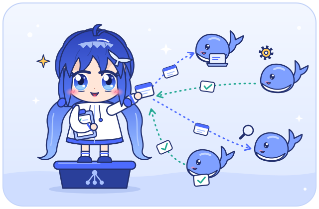
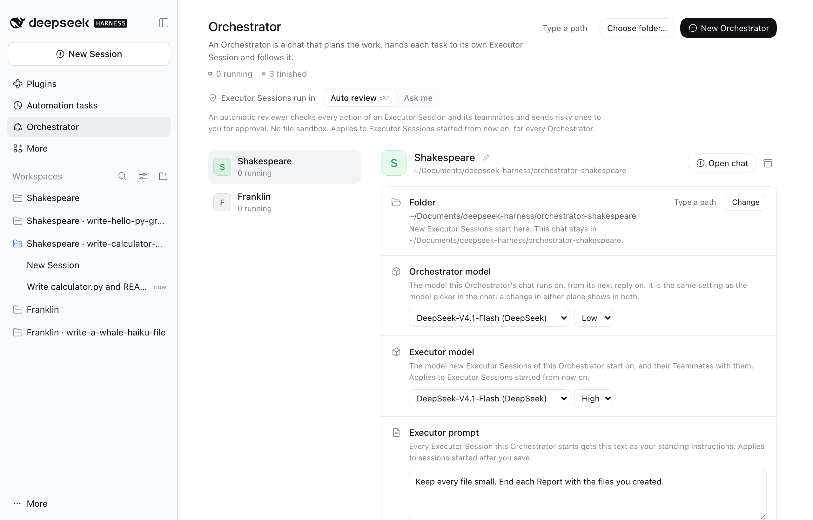
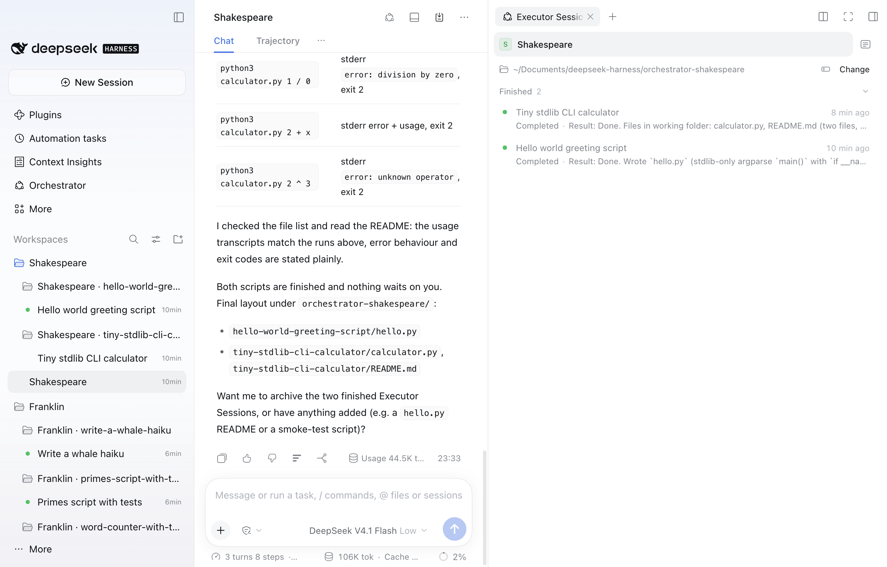
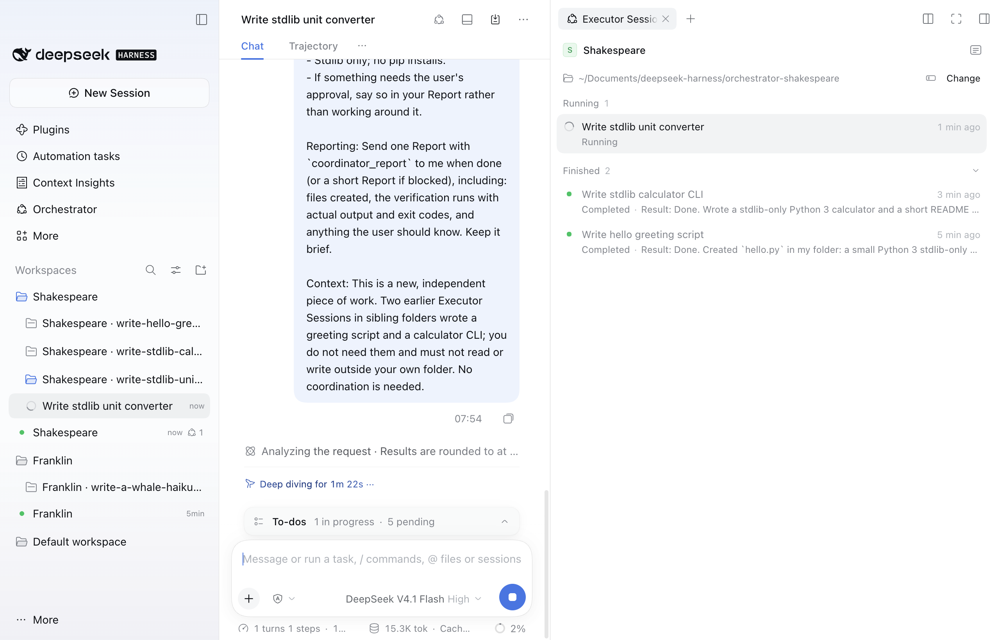
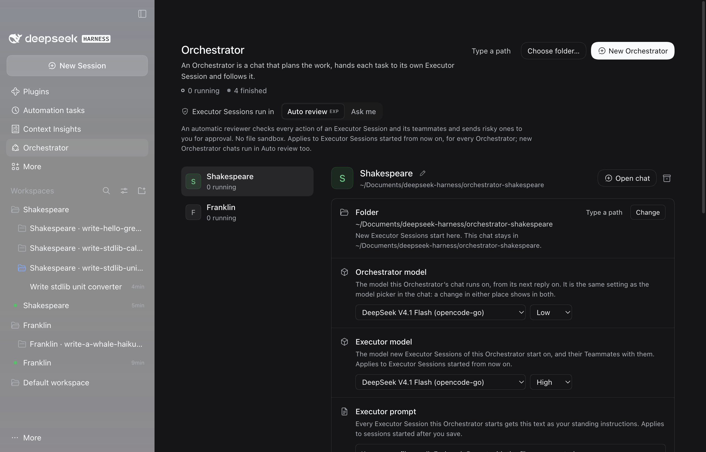

<p align="center">
  
</p>

<p align="center">English | <a href="README.zh-CN.md">简体中文</a> | <a href="README.de.md">Deutsch</a></p>

# Whalepod

Whalepod (package `dsh-whalepod`) is a plugin for the DeepSeek Harness (dsh). It adds Orchestrators. An Orchestrator is the main session that delegates: you describe the work in its chat, and its agent hands each task to its own Executor Session, follows it, and reports the results. You can run several Orchestrators side by side, one per piece of work. Each Orchestrator has a name, such as "Noether" or "李白".

**Install:** in DeepSeek Harness open Plugins > Add plugin, enter `dsh-whalepod` and press Install. Details in [Install](#install).

Executor Sessions run autonomously with Agent Teams on, each in its own folder and in its own sidebar group next to its Orchestrator. Executor Sessions of the same Orchestrator can message each other when they share a task; Executor Sessions of different Orchestrators cannot. The Lead of an Executor Session may split its task across an agent team. The executor shows as running while any Teammate works, and the Orchestrator hears once, when the whole team is done.

Executor Sessions run in dsh's Auto review by default when you have switched on dsh's Auto authorization review plugin; it has no file sandbox. Without it they run in Ask me, and the Orchestrator page switches new ones to Ask me at any time. [Security](#security) explains both modes and the boundaries the plugin enforces.

## Screenshots

<p align="center">
  
</p>
<p align="center"><em>The Orchestrator page: Shakespeare selected, with its folder and its Orchestrator and Executor models.</em></p>

<p align="center">
  
</p>
<p align="center"><em>Shakespeare's chat reports both jobs done; the pane lists its Executor Sessions, and the sidebar shows one group per Executor Session.</em></p>

<p align="center">
  
</p>
<p align="center"><em>An Executor Session at work on a small unit converter, with its Orchestrator and its two finished siblings in the pane.</em></p>

<p align="center">
  
</p>
<p align="center"><em>The Orchestrator page in the dark theme.</em></p>

## Requirements

- DeepSeek Harness 0.2.2-rc.2 or a later 0.2.x release (`engines.dsh`).
- Git only for the `github:` install form below; the package name needs nothing else.
- The package ships prebuilt code and has no runtime dependencies. `@deepseek-ai/cordis` and `@deepseek-ai/dsh-typert-protocol` are peers that the running dsh supplies; pnpm's peer warning during install is expected.

## Install

Whalepod is published on npm as `dsh-whalepod`. None of the forms below builds anything on your machine; the package contains the built code.

**In the app.** Open Plugins, choose Add plugin, type `dsh-whalepod` into "Package name or address" and press Install. The Registry dropdown can stay at the official npm registry. When the install is done, choose Enable now. If the dialog says to restart DSH, quit the app and start it again.

**From the command line.** Quit the app first when installing into the desktop profile, and start it again afterwards. The desktop profile must exist, so open the desktop app once before the first install. For `dsh web`, use `--profile web` and restart `dsh web`.

```sh
dsh plugin --profile desktop add dsh-whalepod
```

**The latest code from GitHub.** To install the current state of the repository instead of the published package, use `github:simveit/dsh-whalepod` in either place. This needs Git:

```sh
dsh plugin --profile desktop add github:simveit/dsh-whalepod
```

That is the whole install. The Orchestrator entry appears in the sidebar, and the Orchestrator tools are available. The plugin adds no agent preset: Executor Sessions and Orchestrators run on your Standard preset.

To install a newer version, remove the plugin (see [Uninstall](#uninstall)) and add the newer version. Orchestrators, Executor Sessions and the plugin state are kept.

Auto review comes from dsh's own optional plugin "Auto authorization review" (`@deepseek-ai/dsh-experimental-auto-review`), which ships with dsh. To use it, switch it on under Plugins; nothing is downloaded. Without it, Executor Sessions run in Ask me (`workspace-write`), and the Orchestrator page says why. Version 0.1.0 of this plugin switched that plugin's component on by itself; 0.1.1 leaves it to you, because dsh's in-app Uninstall refused to remove Whalepod while you also had Auto authorization review on.

## Quick start

1. Open the Orchestrator entry in the left sidebar and press New Orchestrator. A setup step opens first: it suggests a name and shows the model for the Orchestrator and the model for its executors. Change what you like, then press Enter or Create. The plugin then makes the Orchestrator's folder and opens its chat.
2. Describe the work in the chat, for example "Write a CSV word counter in Python and in Go, in two parallel Executor Sessions". For larger work the Orchestrator may propose a split first. It then starts one Executor Session per piece of work.
3. Follow the Executor Sessions in the pane on the right of the chat or on the Orchestrator page. Approvals, questions and folder confirmations come to you, on the Executor Session's row and in the Orchestrator chat.
4. The Orchestrator reports each result in its chat. Open any Executor Session to look inside or to talk to its Lead directly.
5. When the work is done, press Archive Orchestrator on the Orchestrator page. Nothing is deleted.

## Orchestrators and their folders

**Starting one.** Press New Orchestrator on the Orchestrator page. A setup step opens under the head, and nothing is created yet. It has three fields. "Name for the new Orchestrator" shows a suggested name in grey: leave the field empty and the Orchestrator gets exactly that name, or type your own. "Orchestrator model" and "Executor model" are the two settings described under Models below, already filled in with their defaults; change them here, or later on the page. Press Enter or Create to make the Orchestrator (Esc closes the step). A name, folder or model that is refused creates nothing, and the step says why. The plugin then makes a folder for the Orchestrator next to dsh's default workspace (on a standard Mac, `~/Documents/deepseek-harness/orchestrator-noether`, `orchestrator-li-bai` and so on; for a name of your own, `coordinator-` and the Latin letters and digits of the name, or plain `orchestrator` when it has none), adds that folder to the sidebar as a Workspace titled "Noether", and opens the Orchestrator chat there with the same title. Choose folder... does the same in a folder you pick in the folder dialog, and Type a path next to it lets you type the folder instead. A folder that is already a Workspace with your own sessions is refused, and so is a folder inside or around another Orchestrator's folder. Open chat on an Orchestrator opens it again. When no Orchestrator exists yet, the page offers New Orchestrator, which opens the same setup step, so your first Orchestrator is set up the same way. If a folder with files in it is left over under the suggested name from an earlier Orchestrator, the new Orchestrator keeps the name and gets the next free folder (`orchestrator-li-bai-2`); the old folder is not touched. If the chat cannot be opened after the Orchestrator was created, the step closes anyway and a notice says so: the Orchestrator is in the list, with its Open chat button.

**Names.** Every Orchestrator has a name no other live Orchestrator has. You can type one in the form that New Orchestrator opens; a name you type follows the rules of a rename below, and a refused name creates nothing. If you leave the field empty, the Orchestrator gets the name the field suggests in grey, or another free one if an Orchestrator took that name in the meantime. The suggestion, and the name wherever an Orchestrator comes about without that form, is chosen at random from a built-in list of famous philosophers, scientists, mathematicians, novelists and poets, women and men: English-speaking, German-speaking and Chinese names, and a few from elsewhere. Chinese names are written in Chinese characters in every language of the page (李白, 老子, 鲁迅). When every name is in use, a number is added ("Noether 2"). To rename an Orchestrator, press the pencil after its name on the Orchestrator page, type the new name and press Enter (Esc cancels). A name has 1 to 40 characters, no control characters and no middle dot (·), is not only digits, and must differ from every other live Orchestrator's name. Invisible characters are removed, and names that differ only in case, character width or invisible characters count as the same name. The chat and its sidebar group are titled with the bare name and follow a rename when they still carry the plugin's title; a title you gave the chat yourself stays. A rename never moves the folder.

**New Session in an Orchestrator's group.** A new session you start in an Orchestrator's sidebar group (the group's New Session button) becomes another Orchestrator in that folder with the first message you type in it. Until then it already lists the Orchestrator's tools, but refuses to use them, so a schedule, a workflow or anything else that opens a session there cannot start Executor Sessions. Once it is an Orchestrator, it gets a name, its chat is renamed to that name, and it runs on `workspace-write` like the chats New Orchestrator makes. It shows no welcome. It keeps the model you started it on and gets no model settings; the defaults are only what the setup step of New Orchestrator proposes. At most 20 Orchestrators can be live at once.

A session in an Orchestrator's folder that does not become an Orchestrator is limited to reading and searching and has no plugin tools. That covers a session that already had turns when it came there, one past the limit of 20, a fork of an Orchestrator chat, and an earlier Orchestrator chat that you unarchive. If you keep unrelated chats in an Orchestrator's folder, you will find them limited this way.

**Its folder.** An Orchestrator's chat stays in the folder it was created in. Its folder for new work starts as that same folder: each new Executor Session gets a fresh subfolder there, named after its title. The Orchestrator page and the Executor Sessions pane show the folder with Change and Type a path. Change opens the folder dialog; Type a path opens a path field. While the dialog is open, the page says so and offers Type a path and Cancel. If the dialog has not answered after 8 seconds, the page says it may be behind this window; after 60 seconds it gives up and opens the path field. Only Executor Sessions started afterwards use the new folder. Existing ones keep theirs, and the chat stays where it is.

**Which folders ask you.** A new folder below the Orchestrator's folder starts without asking when its nearest existing parent is the Orchestrator's folder or a folder the plugin made for an executor. Every other folder needs the path typed by you in that Orchestrator's own chat and then your confirmation: a folder outside the Orchestrator's folder, an existing folder below it, and a new folder inside a folder the plugin did not make, such as one of your repositories. A folder inside or around another live executor's folder also needs your confirmation. Folders inside another Orchestrator's home, folders that contain an Orchestrator's folder, the home folder, dot folders, system folders and the dsh home are always refused. The card with Reject, Allow once and Always allow appears in the Orchestrator chat once the Orchestrator's turn has ended, never together with a question the Orchestrator asks you; the same buttons on the executor's row on the page and in the pane always work. "Always allow" adds the folder to the allowed folders on the Orchestrator page and applies to every Orchestrator; the card and the row say so. After a restart the allowed folders are still listed, but a folder under one asks again until you choose "Always allow" for it once more. The card, the page and error messages show paths with your home folder as `~`.

**Models.** Each Orchestrator has two model settings on the Orchestrator page, under its folder. "Orchestrator model" is the model its chat runs on, from the Orchestrator's next reply on. It is the same setting as the model picker in the chat: a change in either place shows in both. "Executor model" is the model its new Executor Sessions start on; its first choice is "Same as Orchestrator". The setup step of New Orchestrator proposes both settings when DeepSeek Harness offers DeepSeek V4.1 Flash: the Orchestrator model at effort Low and the executor model at effort High. Nothing is set before you press Create, and you can change both there. When several providers offer that model, the provider of your default model is used, and each choice in the pickers names its provider. A picker starts empty ("Not set" for the Orchestrator, "Same as Orchestrator" for the executors) when the model is not available, when the model does not offer the effort meant for that picker (no other effort is taken in its place), or when the models of your default model's provider could not be loaded. If the step could not load its suggestions at all, it says so, and an Orchestrator you create then has no model settings. Orchestrators you already have are not changed. Both pickers list the models DeepSeek Harness offers, grouped by provider, with the reasoning effort next to the model when the model has one, as in the chat's message box. A change saves at once. The Executor model applies to Executor Sessions started from then on. Running ones keep the model they started on, and so does one whose model you changed by hand in its own chat. Teammates run on the model of their Lead. Choosing a model on the page does not change the model your other sessions in DeepSeek Harness start on. Choosing one in a chat's model picker does, because DeepSeek Harness saves that choice as its default. When a chosen model is no longer available, for example after you signed out of its provider, it stays selected with a note. New Executor Sessions then start on the Orchestrator's model, or on the DeepSeek Harness default, until you choose another one, and the Orchestrator is told when it starts one. When DeepSeek Harness cannot check the Executor model at that moment, because its provider's model list fails, no Executor Session starts on another model in its place: the Orchestrator is told to try again, and the page says that the model could not be checked. Only you change the two settings: no tool of an Orchestrator or an Executor Session reads or sets them. Every new Executor Session and each of its Teammates uses the Executor model, so a more expensive model there raises the cost of all of them.

**Executor prompt.** Each Orchestrator has an Executor prompt on the Orchestrator page, under its folder: standing instructions that every Executor Session this Orchestrator starts receives, for example "write tests before changing code, and ask before adding a dependency". The Lead gets the text as your instructions, with your authority over the Assignment and over messages from the Orchestrator; Teammates get what matters through their Lead. A saved prompt applies to Executor Sessions started after the save; running ones keep the text they started with. It has up to 4000 characters, Cmd+Enter or Ctrl+Enter saves, Esc reverts, and saving an empty field clears it. Only you can change it on the page: the Orchestrator knows it exists but cannot read or change it, and no model tool can.

**Memory.** Each Orchestrator has a memory: one short page of notes that it shares with its Executor Sessions. It holds what a fresh Orchestrator or a new Executor Session would otherwise have to ask you again: your standing preferences and rules, decisions, how you like a kind of work done, split and reported, and lasting facts about your projects and folders, but not the status of current work. The Orchestrator and the Leads of its Executor Sessions keep it up to date by themselves, in the turn they learn something, and it survives compaction and restarts. Tell the Orchestrator in its chat to remember or forget something and it does so in that turn. The Orchestrator always has the page in front of it. An Executor Session starts without it: the Orchestrator puts the parts that matter into the Assignment, and the Lead can read the whole page (`memory_read`) and save what you tell it in its session (`memory_update`); Teammates cannot. Every write replaces the whole page and names the revision it is based on, so when someone else changed the page meanwhile, nothing is saved and the writer merges and sends again. The Memory row on the Orchestrator page, under the Executor prompt, shows the memory, who changed it last (you, the Orchestrator or an Executor Session), which Executor Sessions changed it since you last saved it there, and a count of up to 6000 characters; that is a safety bound, the page is meant to stay short. The row follows the memory on its own: when the Orchestrator or an Executor Session changes it, the text simply updates and there is nothing for you to do. You can edit it there (Revert and Save); only when it is changed while you have unsaved edits does the page say so and keep your draft. The list of Executor Sessions that changed the page is there for your information. "Mark as reviewed" next to it clears the list, and so does a Save of your own edit. "Use memory" switches an Orchestrator's memory off: the Orchestrator and its Executor Sessions then get no notes and cannot change them, and the text is kept until you switch it on again. The Orchestrator also holds its Executor Sessions to the memory: when a Report or a notice shows an Executor Session working against a rule or preference in it, the Orchestrator sends it a reminder of how you want it done, stops it when needed, and tells you. The memory is only notes: it never counts as your instruction and cannot allow a folder, give an Assignment your authority or answer an approval. What you type in an Executor Session wins there over the memory and the Executor prompt; what you say in the Orchestrator's chat wins over the memory.

**Look-ins.** Notices come when an Executor Session reports, finishes, asks or fails. When the memory has rules for its work, the Orchestrator can also look in while it works, at times it picks itself: first after 10 to 20 minutes, then further apart while all is well, and it stops after two or three look-ins with no change. A look-in shows short previews of what the Executor Session wrote: its latest message, its last Reports and its todo list. If the work goes against a rule, the Orchestrator reminds it how you want it done and tells you in one line; otherwise it ends quietly, and the chat shows only a collapsed row "… is still working (your look-in)" and a finished turn without a reply. Executor Sessions keep a todo list and send a short progress Report when they make a decision that shapes the work, such as a tool or an approach; neither wakes the Orchestrator, both show at the next look-in or notice. Without rules in the memory there are no look-ins and no extra cost. The host allows 6 look-ins per Executor Session (`checkLaterMaxPerExecutor`) until you write again, in the Orchestrator's chat or in the Executor Session, so look-ins and reminders cannot keep going without you. A look-in that is still pending is lost when the plugin reloads or the app restarts; the Orchestrator can schedule a new one at the next notice.

**Where Executor Sessions show.**

- The Orchestrator page lists the Orchestrators by name. Select one to see its folder, its Executor prompt, its memory and its Executor Sessions, grouped as Needs you, Running, Standing by and Finished.
- Beside an Orchestrator chat, the Executor Sessions pane in the right sidebar lists that Orchestrator's executors. Beside an Executor Session it lists the other executors of the same Orchestrator, with the Orchestrator on top. The header button toggles the pane.
- In the left sidebar, an Orchestrator's row shows a count of its executors that need you or are running, and its hover card names the Orchestrator and the numbers.
- Each Executor Session sits in its own sidebar group at its folder, titled "<Orchestrator name> · <folder name>" (for example "Orwell · write-the-parser"), placed right after its Orchestrator's group and collapsed until you open it. The group follows a rename of the Orchestrator. In dsh's "Group by workspace tree" view, these groups nest under the Orchestrator's group when the executor's folder lies below the Orchestrator's folder. When an executor works in a folder that already is one of your Workspaces, it joins that Workspace, which the plugin never renames or removes. A New Session you open inside an executor's group is your own plain session: the plugin does not touch it.
- The Orchestrator entry in the sidebar counts the executors of every Orchestrator that need you.

An executor shows as Standing by when its last turn ended without a result and it waits for the next message.

**Executor Session titles.** A new Executor Session starts with the working title its Orchestrator gave it. When dsh's session-titles generator is enabled ("Conversation-following titles"), dsh then retitles the session from its Assignment, and later from what you type in it; without the generator, the working title stays. The page, the pane, notices and the Orchestrator's tools show the current title. An Executor Session may not be titled like an Orchestrator, and a generated title that looks like one is not taken over, so planted text cannot dress an executor up as an Orchestrator.

**Reports.** A Lead's result reaches its Orchestrator once; the same result sent again is recorded but not delivered twice. A notice that would wake the Orchestrator while it is working waits until the Orchestrator has finished its turn and then opens the next one. It never appears in the queue above the chat's message box, and a message you type meanwhile goes first. After a turn you stopped, or one that failed, waiting notices stay back: your next message runs without them, and they open a turn of their own once a turn of the Orchestrator has ended normally, or together with the next notice that wakes it.

**Archiving.** Archive Orchestrator on the Orchestrator page archives its chat and its finished Executor Sessions; nothing is deleted. If executors still work, the confirmation lists them and offers Stop and archive. Tick "Also remove its workspace from the sidebar" to remove the Orchestrator's sidebar group too; files on disk are kept. The group stays when another Orchestrator uses it, when it holds other sessions, or when the plugin did not create it, and the page says why. If removing the group fails, the Orchestrator is archived anyway and the page says you can remove the group in the sidebar. Archiving an Executor Session, or an Orchestrator with its Executor Sessions, removes the plugin's groups of those executors when nothing else is left in them; your own Workspaces are never removed. An Orchestrator's archived Executor Sessions are listed, read-only, in a collapsed "Archived" group under its Executor Sessions; you open them from the sidebar's archive. An archived Orchestrator stays on the page, read-only; Reopen brings it back with a new chat, and its archived Executor Sessions stay archived. If another Orchestrator took its name meanwhile, it gets a new one. When Reopen is refused (20 Orchestrators are open, or its folder is refused), the page says why. Delete Orchestrator (the bin button of an archived Orchestrator) removes only its entry from the page; its sessions, folders and files stay.

If you delete an Orchestrator chat from the left sidebar instead, the Orchestrator keeps its Executor Sessions and their notices wait for it. The page then shows the chat's state: "Chat archived", "Chat deleted" when the session no longer exists, or "No chat yet". Reopen chat (or Start chat when there never was one) creates a new chat for the same Orchestrator in its folder and hands over what waited.

**Shared settings.** "Executor Sessions run in", the allowed folders and the running cap (`maxRunningThreads`) apply to all Orchestrators together. So does the "Matriarc in Executor Sessions" toggle, shown under "Executor Sessions run in" and in the setup step only when the Matriarc plugin is installed. It is on by default: each new Executor Session starts with Matriarc on, and Orchestrator chats never get Matriarc, even if you turn it on in one. Off, Whalepod leaves Matriarc alone. Whalepod works with the Matriarc plugin as well as without it; the screenshots above show it without. While new Executor Sessions run in Auto review and Auto review is loaded, new Orchestrator chats run in Auto review too, with the same limited tools; otherwise they run in Workspace Write. The name, the two models, the Executor prompt and the memory, with its switch, belong to each Orchestrator.

## Configuration

All keys are optional. The easiest way to change them is the plugin's own settings: open Plugins, click Whalepod, and edit the form below its short introduction. It has every key except the legacy `threadsRoot`, checks each value as you type, and saves to the plugin's row of the profile's `cordis.patch.yml`. That row keeps the id `dsh-coordinator`, the name the plugin had before it became Whalepod. Changes apply at once, without restarting the plugin. "Reset to default" takes a key back out of the patch.

You can also write that row by hand:

```yaml
- id: dsh-coordinator
  config:
    coordinatorBase: ~/Documents/deepseek-harness
```

| Key | Default | Meaning |
|---|---|---|
| `coordinatorBase` | next to dsh's default workspace | Where New Orchestrator makes each Orchestrator's own folder (`orchestrator-<name>`, with `-2` when that folder is taken). Without it, the parent of dsh's registered default workspace, else `~/Documents/deepseek-harness`. The home folder, dot folders, system folders and folders that contain the dsh home are refused; the page then says so and New Orchestrator is disabled. |
| `threadsRoot` | `~/dsh-threads` | Legacy. Only locates the chat of the Orchestrator that an earlier release's state file had. New Executor Sessions never start there unless the folder for new Orchestrators is refused. |
| `maxRunningThreads` | `128` | Executor Sessions running at once, across all Orchestrators; further starts and wake-ups queue |
| `noticeDebounceMs` | `3000` | Quiet time before a batch of executor notices reaches its Orchestrator |
| `noticeMaxDelayMs` | `15000` | Longest a notice waits for its batch |
| `checkLaterMinMinutes` | `5` | Shortest gap, in minutes, an Orchestrator may ask for when it schedules a look-in; at least 1, and a value above 240 counts as 240 |
| `checkLaterMaxPerExecutor` | `6` | Look-ins one Executor Session may get until you write again, in the Orchestrator's chat or in the Executor Session; at least 1 |
| `briefAs` | `user` | `user`: the Assignment is a user prompt (Auto review treats it as the task) when the user opened the Orchestrator turn; `notice`: always an agent message |
| `wakeMaxPerThread`, `wakeWindowMs` | `60`, `600000` | How often one Executor Session may wake its Orchestrator; past it the executor pauses until you resume it |
| `threadTurnBudget` | `0` | Turns per Executor Session per 24 hours that the executor, its Orchestrator, a peer or a schedule starts (your own turns do not count); past it the executor pauses until you resume it. `0` means no daily turn budget |
| `coordinatorExtraTools` | `[]` | Extra tools of other plugins or MCP servers the Orchestrators may use, by name. Tools that execute code, write files, spawn work, read other sessions' logs (`session_search` and the like), manage plugins, or drive terminals, browsers or office documents are never added |
| `peerMaxPerPair`, `peerMaxPerThread`, `peerWindowMs` | `40`, `200`, `600000` | Limits on `executor_send` per executor pair (both directions) and per sender. The message past a limit is refused, and the pair limit pauses both executors, the sender limit the sender, until you resume them |
| `matriarc` | `on` | The Matriarc toggle until you change it on the Orchestrator page: `on` (new Executor Sessions start with Matriarc on, Orchestrator chats never get it) or `off` (Whalepod leaves Matriarc alone). Used only while Matriarc is installed. |
| `threadPermission` | `auto` | How new Executor Sessions run until the user picks on the Orchestrator page: `auto` (Auto review, no file sandbox) or `ask` (Ask me, `workspace-write`: sandboxed to the executor's folder, approvals to the user). Any other value reads as `auto`; the plugin never uses a looser preset. |

The key names are unchanged from earlier releases, so existing patches keep working. A value a key refuses (below its minimum, a choice it does not know) reads as the key's default and never stops the plugin from loading. Only one dsh process per `DSH_HOME` runs the Orchestrators; another one shows why it is disabled.

Folders you allow with "Always allow" are listed on the Orchestrator page under "Allowed folders", where you can remove them. They are not part of the config. Orchestrator names, Executor prompts and memories are set on the Orchestrator page, not in the config.

To run without Auto review, leave Auto authorization review switched off under Plugins (or switch it off). Executor Sessions then run in Ask me (`workspace-write`) and ask before acting outside their folder; the Orchestrator page's control shows Ask me and says why. The host log says so at startup (`auto permission preset NOT available`). The plugin never picks a more permissive preset.

## Security

Executor Sessions run in dsh's Auto review by default while Auto authorization review is switched on under Plugins: an automatic reviewer checks each action and sends risky ones to you, and there is no file sandbox in this mode. Without it, they run in Ask me. The Orchestrator page has an "Executor Sessions run in: Auto review | Ask me" control; Ask me runs new executors under dsh's `workspace-write` preset: the Lead writes only in the executor's folder and asks you before anything else, and its Teammates work in the same folder sandbox. Teammates never ask you, in either mode: an action that would need your approval, such as anything outside the folder under Ask me, is refused for them. The control applies to every Orchestrator.

The Orchestrator has `executor_start`, `executor_message`, `executor_list`, `executor_read`, `executor_flag_user`, `executor_stop`, `executor_archive`, `memory_read` and `memory_update` (its memory) and `executor_check_later` (look-ins), plus tools to read and search files, load a skill (DeepSeek Harness's `skill` tool), ask you questions and keep a todo list; it has no shell, write, web or browser tools, and the host refuses any call outside its allow list. Each Orchestrator sees and controls only the Executor Sessions it started. Leads have the user's Standard tools (without the plugin manager) plus `coordinator_report`, `executor_peers`, `executor_send`, and `memory_read` and `memory_update` for the memory of their own Orchestrator. The tools take an `executor` parameter for the target and an `assignment` parameter for the first message.

Boundaries are enforced in the host. Executor output reaches the Orchestrator only as fenced data. A folder outside the Orchestrator's own folder, or one below it that the plugin did not make, needs the user's own words in that Orchestrator's chat and then the user's confirmation, on the executor's row or in a card in the Orchestrator chat. A folder on the allowed folders skips the confirmation once you have chosen "Always allow" for it in the current run of the app. An Assignment counts as the user's instruction only when the user asked for the work. An Orchestrator's memory is written by models, its own and those of its Executor Sessions' Leads. It is stored in the plugin's state, where it changes only through the two memory tools and the Orchestrator page, and an Executor Session reaches only the memory of its own Orchestrator. No host check accepts the memory in place of your own words, so text an executor wrote there cannot grant anything by itself. It can still shape what the Orchestrator and other Executor Sessions of that Orchestrator do. When an Executor Session changes the memory while the Orchestrator works on your request, or the Orchestrator reads a memory that Executor Sessions changed since you last saved it, the Assignments it writes in the rest of that turn do not count as your instruction. In a later turn you open they do again, even when a note in the memory shaped them. The Memory row shows who changed the memory last and which Executor Sessions changed it since your last save. Review and edit it on the Orchestrator page, or switch it off there, above all before unattended work on untrusted content. The plugin refuses Orchestrators, Executor Sessions and their Teammates its own state folder (`storages/dsh-coordinator` in the dsh home), where the Executor prompts, memories and model settings are kept. Their file and search tools do not reach it under any name the folder has. A shell command of an Executor Session is refused only in the spellings the plugin recognises, so there DeepSeek Harness's sandbox and Auto review remain the control. In the rest of the dsh home they are treated like any other session of yours, by DeepSeek Harness's sandbox and Auto review and not by the plugin: they can use your skills, and they can also read the credentials file, the profiles and the session logs, as every session can. An Orchestrator loads a skill to write the Assignment and names it there; the Executor Session uses it. A skill is text the Orchestrator takes as instructions. When the Orchestrator's project has a skills folder of its own (`.dsh/skills` or `.agents/skills`), which an Executor Session may have written, the Assignments the Orchestrator writes after loading a skill in that turn do not count as your instruction. An executor that wakes its Orchestrator too often, or two executors that message each other too often, pause until you resume them. A daily turn budget can be set but is off by default; with up to 128 executors running at once, set one for unattended use, because model spend and the provider's rate limits can be reached quickly.

[docs/security.md](docs/security.md) has the threat model, what the host enforces and what rests on prompts, and the known limits. To report a vulnerability, see [SECURITY.md](SECURITY.md).

## Upgrading from an earlier release

**From 0.1.0 to 0.1.1.** If Auto authorization review is switched on under Plugins, dsh refuses to uninstall or update Whalepod 0.1.0 in the app ("Other configuration still uses this bundle's components"). Either switch Auto authorization review off, update or uninstall Whalepod, and switch it on again; or, with the app quit, run `dsh plugin --profile desktop remove dsh-whalepod` and add the new version (see [Install](#install)). If you used Auto review without switching on Auto authorization review yourself, switch it on after the update; until then Executor Sessions run in Ask me, and those last run in Auto review wait until it is back. Orchestrators, Executor Sessions, the plugin state and settings are kept.

**From the package `dsh-coordinator`.** The plugin was called `dsh-coordinator` before it became Whalepod (package `dsh-whalepod`). dsh installs plugins by package name, so remove the old package and add the new one, with the app quit (or `dsh web` stopped):

```sh
dsh plugin --profile desktop remove dsh-coordinator          # or: --profile web
dsh plugin --profile desktop add dsh-whalepod                # or github:simveit/dsh-whalepod, see Install
```

Orchestrators, Executor Sessions and the plugin state are kept: the plugin's id, its state folder (`$DSH_HOME/storages/dsh-coordinator/`) and the marks in session logs keep the old name. Settings you set on the Plugins page are kept too, but dsh skips a settings row whose `name` names the old package. If the profile's `cordis.patch.yml` has a row with `id: dsh-coordinator` and `name: dsh-coordinator`, change that line to `name: dsh-whalepod` (or delete it) before the next start. A row with only `id: dsh-coordinator` needs no change.

**From an earlier release of the plugin.** Nothing is lost. On the first start:

- Your existing Orchestrator becomes the first Orchestrator on the page, with its chat, all its Executor Sessions (archived ones included), the allowed folders and your "run in" choice. Its new Executor Sessions start in a new folder next to dsh's default workspace (`~/Documents/deepseek-harness/orchestrator-<name>`), like a new Orchestrator's. Its chat stays where it is; without a chat, Reopen makes the chat in that new folder. Existing Executor Sessions keep their folders. The folder is created when the first new Executor Session starts there. You can change it on the page. If the folder for new Orchestrators is refused, the old `threadsRoot` stays in use and the page says why.
- Every existing Orchestrator gets a name. A chat or sidebar group still titled "Coordinator", "Coordinator 2" or "Coordinator <name>" is renamed once to the bare name. Existing folders are not renamed.
- The allowed folders stay listed, but each one asks for your confirmation again until you choose "Always allow" for it once more.
- Before the state file is first written in the new format, it is copied once to `state.v1.json` next to it (`$DSH_HOME/storages/dsh-coordinator/`). That copy is never overwritten.
- Each live Executor Session gets its own sidebar group next to its Orchestrator. A group an earlier release made for it is kept and gets the current title and place. Executors in your own Workspaces stay there, and archived ones are not touched.
- New Orchestrators go to the folder next to dsh's default workspace, not to `threadsRoot`.
- Sessions created on the old `thread` and `coordinator` presets are moved to Standard.
- The tools are now called `executor_*` (they were `thread_*`). The old parameter names `thread` and `brief` still work, and session logs written before the rename are still read correctly.

Going back to an earlier release loses settings without a notice. The state file has had the same format since 0.1.0, so an earlier release reads it, keeps only the fields it knows and writes the file without the others at its first save: 0.1.1 drops every Orchestrator's memory and model settings, and 0.2.x and 0.3.0 drop the model settings. Keep a copy of `state.json` before you install an earlier release. A pre-release build from before 0.1.0 cannot read the file at all: it runs without saving and leaves the file alone. If this release finds a state file it cannot read, it moves it aside, and if it finds one from a newer release, it leaves it alone and runs without saving. In both cases the page says so, and chats that carry the plugin's marks stay limited to reading. The plugin remembers the reset, so the notice stays on later starts until you open or create an Orchestrator. Sessions the plugin does not know are always classified by the plugin's marks in their logs, so removing entries from the state file does not lift these limits either.

## Uninstall

In the app, open Plugins and choose Uninstall on Whalepod. From the command line:

```sh
dsh plugin --profile desktop remove dsh-whalepod   # or: --profile web
```

This removes the package and its layer. Auto authorization review is not touched: it stays on or off as you set it. When the plugin unloads, it first moves its Executor Sessions to `workspace-write`, because dsh's auto-review plugin switches `auto` sessions to full access when it goes away.

The Orchestrator chats and the Executor Sessions stay and keep working as ordinary Standard sessions, without the Orchestrator's role prompt and tools. A former Orchestrator chat then has shell and write tools again, with the executor output it read still in its history, and new sessions in an Orchestrator's group stay ordinary sessions. An Executor Session whose session last ran in `auto` and was not loaded when the plugin was removed opens only while Auto review is enabled. Executor folders and their sidebar groups, the Orchestrators' sidebar Workspaces and folders, and the plugin state (`state.json`, and `state.v1.json` after an upgrade) are kept. To delete the state as well, with the app or `dsh web` stopped (the state folder keeps the plugin's earlier name):

```sh
rm -r "$DSH_HOME/storages/dsh-coordinator"   # DSH_HOME defaults to ~/.dsh
```

Remove the Orchestrator and executor Workspaces from the sidebar if you no longer want them; their folders and the executor folders are yours to keep or delete.

## Development

The build uses the Node and pnpm inside the app, so nothing is installed globally:

```sh
R="/Applications/DeepSeek Harness.app/Contents/Resources/runtime/primary-runtime/dependencies"
export PATH="$R/node/bin:$PATH"
pnpm() { node "$R/pnpm/bin/pnpm.cjs" "$@"; }
pnpm install
pnpm run build       # tsc for the host (lib/), tsdown for the client (lib/client.js)
pnpm run typecheck
pnpm test
pnpm check           # typecheck, tests, build and a pack dry run
pnpm pack            # runs the build, writes dsh-whalepod-<version>.tgz
```

`lib/` is committed as a release build, so a `github:` install needs no build step. Rebuild it with `pnpm run build` and commit it together with every change to `src/`; CI checks that the committed `lib/` matches a fresh build.

To try your own build in the app, install the packed file (quit the app first for the desktop profile):

```sh
dsh plugin --profile desktop add ./dsh-whalepod-<version>.tgz   # or: --profile web
```

tsdown runs on rolldown's WebAssembly binding because the app's Node refuses native addons from other vendors. `pnpm-workspace.yaml` adds `wasm32` for that reason.

`scripts/dev.sh` builds, links this folder into a dev home's `web` profile with `dsh plugin --profile web add link:<dir>`, and starts `dsh web` on 127.0.0.1. Set `DSH_HOME` (default `.dsh-home` in this folder, never `~/.dsh`) and `PORT` (default 4317). New Orchestrators of a dev server and their Executor Sessions go to `dev-threads` in this folder (`DSH_COORDINATOR_BASE`, and `DSH_COORDINATOR_THREADS_ROOT` for the legacy root), so a dev server never writes into `~/Documents`. Both folders are gitignored, so this folder holds all plugin work. `DSH_COORDINATOR_SKIP_BUILD=1` skips the install and build when `lib/` is already built. The script header lists the dev-only variables. Host log lines start with `[dsh-coordinator]`, the plugin's earlier name, which the log prefix keeps like the plugin id. A client change needs a rebuild and a page reload; a host change needs a restart.

`src/client/remote.ts` is a hand-written copy of the client spec for the `coordinator` Remote namespace. Keep it in sync with the `@Remote` methods in `src/index.ts`.

Dev-only aids, not in the package: `dev/mock-llm.mjs` is a scripted local model, and `dev/rpc.mjs` calls Remote methods of a local `dsh web`. `scripts/dev.sh` builds with `DSH_COORDINATOR_DEV=1`, which compiles in the client's fake data source (`?coordinatorSource=fake`, two Orchestrators; `?coordinatorSource=real` switches back); `pnpm run build` and `pnpm pack` build without it. Never commit a `lib/` built by `scripts/dev.sh`. The localStorage key `dsh-coordinator:fake-scenario` picks a starting state for the fake: `empty`, `validating`, `archived`, `slow-pick` or `readme` (neutral demo data).

To run without model credentials:

```sh
node dev/mock-llm.mjs --port 4319 &
DSH_COORDINATOR_MOCK_URL=http://127.0.0.1:4319/v1 scripts/dev.sh
```

## Feedback and contributing

Bug reports, questions and ideas are very welcome as [GitHub issues](https://github.com/simveit/dsh-whalepod/issues). We do not accept pull requests for now: this is a side project, and the maintainer wants to keep the design focused and does not have the capacity to review contributions. Please open an issue instead. See [CONTRIBUTING.md](CONTRIBUTING.md) for what to include, and [SECURITY.md](SECURITY.md) for security problems.

## License

MIT. Portions derive from dsh-superagent-prototype (MIT) and from DeepSeek Harness (MIT); see [LICENSE](LICENSE). The mascot is original artwork for this project, under the same licence.

This is an independent plugin. It is not made or endorsed by DeepSeek.
