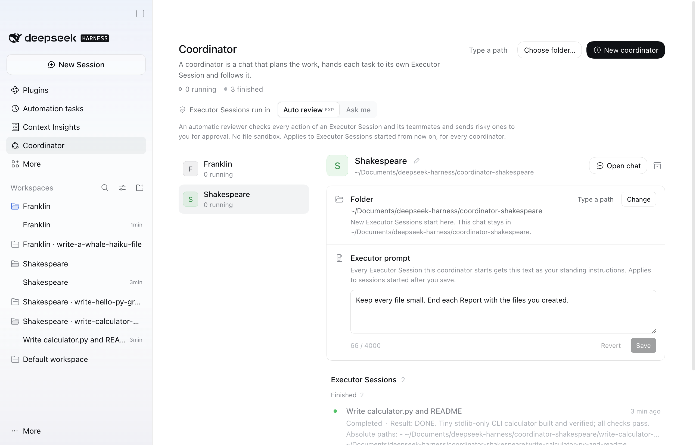
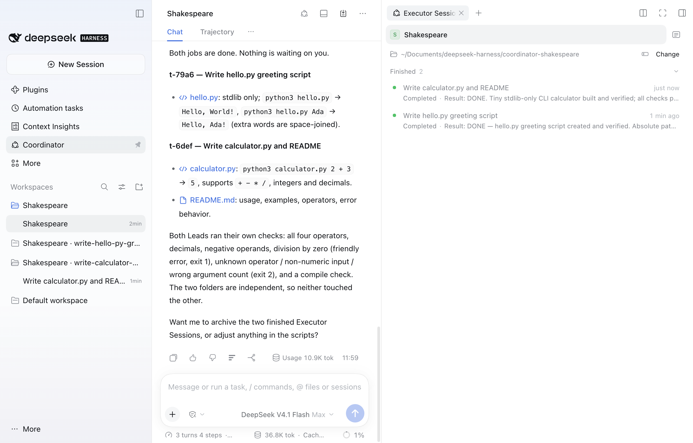
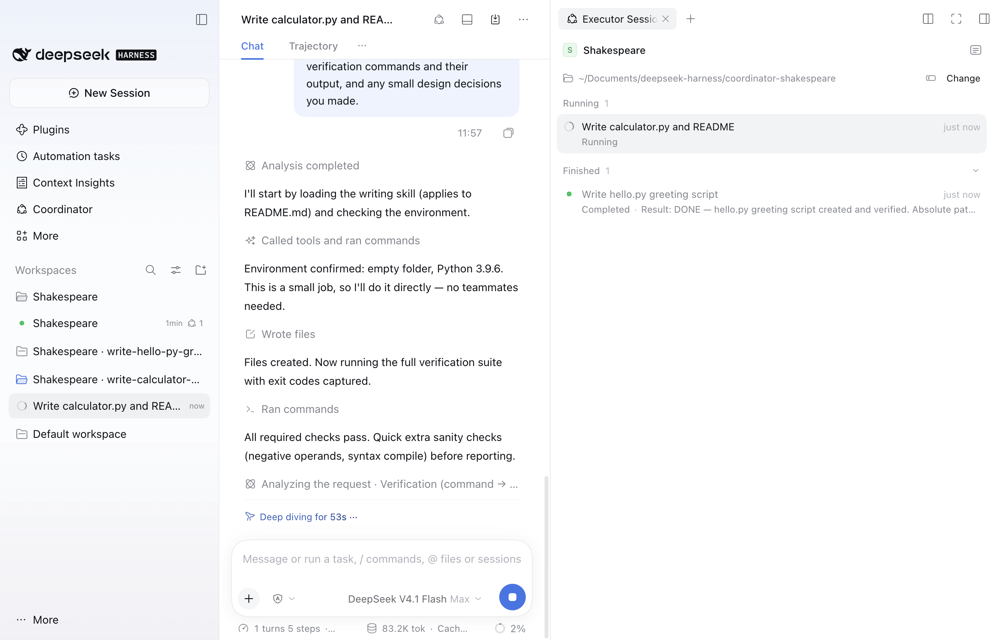
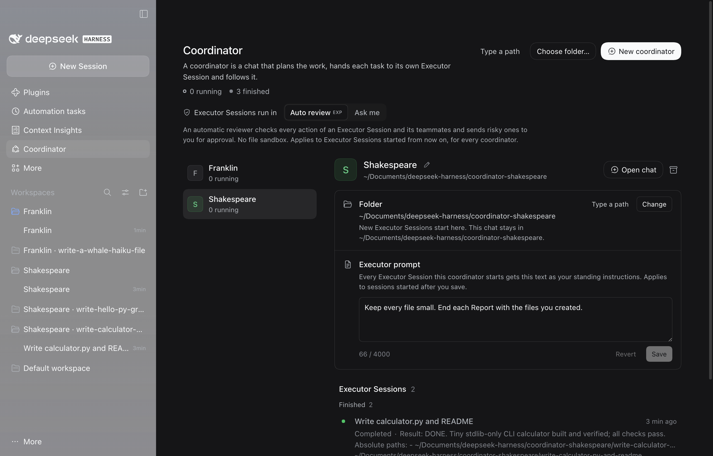

<p align="center">
  
</p>

<p align="center"><a href="README.md">English</a> | 简体中文 | <a href="README.de.md">Deutsch</a></p>

# Whalepod

Whalepod（包名 `dsh-whalepod`）是 DeepSeek Harness（dsh）的一个插件，用来添加“协调者”。协调者是负责分派工作的主会话：你在它的对话里描述要做的事，它的智能体把每项任务交给一个独立的执行器 Session，跟进进展，并把结果汇报给你。你可以同时运行多个协调者，每个负责一项工作。每个协调者都有一个名字，例如“Noether”或“李白”。

**安装：** 在 DeepSeek Harness 中打开“插件” > “添加插件”，输入 `dsh-whalepod`，点击“安装”。详见[安装](#安装)。

执行器 Session 会自主运行，默认开启智能体团队（Agent Teams），每个执行器都有自己的文件夹，并在侧边栏中紧挨着它的协调者拥有自己的分组。同一个协调者下的执行器在处理同一任务时可以互相发消息；不同协调者的执行器之间不能通信。执行器的 Lead（主智能体）可以把任务拆给一个智能体团队。只要还有队友在工作，执行器就显示为运行中；整个团队完成后，协调者只会收到一次通知。

如果你开启了 dsh 的“自动授权审查”插件，执行器 Session 默认以 dsh 的“自动审查”方式运行，此模式下没有文件沙箱。未开启时它们以“询问我”方式运行；“协调者”页面也随时可以把新的执行器切换为“询问我”。两种方式以及插件强制执行的边界见[安全](#安全)一节。

## 截图

<p align="center">
  
</p>
<p align="center"><em>“协调者”页面：选中 Shakespeare，显示它的文件夹、执行器提示词和两个已结束的执行器 Session。</em></p>

<p align="center">
  
</p>
<p align="center"><em>Shakespeare 的对话报告两项工作都已完成；窗格列出它的执行器 Session，侧边栏为每个执行器 Session 显示一个分组。</em></p>

<p align="center">
  
</p>
<p align="center"><em>一个正在编写小型计算器的执行器 Session，窗格中显示它的协调者和已结束的同级会话。</em></p>

<p align="center">
  
</p>
<p align="center"><em>深色主题下的“协调者”页面。</em></p>

## 系统要求

- DeepSeek Harness 0.2.2-rc.2 或更高的 0.2.x 版本（`engines.dsh`）。
- 只有下面的 `github:` 安装方式需要 Git；按包名安装不需要其他东西。
- 软件包内含预构建代码，没有运行时依赖。`@deepseek-ai/cordis` 和 `@deepseek-ai/dsh-typert-protocol` 是由运行中的 dsh 提供的 peer 依赖；安装时 pnpm 的 peer 警告属于正常现象。

## 安装

Whalepod 以 `dsh-whalepod` 发布在 npm 上。下面任何一种方式都不会在你的电脑上构建任何东西：包里已经带有构建好的代码。

**在应用中安装。** 打开“插件”，选择“添加插件”，在“包名或地址”中输入 `dsh-whalepod`，然后点击“安装”。“Registry”下拉框保持官方 npm registry 即可。安装完成后选择“立即启用”。如果对话框提示需要重启 DSH，请退出应用再重新打开。

**通过命令行安装。** 安装到桌面版配置时，请先退出应用，安装完成后再重新打开。桌面版配置必须已经存在，因此首次安装前请先打开一次桌面应用。对于 `dsh web`，请使用 `--profile web`，然后重启 `dsh web`。

```sh
dsh plugin --profile desktop add dsh-whalepod
```

**安装 GitHub 上的最新代码。** 如果想安装仓库的当前代码而不是已发布的包，可以在上述两处使用 `github:simveit/dsh-whalepod`。这需要 Git：

```sh
dsh plugin --profile desktop add github:simveit/dsh-whalepod
```

安装就完成了。侧边栏中会出现“协调者”入口，协调者工具即可使用。插件不添加任何智能体预设：执行器和协调者都使用你的 Standard 预设。

要安装新版本，请先移除插件（见[卸载](#卸载)一节），再添加新版本。协调者、执行器和插件状态都会保留。

自动审查来自 dsh 自带的可选插件“自动授权审查”（`@deepseek-ai/dsh-experimental-auto-review`）。如需使用，请在“插件”中开启它，不会下载任何内容。未开启时，执行器以“询问我”（`workspace-write`）方式运行，“协调者”页面会说明原因。本插件 0.1.0 版会自行开启该插件的组件；0.1.1 版交由你决定，因为当你同时开启了“自动授权审查”时，dsh 的应用内卸载会拒绝移除 Whalepod。

## 快速上手

1. 在左侧边栏打开“协调者”入口，点击“新建协调者”。插件会为协调者起名、创建它的文件夹并打开它的对话。
2. 在对话中描述要做的工作，例如“分两个并行的执行器 Session，用 Python 和 Go 各写一个 CSV 词频统计工具”。工作量较大时，协调者可能会先提出拆分方案，然后为每项工作启动一个执行器 Session。
3. 在对话右侧的窗格或“协调者”页面中跟进执行器 Session。审批、问题和文件夹确认都会交给你处理，显示在执行器 Session 所在行和协调者对话中。
4. 协调者会在对话中汇报每个结果。你可以打开任意执行器 Session 查看详情，或直接与它的 Lead 对话。
5. 工作完成后，在“协调者”页面点击“归档协调者”。不会删除任何内容。

## 协调者及其文件夹

**新建协调者。** 在“协调者”页面点击“新建协调者”。插件会为它选一个名字，在 dsh 默认工作区旁边为它创建一个文件夹（在常规的 Mac 上例如 `~/Documents/deepseek-harness/coordinator-noether`、`coordinator-li-bai`），把这个文件夹作为工作区加入侧边栏，标题为“Noether”，并在那里打开同名的协调者对话。“选择文件夹…”的作用相同，只是使用你在文件夹对话框中挑选的文件夹；旁边的“输入路径”可以让你直接输入文件夹路径。如果该文件夹已经是一个包含你自己会话的工作区，或者位于另一个协调者的文件夹之内或包含它，会被拒绝。点击某个协调者的“打开对话”可以再次打开它。如果还没有任何协调者，“打开协调者对话”会新建一个。

**名字。** 每个协调者都会得到一个其他活动协调者没有使用的名字，从内置列表中随机选取。列表收录著名的哲学家、科学家、数学家、小说家和诗人，有男有女：英语国家、德语国家和中国的名字，以及少数来自其他地方的名字。中文名字在页面的所有语言中都用汉字书写（李白、老子、鲁迅）。所有名字都被占用时，会加上数字（“Noether 2”）。要重命名协调者，点击“协调者”页面上名字后面的铅笔按钮，输入新名字后按 Enter（按 Esc 取消）。名字为 1 到 40 个字符，不能包含控制字符和间隔号（·），不能只由数字组成，且不能与其他活动协调者的名字相同。不可见字符会被去掉；只在大小写、全角半角或不可见字符上不同的名字视为同一个名字。协调者对话和侧边栏分组的标题就是名字本身（例如“鲁迅”）；如果它们仍使用插件给的标题，会随重命名一起改名，你自己给对话起的标题会保留。重命名不会移动文件夹。

**在协调者的分组中新建会话。** 在协调者的侧边栏分组中新建的会话（分组上的“新建会话”按钮），会在你在其中输入第一条消息时，成为该文件夹下的另一个协调者。在此之前，它已经列出协调者的工具，但会拒绝使用它们，因此定时任务、工作流或其他在这里打开会话的方式都无法启动执行器 Session。成为协调者后，它会得到一个名字，对话被重命名为这个名字，并像“新建协调者”创建的对话一样以 `workspace-write` 运行。它不显示欢迎语。同时处于活动状态的协调者最多 20 个。

位于协调者文件夹中、但没有成为协调者的会话，只能读取和搜索，也没有插件工具。这包括来到这里时已经有过对话轮次的会话、超出 20 个上限的会话、协调者对话的分支，以及你取消归档的早期协调者对话。如果你在协调者的文件夹里放了无关的对话，它们也会受到这样的限制。

**它的文件夹。** 协调者的对话始终留在它被创建时所在的文件夹。它用于新工作的文件夹一开始就是这个文件夹：每个新的执行器 Session 会在其中得到一个以标题命名的新子文件夹。“协调者”页面和执行器 Session 窗格都会显示这个文件夹，旁边有“更改”和“输入路径”。“更改”会打开文件夹对话框；“输入路径”会打开路径输入框。对话框打开期间，页面会提示这一点，并提供“输入路径”和“取消”。如果对话框 8 秒后仍无响应，页面会提示它可能在此窗口后面；60 秒后放弃等待并打开路径输入框。只有之后启动的执行器才会使用新文件夹。已有的执行器保留原来的文件夹，对话也留在原处。

**哪些文件夹需要你确认。** 协调者文件夹下的新文件夹，如果离它最近的已存在上级目录是协调者的文件夹或插件为执行器创建的文件夹，就无需询问直接启动。其他文件夹都需要你在该协调者自己的对话中写出路径，然后再确认：协调者文件夹之外的文件夹、协调者文件夹下已有的文件夹，以及位于并非插件创建的文件夹（例如你的某个仓库）中的新文件夹。位于另一个活动执行器文件夹之内或包含它的文件夹，同样需要你确认。另一个协调者主文件夹内的文件夹、包含某个协调者文件夹的文件夹、主目录、以点开头的文件夹、系统文件夹以及 dsh 主目录始终会被拒绝。带有“拒绝”“允许一次”和“始终允许”的卡片会在协调者这一轮结束后出现在协调者对话中，绝不会与协调者向你提出的问题同时出现；页面和窗格中执行器所在行上的同样按钮始终可用。“始终允许”会把文件夹加入“协调者”页面上的“允许的文件夹”，并对所有协调者生效；卡片和执行器所在行都会说明这一点。重启后，允许的文件夹仍会列出，但其下的文件夹会再次询问，直到你再次为它选择“始终允许”。卡片、页面和错误信息中的路径会把你的主目录显示为 `~`。

**执行器提示词。** 每个协调者在“协调者”页面上、文件夹下方都有一个“执行器提示词”：这个协调者启动的每个执行器 Session 都会收到的常驻指示，例如“改代码前先写测试；添加依赖前先询问”。Lead 会把这段文字作为你的指示接收，它的效力高于派工和协调者发来的消息；队友通过它们的 Lead 获得其中重要的部分。保存的提示词只对保存之后启动的执行器 Session 生效；正在运行的执行器保留它们启动时的文字。提示词最多 4000 个字符，按 Cmd+Enter 或 Ctrl+Enter 保存，按 Esc 还原，保存空内容会清除它。只有你能在页面上修改它：协调者知道它存在，但不能读取或修改，任何模型工具也都不能。

**执行器 Session 显示在哪里。**

- “协调者”页面按名字列出所有协调者。选中一个即可查看它的文件夹、执行器提示词和执行器 Session，执行器按“待你处理”“运行中”“待命”和“已结束”分组。
- 在协调者对话旁边，右侧边栏的执行器 Session 窗格列出该协调者的执行器。在执行器 Session 旁边，它列出同一协调者的其他执行器，协调者显示在最上方。会话标题栏上的按钮可以显示或隐藏这个窗格。
- 在左侧边栏中，协调者所在行会显示需要你处理或正在运行的执行器数量，悬停卡片中会显示协调者的名字和具体数字。
- 每个执行器 Session 都位于侧边栏中自己文件夹对应的分组中，标题为“<协调者名字> · <文件夹名>”（例如“Orwell · write-the-parser”），紧跟在它的协调者分组之后，在你打开之前保持折叠。协调者改名时，分组标题会随之更新。在 dsh 的“按工作区树分组”视图中，如果执行器的文件夹位于协调者的文件夹之下，这些分组会嵌套在协调者的分组下面。如果执行器所用的文件夹本身就是你的某个工作区，它会加入该工作区，插件绝不会重命名或移除它。你在执行器分组中新建的会话是你自己的普通会话，插件不会处理它。
- 侧边栏中的“协调者”入口统计所有协调者下需要你处理的执行器。

当执行器的上一轮结束时没有给出结果、正在等待下一条消息时，它显示为“待命”。

**执行器 Session 的标题。** 新的执行器 Session 一开始使用协调者给它的工作标题。如果启用了 dsh 的会话标题生成功能（Conversation-following titles），dsh 会根据它的派工、以及之后你在其中输入的内容为它重新命名；没有启用时，工作标题保持不变。页面、窗格、通知和协调者的工具都显示当前标题。执行器 Session 的标题不能模仿协调者，生成的标题如果看起来像协调者也不会被采用，因此被植入的文字无法把执行器伪装成协调者。

**报告。** Lead 的结果只会送达协调者一次；再次发送的相同结果会被记录，但不会重复送达。

**归档。** 在“协调者”页面点击“归档协调者”，会归档它的对话和已结束的执行器，不会删除任何内容。如果仍有执行器在工作，确认框会列出它们，并提供“停止并归档”。勾选“同时从侧边栏移除它的工作区”可以一并移除协调者的侧边栏分组，磁盘上的文件会保留。如果另一个协调者在使用该分组、分组中还有其他会话，或者分组不是插件创建的，分组会保留，页面会说明原因。如果移除分组失败，协调者仍会被归档，页面会提示你可以在侧边栏中手动移除。归档执行器 Session，或连同执行器一起归档协调者时，插件为这些执行器创建的分组如果已经没有其他内容，会被移除；你自己的工作区绝不会被移除。协调者已归档的执行器 Session 会以只读方式列在它的执行器下方一个折叠的“已归档”分组中；要打开它们，请使用侧边栏的归档。已归档的协调者仍显示在页面上，并且只读；“重新打开”会用一个新对话恢复它，它已归档的执行器 Session 保持归档。如果它的名字在此期间被另一个协调者使用，它会得到一个新名字。如果无法重新打开（已有 20 个协调者处于打开状态，或它的文件夹被拒绝），页面会说明原因。“删除协调者”（已归档协调者上的垃圾桶按钮）只会从页面上移除它的条目；它的会话、文件夹和文件都会保留。

如果你改为在左侧边栏中删除协调者对话，该协调者仍保留它的执行器，发给它的通知会先暂存。页面会显示对话的状态：“对话已归档”、会话已不存在时的“对话已删除”，或“还没有对话”。“重新打开对话”（从未有过对话时为“开始对话”）会在原文件夹中为同一个协调者创建新对话，并把暂存的通知交给它。

**共享设置。** “执行器 Session 运行方式”、允许的文件夹以及同时运行的上限（`maxRunningThreads`）对所有协调者共同生效。名字和执行器提示词属于各个协调者。

## 配置

所有配置项都是可选的。最简单的修改方式是插件自己的设置：打开“插件”，点击 Whalepod，在简短介绍下方的表单中修改。表单包含除旧配置项 `threadsRoot` 以外的所有配置项，输入时即检查每个值，并保存到配置的 `cordis.patch.yml` 中本插件的那一行。这一行沿用 id `dsh-coordinator`，即本插件改名为 Whalepod 之前的名字。修改立即生效，无需重启插件。“恢复默认”会把该配置项从 patch 中移除。

你也可以手动编写这一行：

```yaml
- id: dsh-coordinator
  config:
    coordinatorBase: ~/Documents/deepseek-harness
```

| 配置项 | 默认值 | 含义 |
|---|---|---|
| `coordinatorBase` | dsh 默认工作区旁边 | “新建协调者”为每个协调者创建专属文件夹（`coordinator-<名字>`，已被占用时加 `-2`）的位置。未设置时，使用 dsh 已注册的默认工作区的上级目录，否则为 `~/Documents/deepseek-harness`。主目录、以点开头的文件夹、系统文件夹以及包含 dsh 主目录的文件夹都会被拒绝；此时页面会给出说明，并禁用“新建协调者”。 |
| `threadsRoot` | `~/dsh-threads` | 旧配置项。只用于找到早期版本状态文件中那个协调者的对话。除非新协调者的文件夹被拒绝，新的执行器不会在这里启动。 |
| `maxRunningThreads` | `128` | 所有协调者合计同时运行的执行器数量；更多的启动和唤醒会排队 |
| `noticeDebounceMs` | `3000` | 一批执行器通知送达协调者之前的静默时间 |
| `noticeMaxDelayMs` | `15000` | 一条通知等待成批发送的最长时间 |
| `briefAs` | `user` | `user`：当用户开启了协调者的这一轮对话时，派工作为用户提示词记录（自动审查把它当作任务）；`notice`：始终作为智能体消息 |
| `wakeMaxPerThread`、`wakeWindowMs` | `60`、`600000` | 一个执行器唤醒其协调者的频率上限；超过后该执行器会暂停，直到你让它继续 |
| `threadTurnBudget` | `0` | 每个执行器每 24 小时内由执行器自身、其协调者、同伴或定时任务开启的轮次上限（你自己开启的轮次不计入）；超过后该执行器会暂停，直到你让它继续。`0` 表示不设每日轮次上限 |
| `coordinatorExtraTools` | `[]` | 协调者可额外使用的其他插件或 MCP 服务器的工具，按名称列出。执行命令、写入、派生工作、读取其他会话（`session_search`）、管理插件或技能、操作终端或办公文档的工具永远不会被加入 |
| `peerMaxPerPair`、`peerMaxPerThread`、`peerWindowMs` | `40`、`200`、`600000` | 每对执行器之间（双向合计）以及每个发送方使用 `executor_send` 的上限。超过上限的消息会被拒绝；超过每对上限时两个执行器都会暂停，超过发送方上限时发送方暂停，直到你让它们继续 |
| `threadPermission` | `auto` | 在用户于“协调者”页面做出选择之前，新执行器的运行方式：`auto`（自动审查，无文件沙箱）或 `ask`（询问我，`workspace-write`：限制在执行器的文件夹内，审批交给用户）。其他任何值都按 `auto` 处理；插件绝不会使用更宽松的预设。 |

配置项名称与早期版本相同，现有的 patch 可以继续使用。配置项不接受的值（低于最小值、未知的选项）按该配置项的默认值处理，不会导致插件无法加载。每个 `DSH_HOME` 只有一个 dsh 进程运行协调者；其他进程会显示它被禁用的原因。

你通过“始终允许”放行的文件夹列在“协调者”页面的“允许的文件夹”下，可以在那里移除。它们不属于配置。协调者的名字和执行器提示词也在“协调者”页面上设置，不在配置中。

如果要在没有自动审查的情况下运行，请在“插件”中保持“自动授权审查”关闭（或将其关闭）。这样执行器会以“询问我”（`workspace-write`）方式运行，在文件夹外操作前会询问你；“协调者”页面的开关会显示“询问我”并说明原因。宿主日志会在启动时提示这一点（`auto permission preset NOT available`）。插件绝不会选择更宽松的预设。

## 安全

在“插件”中开启“自动授权审查”后，执行器 Session 默认以 dsh 的“自动审查”方式运行：自动审查会检查每个操作，把有风险的操作交给你审批，此模式下没有文件沙箱。未开启时，它们以“询问我”方式运行。“协调者”页面上有一个“执行器 Session 运行方式：自动审查 | 询问我”的开关；选择“询问我”后，新的执行器会使用 dsh 的 `workspace-write` 预设（界面中称为“工作区内修改”）：Lead 只能在执行器自己的文件夹内写入，其他操作都会先询问你；它的队友在同一个文件夹沙箱中工作。在两种方式下队友都不会询问你：需要你审批的操作（例如“询问我”方式下文件夹之外的操作）对它们一律拒绝。这个开关对所有协调者生效。

协调者可以使用 `executor_start`、`executor_message`、`executor_list`、`executor_read`、`executor_flag_user`、`executor_stop` 和 `executor_archive`，以及读取和搜索文件、向你提问和维护待办列表的工具；它没有 shell、写入、网络或浏览器工具，宿主端会拒绝它调用允许列表之外的任何工具。每个协调者只能看到和控制自己启动的执行器。Lead 拥有用户 Standard 预设中的全部工具（插件管理器除外），另外还有 `coordinator_report`、`executor_peers` 和 `executor_send`。这些工具用参数 `executor` 指定目标，用参数 `assignment` 传递派工内容。

各项边界由宿主端代码强制执行。执行器的输出只会以隔离的数据块形式送达协调者。如果文件夹位于协调者自己的文件夹之外，或者位于该文件夹下但不是插件创建的，就需要用户在该协调者的对话中亲自写出这个路径，然后经过用户确认（在执行器所在行上，或在协调者对话中弹出的卡片里）。“允许的文件夹”中的文件夹，只有在你于应用本次运行中为它选择过“始终允许”之后，才会跳过确认。只有当用户本人要求做这项工作时，派工才算作用户的指令。执行器、它们的队友和协调者都不能访问 dsh 主目录（凭据、会话日志）。如果某个执行器唤醒协调者过于频繁，或者两个执行器互相发消息过于频繁，它们会暂停，直到你让它们继续。也可以设置每日轮次上限，但默认不设；最多可有 128 个执行器同时运行，无人值守时请设置上限，否则很快会产生大量模型费用或触及服务商的速率限制。

[docs/security.md](docs/security.md) 介绍威胁模型、哪些由宿主端强制执行、哪些依赖提示词，以及已知的限制。报告安全漏洞的方式见 [SECURITY.md](SECURITY.md)。

## 从早期版本升级

**从 0.1.0 升级到 0.1.1。** 如果在“插件”中开启了“自动授权审查”，dsh 会拒绝在应用内卸载或更新 Whalepod 0.1.0（“其他配置仍在使用这个组合包的组件”）。你可以先关闭“自动授权审查”，更新或卸载 Whalepod，再重新开启它；也可以在退出应用后运行 `dsh plugin --profile desktop remove dsh-whalepod`，再添加新版本（见[安装](#安装)）。如果你之前使用自动审查但没有自己开启“自动授权审查”，请在更新后开启它；在此之前执行器以“询问我”方式运行，上次以自动审查运行的执行器会等到它重新可用。协调者、执行器、插件状态和设置都会保留。

**从包 `dsh-coordinator` 升级。** 本插件改名为 Whalepod（包名 `dsh-whalepod`）之前叫 `dsh-coordinator`。dsh 按包名安装插件，所以请在退出应用（或停止 `dsh web`）后移除旧包并添加新包：

```sh
dsh plugin --profile desktop remove dsh-coordinator          # 或：--profile web
dsh plugin --profile desktop add dsh-whalepod                # 或 github:simveit/dsh-whalepod，见“安装”
```

协调者、执行器和插件状态都会保留：插件的 id、状态文件夹（`$DSH_HOME/storages/dsh-coordinator/`）以及会话日志中的标记沿用旧名字。你在“插件”页面上做的设置也会保留，但 dsh 会跳过 `name` 写着旧包名的设置行。如果配置的 `cordis.patch.yml` 中有一行同时写着 `id: dsh-coordinator` 和 `name: dsh-coordinator`，请在下次启动前把这一行改成 `name: dsh-whalepod`（或删除它）。只有 `id: dsh-coordinator` 的行无需修改。

**从本插件的早期版本升级。** 不会丢失任何内容。首次启动时：

- 你原有的协调者会成为页面上的第一个协调者，保留它的对话、所有执行器（包括已归档的）、允许的文件夹以及你选择的运行方式。它新的执行器会在 dsh 默认工作区旁边的新文件夹中启动（`~/Documents/deepseek-harness/coordinator-<名字>`），和新建的协调者一样。它的对话留在原处；如果没有对话，重新打开时会在这个新文件夹中创建对话。已有的执行器保留各自的文件夹。这个文件夹在第一个新执行器启动时才创建，可以在页面上更改。如果新协调者的文件夹被拒绝，则继续使用旧的 `threadsRoot`，页面会说明原因。
- 每个已有的协调者都会得到一个名字。仍然标题为“Coordinator”“Coordinator 2”或“Coordinator <名字>”的对话或侧边栏分组，会被一次性重命名为名字本身。已有的文件夹不会改名。
- 允许的文件夹仍会列出，但每个文件夹都会再次请求你确认，直到你再次为它选择“始终允许”。
- 在状态文件第一次以新格式写入之前，它会被复制一份为同目录下的 `state.v1.json`（`$DSH_HOME/storages/dsh-coordinator/`）。这份副本永远不会被覆盖。
- 每个活动的执行器 Session 都会在它的协调者旁边得到自己的侧边栏分组。早期版本为它创建的分组会保留，并换成当前的标题和位置。位于你自己工作区中的执行器保持不变，已归档的执行器不受影响。
- 新的协调者会放在 dsh 默认工作区旁边的文件夹中，而不是 `threadsRoot`。
- 使用旧预设 `thread` 和 `coordinator` 的会话会迁移到 Standard。
- 工具现在叫 `executor_*`（以前叫 `thread_*`）。旧参数名 `thread` 和 `brief` 仍然可用，改名前写入的会话日志也仍能被正确读取。

本版本之前的版本无法读取新的状态文件：它会在不保存的情况下运行，并且不改动该文件。如果本版本遇到无法读取的状态文件，会把它移到一旁；如果遇到来自更新版本的状态文件，会保留它不动并在不保存的情况下运行。两种情况下页面都会给出说明，带有插件标记的对话会保持只读限制。插件会记住这次重置，因此在你打开或新建一个协调者之前，之后每次启动都会继续显示这条提示。插件不认识的会话总是根据其日志中的插件标记来分类，所以从状态文件中删除条目也无法解除这些限制。

## 卸载

在应用中，打开“插件”，在 Whalepod 上选择“卸载”。使用命令行：

```sh
dsh plugin --profile desktop remove dsh-whalepod   # 或：--profile web
```

这会移除软件包及其层。“自动授权审查”不受影响，保持你设置的开启或关闭状态。插件卸载时，会先把它的执行器切换到 `workspace-write`，因为 dsh 的自动审查插件在被移除时会把 `auto` 会话切换为完全权限。

协调者对话和执行器 Session 会保留，并作为普通的 Standard 会话继续工作，只是不再有协调者的角色提示词和工具。原来的协调者对话会重新拥有 shell 和写入工具，而它读过的执行器输出仍留在历史记录中；在协调者分组中新建的会话也会保持为普通会话。如果某个执行器的会话上次以 `auto` 运行，并且在移除插件时没有加载，那么只有在启用自动审查时才能打开它。执行器的文件夹及其侧边栏分组、协调者的侧边栏工作区和文件夹，以及插件状态（`state.json`，升级后还有 `state.v1.json`）都会保留。如果也想删除状态，请在应用或 `dsh web` 停止后运行（状态文件夹沿用本插件之前的名字）：

```sh
rm -r "$DSH_HOME/storages/dsh-coordinator"   # DSH_HOME 默认为 ~/.dsh
```

如果不再需要协调者和执行器的工作区，可以把它们从侧边栏中移除；这些文件夹和执行器的文件夹由你决定保留或删除。

## 开发

构建使用应用内置的 Node 和 pnpm，无需全局安装任何东西：

```sh
R="/Applications/DeepSeek Harness.app/Contents/Resources/runtime/primary-runtime/dependencies"
export PATH="$R/node/bin:$PATH"
pnpm() { node "$R/pnpm/bin/pnpm.cjs" "$@"; }
pnpm install
pnpm run build       # 宿主端用 tsc（lib/），客户端用 tsdown（lib/client.js）
pnpm run typecheck
pnpm test
pnpm check           # 类型检查、测试、构建和一次 pack 试运行
pnpm pack            # 先构建，再写出 dsh-whalepod-<version>.tgz
```

`lib/` 以发布构建的形式提交到仓库中，因此通过 `github:` 安装时不需要构建步骤。每次修改 `src/` 时，请用 `pnpm run build` 重新构建并一起提交 `lib/`；CI 会检查提交的 `lib/` 与全新构建的结果一致。

要在应用中试用你自己的构建，安装打包出的文件（安装到桌面版配置时请先退出应用）：

```sh
dsh plugin --profile desktop add ./dsh-whalepod-0.1.1.tgz   # 或：--profile web
```

tsdown 使用 rolldown 的 WebAssembly 绑定，因为应用内置的 Node 会拒绝其他厂商的原生插件。`pnpm-workspace.yaml` 因此添加了 `wasm32`。

`scripts/dev.sh` 会构建插件，用 `dsh plugin --profile web add link:<dir>` 把本文件夹链接到开发主目录的 `web` 配置中，并在 127.0.0.1 上启动 `dsh web`。可设置 `DSH_HOME`（默认为本文件夹中的 `.dsh-home`，绝不使用 `~/.dsh`）和 `PORT`（默认 4317）。开发服务器上新建的协调者及其执行器都放在本文件夹的 `dev-threads` 中（`DSH_COORDINATOR_BASE`，旧根目录用 `DSH_COORDINATOR_THREADS_ROOT`），因此开发服务器永远不会写入 `~/Documents`。这两个文件夹都已加入 gitignore，所以插件的全部工作都留在本文件夹中。`lib/` 已构建好时，`DSH_COORDINATOR_SKIP_BUILD=1` 会跳过安装和构建。脚本开头列出了仅供开发使用的变量。宿主日志行以 `[dsh-coordinator]` 开头，这是本插件之前的名字，日志前缀和插件 id 一样沿用它。客户端改动需要重新构建并刷新页面；宿主端改动需要重启。

`src/client/remote.ts` 是 `coordinator` Remote 命名空间客户端规格的手写副本，请与 `src/index.ts` 中的 `@Remote` 方法保持同步。

仅供开发使用、不会打包的辅助工具：`dev/mock-llm.mjs` 是一个按脚本应答的本地模型，`dev/rpc.mjs` 可以调用本地 `dsh web` 的 Remote 方法。`scripts/dev.sh` 以 `DSH_COORDINATOR_DEV=1` 构建，这会把客户端的假数据源编译进去（`?coordinatorSource=fake`，包含两个协调者；`?coordinatorSource=real` 切换回来）；`pnpm run build` 和 `pnpm pack` 构建时不包含它。切勿提交由 `scripts/dev.sh` 构建的 `lib/`。localStorage 键 `dsh-coordinator:fake-scenario` 用来选择假数据源的初始状态：`empty`、`validating`、`archived`、`slow-pick` 或 `readme`（中性的演示数据）。

在没有模型凭据的情况下运行：

```sh
node dev/mock-llm.mjs --port 4319 &
DSH_COORDINATOR_MOCK_URL=http://127.0.0.1:4319/v1 scripts/dev.sh
```

## 反馈与贡献

非常欢迎通过 [GitHub issue](https://github.com/simveit/dsh-whalepod/issues) 提交问题报告、疑问和想法。目前我们不接受 pull request：这是一个业余项目，维护者希望保持设计的专注，也没有精力审阅外部贡献。请改为提交 issue。需要提供哪些信息见 [CONTRIBUTING.md](CONTRIBUTING.md)，安全问题请按照 [SECURITY.md](SECURITY.md) 处理。

## 许可证

MIT。部分代码源自 dsh-superagent-prototype（MIT）和 DeepSeek Harness（MIT）；见 [LICENSE](LICENSE)。吉祥物是为本项目原创的作品，采用同一许可证。

这是一个独立插件，并非由 DeepSeek 制作或认可。
