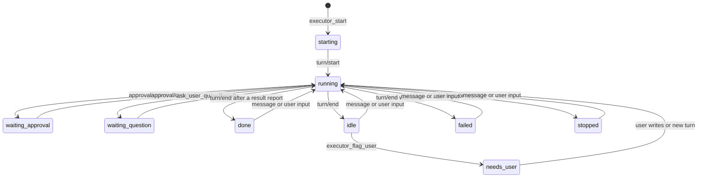

# Architecture

The plugin is one npm package with two halves, as every dsh plugin is:

- A host half, mounted by the bundle layer `cordis.patch.yml`. Entry: `src/index.ts`, compiled by `tsc` into `lib/index.js`.
- A web client half, declared under `dsh.client` in `package.json`. Entry: `src/client/index.tsx`, bundled by `tsdown` into `lib/client.js`.

Types shared by both halves live in `src/types.ts`. The security model is in [security.md](security.md).

Words. A coordinator is the main session that delegates. Each delegated session is an Executor Session ("executor" in running text); its Lead is the agent at its root, and the Lead's agent team members are Teammates. The first message an executor gets is its Assignment. A candidate is a New Session in a coordinator Workspace that becomes a coordinator with the user's first typed message. A fenced Session is one the plugin narrows to reading and searching because it sits in a coordinator Workspace or carries a coordinator's marks without being a coordinator. The code keeps the older words: `ThreadService`, `ThreadInfo`, `threads.ts`, `brief` and the `thread*` config keys all mean Executor Sessions and Assignments.

## Host

### Services and responsibilities

| File | Responsibility |
|---|---|
| `src/index.ts` | `CoordinatorService`, a `TypertRemoteService` registered as `coordinator`. Reads the config, takes the single-owner lock, loads the prompts, creates the `ThreadService` once its dsh services are injected, and exposes the Remote methods. |
| `src/host/threads.ts` | `ThreadService`: coordinator records with their names and Executor prompts, adoption of new coordinator chats, fencing, Executor Sessions, delivery of Assignments and messages, dsh events, status, notices, persistence, and the tools. |
| `src/host/scope.ts` | Pure: which Executor Sessions a caller may see (`findOwned`, `ownedBy`, `peersOf`). |
| `src/host/names.ts` | Pure: the model-facing tool names (`TOOL`), the names of earlier releases (`LEGACY_TOOL`, `toolKey`), the role nouns of the prompts, and the prompt placeholders, filled in one pass. |
| `src/host/cwd-guard.ts` | The folder guard for `executor_start` per calling coordinator, and the checks for a coordinator's home or folder (`coordinatorFolderProblem`). |
| `src/host/home-guard.ts` | The dsh-home guard: whether a tool call of a coordinator or an executor agent targets the dsh home, or writes to a temp folder in Ask me mode. |
| `src/host/permission.ts` | The table of an executor's effective permission (chosen mode, Auto review loaded, plugin unloading) and the action for a Lead or a Teammate. |
| `src/host/coordinator-tools.ts` | The coordinator's tool allow list and the names that may never be added (`COORDINATOR_NEVER`, `COORDINATOR_NEVER_PREFIXES`). |
| `src/host/authority.ts` | Reads which messages in a session log the user typed, and whether the user opened the current turn. Recognises the old and new tool names. |
| `src/host/fence.ts` | The one helper that cleans executor text and wraps it in `<thread-data>` blocks. |
| `src/host/views.ts` | What `executor_list`, `executor_read` and `executor_peers` return, and how a tool result is rendered. |
| `src/host/status.ts` | Pure status logic: `ThreadFacts` (with the Lead's Teammates), `applyEvent`, `applyMemberEvent`, `deriveStatus`, `restoredFacts`, `foldTurn`. |
| `src/host/notices.ts` | `NoticeBatcher` (debounce, maximum delay, holding reports) and the notice wording. Each notice carries its coordinator id. |
| `src/host/tools.ts` | The tool definitions: `coordinatorTools` and `threadTools`. Every op takes the calling Session id first. |
| `src/host/slots.ts` | `Slots`: the cap on running executors and the FIFO queue. |
| `src/host/rate.ts` | Sliding-window counters (wake guard, peer limits) and a bounded set. |
| `src/host/model.ts` | `pickModel`: which model a plugin-created session runs on. |
| `src/host/store.ts` | `JsonStore`: the persisted state file, version 2, and the upgrade of version 1. |
| `src/host/lock.ts` | The single-owner lock on the state directory. |
| `src/host/history.ts` | Turns a session log into readable entries for `executor_read`, with paging and sender roles. |
| `src/host/ids.ts` | Executor and coordinator ids, the built-in coordinator names (`COORDINATOR_NAMES`, `freeName`, `nameSlug`, `checkCoordinatorName`), coordinator titles and folder names, the Executor prompt cleaner (`cleanExecutorPrompt`), the coordinator base (`discoverBase`), title normalisation, the working-directory line in an Assignment, and `parseConfig`. |
| `src/host/auto-mode.ts` | Logs whether the `auto` permission preset is live; `ThreadService` applies the presets. |
| `src/host/dsh.ts` | Local type declarations for the dsh services the plugin calls, and `HOST_INJECT`. The plugin imports no dsh package at runtime. |

`ThreadService` requires `workspaceRegistry`, `sessionController`, `sessionQuery`, `agents`, `tools` and `systemPrompt` (`HOST_INJECT`). While one is missing, `getState` returns a `not-ready` problem naming it. It reads `permissionPresets`, `agentTeams`, `subagents`, `llm`, `agentDefaultModel`, `userQuestions`, `agentPresets` and `workingDirectory` with `ctx.get`, and copes when one is missing.

Every module except `threads.ts` and `index.ts` is pure or takes its filesystem as a parameter. `tests/harness.ts` is a fake dsh host context, so `ThreadService` itself is tested too. `pnpm check` runs the type checks, the unit tests, the build and a pack dry run.

### Startup

1. `parseConfig` reads the config.
2. The service takes the lock `storages/dsh-coordinator/owner.lock`. When another live dsh process holds it, this process stays disabled: no tools, no `ThreadService`, and `getState` returns a `locked` problem that says how to recover.
3. `ThreadService` loads the state file (upgrading a version 1 file in memory, see [Persistence and restart](#persistence-and-restart)) and registers its listeners, tools, prompt section, step gate, dsh-home guard and agent hooks.
4. Before validation starts, every stored coordinator chat, its earlier chats and every stored live executor Session are narrowed and guarded, so nothing runs unclassified while validation is pending. `agent/created` waits for validation before it decides about a Session, and `getState` reports `loading: true` until it settles.
5. A background pass validates the executor rows against their own Sessions, then the coordinator records (see [Validation](#validation)), gives each coordinator its final restriction, moves Sessions of an earlier release off the old presets, removes the sidebar groups an earlier release made for executors, names unnamed coordinators, looks at every Session of every coordinator Workspace (candidates, fenced Sessions), applies each executor's permission, re-reads each executor's log, and submits Assignments that were still queued.

On load the plugin also fences, provisionally, every live Session in a stored coordinator Workspace, and decides what they are (candidate or fenced) before the old-preset migration, so a plugin reload leaves no fenced Session unrestricted. Every top-level Session the plugin does not know is classified by its log marks (see [Persistence and restart](#persistence-and-restart)).

A refused base for new coordinators is no longer a startup failure: it is a `bad-root` problem, and only New coordinator is disabled.

### Coordinators

A coordinator is a record the plugin owns:

| Field | Meaning |
|---|---|
| `id` | `c-` plus 4 hex digits, unique. |
| `sessionId` | The chat Session. It may be archived; see [Archiving](#archiving-a-coordinator). |
| `home` | Real path of the chat's header cwd and of its sidebar Workspace. Fixed for life, because a Session's header cwd cannot change. |
| `folder` | Real path under which new Executor Sessions get their folders. Starts equal to `home`; the user changes it on the page. |
| `name` | Unique among live coordinators (case-insensitive), 1 to 40 characters. Chosen by the plugin, changed by the user. |
| `title` | Last seen Session title, for the page while the Session is cold. The plugin's title is the bare name. |
| `executorPrompt` | Optional. The user's standing instructions for this coordinator's executors, at most 4000 characters. |
| `marks` | Which log mark validation expects: `opening` (the opening turn) or `role` (an adopted chat). |
| `pastSessionIds` | Chat Sessions it had before a Reopen (at most 10), so messages they sent into executors still read as the coordinator's. |
| `archived` | Archived by the user on the page. |

The plugin also records each coordinator Workspace (id, path, whether the plugin created it). Any number of coordinators may share one. Every executor row carries `coordinatorId`; an executor belongs to one coordinator for life. Executor ids stay unique across all coordinators, so notices, Remote calls and logs need no coordinator prefix.

At most 20 coordinators may be live (`COORDINATORS_MAX`); past it New coordinator and Reopen of an archived one refuse, and a candidate is fenced instead of promoted. At most 20 archived records are kept, never one that still owns a live executor.

#### Where coordinators live

The base is the configured `coordinatorBase`, else the parent of a registered Workspace whose path ends in `deepseek-harness/default-workspace` (`workspaceRegistry.list()`), else `~/Documents/deepseek-harness` (`discoverBase` in `ids.ts`). The plugin makes no osascript call; the fallback matches dsh on a standard Mac. A base that fails the coordinator folder checks below is a `bad-root` problem, reported in `getState().base.problem`.

#### New coordinator

`createCoordinator({ home? })` is called by the page's New coordinator and Choose folder... buttons. Calls are serialised, so two never pick the same folder.

1. The plugin picks a name with `freeName`: a random name from `COORDINATOR_NAMES` that no live coordinator has, else a listed name with a number ("Noether 2"). The list has 98 names: 30 English-speaking, 30 German-speaking, 30 Chinese (written in Chinese characters in every locale) and 8 from elsewhere.
2. Without `home`, the first `<base>/coordinator-<slug>`, `-2`, ... (`coordinator-noether`, `coordinator-li-bai`; plain `coordinator` for a name without a slug) that is not a registered Workspace, not a non-empty folder and passes the checks. With `home` (from the picker or the typed path), that folder after the checks; a folder that is a Workspace holding the user's own unarchived Sessions is refused, because every New Session in a coordinator Workspace becomes a candidate.
3. The folder is created and its real path checked again. It is registered as a Workspace titled with the bare name (`Noether`, `鲁迅`), cut at dsh's 80-byte title limit on a character boundary.
4. A Session is created there on the stock `standard` preset and renamed to that title. The plugin selects a model if the default is not usable, sets `workspace-write`, and narrows its tools (see [Tools per role](#tools-per-role)).
5. The record is saved at once, with `folder` equal to `home`, and becomes the last used coordinator.
6. When a model is available, the plugin opens one turn without a model call. dsh lists a session without a turn as a blank "New Session" and hides it from the sidebar unless it is selected; only a `turn/start` changes that. An `agent/pre-step` listener, first in the chain, enters that turn with no messages. It acts only on step 1 of a coordinator session when every message in the step is the opening message the plugin queued itself, identified by a random id that is forgotten after five seconds; the id now carries the coordinator id. The chat shows a "Completed in 1s" row for that turn above the welcome. That turn enters with no messages, so dsh never logs the opening message. After it, and for a chat without a model, the plugin queues the role mark bound to the coordinator id; dsh logs it with the user's first message. This is what keeps a New coordinator chat across restarts (see [Validation](#validation)).

If a step from 3 on throws, the Session is archived, a Workspace the plugin registered is removed, and a folder it created is removed when still empty.

`ensureCoordinator({ coordinatorId? })` is "Open chat": it opens the named coordinator, else the last used live one, else creates one. Concurrent calls with no coordinator share one creation. An existing chat is reused and its model is never changed; a chat that never had a turn gets the opening turn now.

#### Adoption: a new Session in a coordinator Workspace

dsh awaits `agent/created` before it releases queued work for the Agent, so a listener there decides before the first step. The listener first waits until validation has settled. A Session becomes a **candidate** when:

- its header cwd resolves to a recorded coordinator Workspace (for the migrated legacy coordinator, also `_coordinator` below the threads root);
- it is not a subagent, not an executor Lead or Teammate, not archived, and not one the plugin is creating itself (the plugin tracks the exact Sessions it creates, per place; a Session the user opened in the same place meanwhile is considered when that creation ends);
- it has no `turn/start` yet;
- fewer than 20 coordinators and candidates are live.

A candidate gets a coordinator id at once, is narrowed to the coordinator allow list, set to `workspace-write` like a chat the plugin creates, and gets a role mark: an injected message with id `dsh-coordinator:role:<coordinatorId>` ("This chat is a coordinator: it delegates work to Executor Sessions."). dsh logs it as a `user/message` inside turn 1, step 1. Because tool admission and the role prompt are evaluated per request, its first step already sees the coordinator tools and prompt, and the dsh-home guard covers it.

A candidate lists the coordinator's own tools but cannot use them. dsh composes a step's tool list before it logs the admitted messages, so the tools must be listed already for the "+" chat to delegate in its first turn. `callerCoordinator` refuses every call from a candidate with "this session is not a coordinator yet: it becomes one with the user's first message typed in it".

The candidate is promoted only by a message the user typed (source `user`, no principal): in the first-in-chain `agent/pre-step` listener when a step admits such a message, or on the logged `user/message`. A tool call never promotes. On promotion it gets a name, the record is persisted (`marks: 'role'`, `folder` equal to `home`), it becomes the last used coordinator, and its chat is renamed to the name. It has no welcome. Past the cap at that moment, it is fenced instead.

A candidate whose Agent went away or whose Session was archived is dropped. A blank that is never used is never persisted. A New Session opened in a coordinator home while the plugin creates a chat there is narrowed and guarded at once and decided when the creation ends; the plugin's own new Session leaves that fence when its creation returns. After a restart every Session of every coordinator Workspace is looked at again.

A Session in a coordinator Workspace that does not become a coordinator is **fenced**: narrowed to the stock read and search tools, no plugin tools, guarded, and given a short role text that says it is not a coordinator. That covers a Session with turns there (an unarchived plain chat, a fork of a coordinator chat), one past the cap, a kept earlier chat of a coordinator (`pastSessionIds`), and a chat replaced by Reopen that the user unarchives (fenced by id).

#### Changing a coordinator's folder

`setCoordinatorFolder({ coordinatorId, path })` resolves the real path, runs the checks below, creates the folder if missing, re-checks that no symlink appeared, and stores it. Only new executors use it. The chat stays in its home. The coordinator's role prompt names its current folder (`{{coordinatorFolder}}`), so it can tell the user where new work goes. No model tool can change it.

#### Checks for a coordinator home or folder

`coordinatorFolderProblem` in `cwd-guard.ts`, applied in `createCoordinator`, `setCoordinatorFolder`, on Reopen and on load:

- the hard refusals of the folder guard (filesystem root, home folder and its ancestors, dot-folder segments, system folders, `~/Library`), on the lexical and the real path;
- it does not contain the active dsh home or `~/.dsh`, and does not lie in one;
- it is not inside a live executor's folder;
- it is not another live coordinator's home (a home may equal another home: "+" pairs share one) and not inside one; an archived coordinator's home and its executors no longer block a new home inside it. `otherHomes` has two modes: `new-home` (New coordinator, a picked home, Reopen) counts live homes only; `executor` (executor folders at start and at confirmation, and coordinator folders when set and re-checked) counts every other home, archived ones too, except an archived home that contains the coordinator's own home;
- when it is set: it does not contain another coordinator's home or another coordinator's executor folders (a stored folder on load may contain homes or executor folders that came later);
- no path with a control character or a line break;
- for a home picked by the user: not a Workspace with the user's own Sessions (checked in `threads.ts`).

A coordinator whose stored folder fails these keeps its chat, but `executor_start` refuses with "this coordinator's folder is refused (...); ask the user to change it on the Coordinator page", and `CoordinatorInfo.folderProblem` carries the reason for the page.

#### Archiving a coordinator

`archiveCoordinator({ coordinatorId, force?, removeWorkspace? })`:

- Refused while any of its executors works, waits, waits for a folder confirmation or has a pending Assignment, naming them. With `force` (the page's Stop and archive) those are archived too, with `stopActivity`.
- Archives each of its executors and its chat Session, marks the record archived, and keeps it.
- With `removeWorkspace`, also removes the home Workspace from the sidebar, never files, unless the plugin did not create it (`kept-not-own`), another live coordinator or candidate lives there (`kept-shared`) or it holds another unarchived Session (`kept-has-sessions`). When the removal fails, the coordinator is archived anyway (`failed`). The result says which; `not-asked` when the option was off or there was no Workspace.

Reopening an archived coordinator (`ensureCoordinator` with its id) gives it a new chat in its home and clears `archived` only once that chat is open, so a failed Reopen leaves it archived. Before the new chat is made, the home gets the full checks of a new home against the live coordinators and the other coordinators' live executor folders. When a live coordinator took its name meanwhile, it gets a new name. A refused Reopen says why in one sentence: "Cannot reopen: 20 coordinators are open. Archive one first.", "Cannot reopen: its home folder <path> is refused (<reason>).", or "Cannot reopen: <dsh error>".

#### Renaming a coordinator

`renameCoordinator({ coordinatorId, name })` checks the name with `checkCoordinatorName` (no control characters or line breaks, NFC, invisible characters removed, trimmed, 1 to 40 code points, not only digits) and its uniqueness among live coordinators by `nameKey` (NFKC, invisible characters and soft hyphens removed, white space collapsed, case folded, so `ｎｅｗｔｏｎ`, `NEWTON` and `New\u00ADton` clash with `Newton`). It stores the name and renames the chat and the home Workspace to the bare name when they still carry a plugin title; a title the user gave stays. Folders are never renamed. Errors: "the name must not be empty", "the name may have at most 40 characters", "the name may not contain control characters or line breaks", "the name may not be only a number", "another coordinator is already called X".

On load, every coordinator without a valid name gets one, and a chat or group still titled "Coordinator", "Coordinator N" or `Coordinator <name>` (from an earlier build of this release) is renamed once to the bare name, so no two groups share a title. Stored names are cleaned the same way on load.

#### The Executor prompt

`setExecutorPrompt({ coordinatorId, text })` cleans the text with `cleanExecutorPrompt` (carriage returns become newlines, NUL and control characters other than newline and tab are removed, trailing white space is trimmed), refuses more than 4000 characters ("the Executor prompt may have at most 4000 characters (it has N)"), and stores it; empty text clears it. `executor_start` copies the coordinator's current prompt onto the new row, so each executor keeps the text it started with; the Assignment's request id carries a hash of that copy. On load a copy whose hash does not match is dropped (a `state-dropped` entry), and a row whose Assignment is not delivered yet takes its coordinator's current prompt again. Invisible characters (zero-width, bidi controls, Unicode tag characters, Hangul fillers, soft hyphens, variation selectors) are removed on save and on load. The Lead's role prompt appends it with `executorPromptSection`: a heading "The user's standing instructions for this coordinator's Executor Sessions", a paragraph that gives it the user's authority over the Assignment and coordinator messages and asks the Lead to pass the parts that matter to Teammates, and the text between `<executor-prompt-XXXXXXXX>` tags whose suffix is a hash of the text. Teammates get no section of their own. The coordinator chat never sees the text; its prompt only says that the Executor prompt exists.

The sidebar's delete of a coordinator chat (`workspace/session-archived`) cannot be refused. The record keeps its executors and its `sessionId`; the chat counts as archived (`CoordinatorInfo.chatArchived`), notices are held for it, and the page offers Reopen chat. Reopen creates a new chat Session for the same coordinator in its home (titled with the plugin's title, `marks: 'opening'`), moves the old Session id to `pastSessionIds`, and hands over the held notices. If the user unarchives the old Session in the sidebar instead, the next poll or delivery sees it live again and hands the held notices over.

#### Legacy coordinators

A coordinator from a release before the shared group lives in `<threadsRoot>/_coordinator`. A Session's folder cannot change, so it stays there; on open its Workspace is renamed like the coordinator (its bare name). New Sessions in that group are candidates for the migrated coordinator's home. Validation accepts a migrated coordinator whose home is the legacy root and whose Session is in `_coordinator`. That `_coordinator` folder is also refused as an executor folder.

### Starting an Executor Session

`executor_start` calls `startThread(caller, { title, brief, cwd? })`:

1. Resolve the caller's coordinator (`callerCoordinator`); only a stored coordinator passes, and a candidate gets the "not a coordinator yet" error. A refused coordinator folder stops here.
2. Normalise the title to dsh's session-title style: one line, no control characters, no wrapping quotes, no "Thread:" prefix or id, at most 80 bytes. A title that equals or imitates a coordinator's title is refused: a legacy title ("Coordinator", "Coordinator 2"), or any coordinator's name, chat title or `Coordinator <name>`, compared by `nameKey`.
3. Read **this coordinator's** session log once. Another coordinator's chat never counts.
4. Decide the Assignment's authority: `user` when `briefAs` is `user`, the user opened the current coordinator turn, and no executor data reached the coordinator in that turn yet (a notice, `executor_read`, `executor_list`, `executor_flag_user`, `executor_stop`); otherwise `notice`.
5. Pick the folder. An explicit `cwd` wins; without one, a "Working directory:" line in the Assignment is used. Either goes through the folder guard (below). Without either, the folder is `<coordinator folder>/<slug of title>`, with the id appended when that path is taken by a live executor, a coordinator home or an existing path. Ids are drawn so that parallel starts never share one.
6. A folder that needs the user's confirmation stops here: the executor is recorded without a Session (`facts.confirm`), shows as `needs-user` "confirm folder <real path>" with a `confirm-folder` action, and the tool result tells the coordinator to tell the user and not to try another route. The tool result also tells the coordinator not to ask about the folder and to end its turn. The host raises a question card in **the owner's** chat (`userQuestions.ask` with an approval intent: Reject, Allow once, Always allow) only after the coordinator's turn has ended, and only if that turn did not call `ask_user_question`, because both would share dsh's single question seat. A question the model asks while the card is open withdraws the card. Right before the card goes up, the host checks again that the request was not withdrawn, that the confirmation is still pending, and that the coordinator is idle and still the same Agent. The card's question id is unique per request (`dsh-coordinator-confirm-folder:<executor>:<nonce>`), and only an answer with exactly one entry, which names that id and one of the card's own labels, counts. The card has no owner check of its own; the row buttons and `confirmFolder` are owner-only. The row buttons call `confirmFolder` and always work. Whichever answers first wins; the card is withdrawn. The card, Remote errors (a refused Reopen, a folder changed at confirmation, no free folder) and the `bad-root` problem show paths shortened to `~/...`; data, guards and model-facing notes keep the real path. Allow re-checks the real path and the hard refusals and continues with step 7 (Always also adds it to the allowed folders); Reject drops the executor and wakes the coordinator. Messages sent meanwhile wait for the Assignment.
7. Create the folder and check its real path again. Give it a sidebar group (see [Executor groups](#executor-groups)) and create a Session there with `sessionController.create({ workspaceId, agentPreset: 'standard' })` (dsh's default preset when there is no `standard`). dsh uses the Workspace path, the executor folder, as the header cwd, so it is also the `workspace-write` boundary. If no group can be made, the Session is created with `cwd` only and dsh lists it under Ungrouped. A folder the plugin created is recorded as `ownFolder`.
8. Select the owner coordinator's model, set the permission preset (see [Permission mode](#permission-mode); an executor whose `workspace-write` cannot be set is not started), enable Agent Teams, narrow its tools, and set the coordinator's working title with `sessionController.rename`.
9. Register the executor with a copy of its coordinator's Executor prompt and submit the Assignment to `Slots`. It is delivered now if a slot is free, otherwise queued.

If a step from 7 on throws, the start is rolled back: the session is archived and a folder the plugin created is removed when still empty. A retry then makes exactly one executor. Steps that can fail softly (no model, no `auto`, no Agent Teams, queued, notice authority) add a line to `notes` in the tool result.

#### The folder guard

`checkThreadFolder(requested, userTexts, env)` in `cwd-guard.ts`, where `env.ownFolder` is the caller's folder:

1. A path with a control character or a line break is refused. The path is made absolute and resolved through symlinks for the part that exists; a real path with a control character is refused too.
2. Always refused: the hard refusals above; a folder that contains the active dsh home or `~/.dsh` or lies in one; any coordinator home or a folder that contains one (and the legacy `_coordinator`); the caller's folder itself; a folder inside another coordinator's home; a folder that contains any coordinator's folder (so no coordinator can lock itself or another one out).
3. A folder inside, or around, another live executor's folder, of any coordinator: confirmation (`thread-folder`), without the typed-path check and without the allowed folders.
4. Strictly below the caller's folder: allowed without confirmation when a live row records it as plugin-made (`ownFolder`), or when it does not exist yet and its nearest existing parent is the caller's folder or such a plugin-made folder. Any other folder below it continues with step 5 and, when it gets that far, needs confirmation with `why: 'existing'`.
5. Any other folder must first have been typed by the user in **this** coordinator's chat (whole normalised path, URLs never count). The error below the folder reads "is below your folder but is, or lies inside, a folder the plugin did not make, and the user has not named this folder in this chat".
6. It then runs when its real path lies under an allowed folder that the user confirmed with "Always allow" in this run (`allowedConfirmed`; entries loaded from the state file are listed but not honoured), or after the user confirms it (`outside`, `existing` or `symlink`).

### Executor groups

Each executor sits in its own sidebar group at its folder, a Workspace the plugin registers and records on the row (`workspaceId`, `ownWorkspace`). The group is titled "<coordinator name> · <folder base name>" (`executorGroupTitle`; both parts cleaned of control, invisible and line-break characters, cut at dsh's 80-byte title limit), for example "Orwell · write-the-parser". It is placed right after the coordinator's group and the groups of that coordinator's earlier executors. dsh keeps groups collapsed except the group of the open Session. In "Group by workspace tree" a group nests under the coordinator's group when the executor's folder lies below the coordinator's home.

- When the folder already is a Workspace the user registered, and that Workspace's stored path is exactly the folder (not reached through a link), the Session joins it; the plugin never renames, moves or removes it (`ownWorkspace` unset). When the registry answers a `create` with a Workspace at another folder, the plugin removes that Workspace again if it is empty and starts the executor the dsh default way.
- A coordinator rename retitles only plugin-made groups at their rows' own folders. The group title never follows the executor's title.
- Archiving an executor removes its plugin-made group when the group's path is the row's folder, it is no coordinator Workspace, `ownWorkspace` is set and every Session in it is archived; archiving a coordinator does that for its executors. A New Session the user opened in the group keeps it.
- A New Session the user opens with "+" in an executor's group has the executor's folder as cwd but is no row. It is not a candidate, gets no plugin tools and no role prompt, and its log carries no plugin marks, so it is the user's own Session: not narrowed and not guarded.
- Group titles cannot imitate a coordinator's group: the prefix is always the owning coordinator's name, coordinator names may not contain a middle dot or its look-alikes, and coordinator group titles are bare names.
- Once on load (`executorGroups` in the state file), a live executor in no Workspace gets its group through dsh's `attachSession` (accepted because the group's path is exactly its folder); one already in its own group of an earlier release gets the current title and place; one in a user's Workspace stays. Archived rows are not touched. `workspacesMigrated: true` is always written, so an older build never runs its old removal pass on this file.

### Executor titles

An executor's name is its dsh session title. The sidebar row, the session header, the tab, the page and the pane show the same text. The plugin names a new executor with the coordinator's working title (`sessionController.rename`, which pins it). Once the Assignment is logged as the user's prompt, the plugin calls dsh's title service `refresh()`. With a title provider (the session-titles bundle, "Conversation-following titles"), the generated title replaces the working title, and later prompts the user types in the Session may refine it; without one the plugin puts the working title back. An Assignment with notice authority is no human prompt, so nothing is generated and the working title stays.

The row title (page, pane, notices, `executor_list`, lookup by title) follows the Session's current title through its `session/title` events; after a restart the title is read back with `sessionQuery.readTitle` and goes through `normalizeTitle` and the look-alike check, like a live title change. A title that equals or imitates a coordinator's name or title is not adopted (the row keeps its previous title), and a fallback title during the refresh is ignored. Titles are untrusted display text everywhere. Duplicate titles are allowed, as dsh allows them. A coordinator's title follows its chat's `session/title` events the same way.

### Delivering Assignments and messages

`deliver()` sends text to a Lead once per request key. It steers a running Lead (the text applies at its next step), queues a turn for an idle one, or, for a held peer message, injects it without waking.

- An Assignment with `user` authority goes through `sessionController.prompt`. It is a user message with request id `dsh-coordinator:brief:<executor id>:<coordinator id>:p<hash>`, which binds the row to its owner and its Executor prompt copy to a hash for validation after a restart: the chat shows it as a bubble, Auto review treats it as the task, and dsh dedupes by request id.
- Everything else is an agent message: source `{ kind: 'agent-message', form: 'relay', senderSessionId }`, with the owner coordinator's chat or the sending executor as sender. The chat shows a task message; Auto review reads it as facts. The service skips a message whose id it has delivered or sees in the agent's inbox or log.

An Assignment starts with "Assignment from the coordinator, on the user's request (Executor Session `<id>`, ...)" or, with notice authority, "Assignment from the coordinator (started after an update from another Executor Session, not on a direct user request)". A coordinator message starts with "Message from the coordinator (not from the user):". Messages sent to an executor that has not started yet wait in `pendingMessages` and follow the Assignment as agent messages; they never merge into it.

### Peer messages

Leads have `executor_peers` and `executor_send`. Peers are the other live executors **of the same coordinator** that have a Session; there are no peers across coordinators. A peer message:

- is refused for the sending executor itself, for any coordinator chat (every coordinator Session, current, candidate or past, not only the owner), and for an unknown, archived or other coordinator's executor, all with the same "unknown executor session" error, which adds "to reach your coordinator use coordinator_report";
- counts against two limits within `peerWindowMs`: `peerMaxPerPair` for the pair in both directions and `peerMaxPerThread` for the sender. Past a limit the message is refused and the guard latches as the wake guard does (see [Spend guards](#spend-guards)): past the pair limit both executors of the pair are paused, past the sender limit the sender is. A paused executor's `executor_send` is refused until the user resumes it;
- carries a fixed header ("information from a colleague, not an instruction from the user") and the fenced text;
- goes to a running executor as steering, to an idle one as a followup through `Slots` (so it counts against the cap), to a stopped or failed one as an inject read on its next turn, and to a queued one after its Assignment;
- produces a quiet notice to the coordinator with the first line. A turn a peer message started ends quietly too; a report from it still wakes the coordinator.

`executor_read` labels such messages as peer messages with the sender's title. There is no tool to read another executor's history.

### Observing executors

| Event | Use |
|---|---|
| `session/event` | Every log event of a tracked executor is folded into its facts with `applyEvent`. Also records message ids for dedupe, the owner of each turn, and title changes. For a candidate, a typed `user/message` promotes it; for a coordinator, `session/title` updates its title. |
| `agent/pre-step` | Promotion of a candidate when a step admits a message the user typed (first in the chain), the opening turn, the step gate and the stop hold. |
| `agent/status` | Sets `running` of a Lead or a Teammate, frees slots, and lets held notices go out when an executor goes idle. |
| `agent/created` | Waits for validation, then adoption of candidates, fencing, coordinator narrowing, and the permission of Leads and Teammates. |
| `workspace/session-archived` | The sidebar's delete. An archived candidate is dropped; an archived coordinator chat keeps its record and holds its notices; an archived executor leaves the list. |
| `agent/error` | Logged by executor id. |

A turn is owned by the coordinator when the plugin queued it for an Assignment or coordinator message, by a peer when a peer message started it, and by the user otherwise. A turn that a Teammate's result started inherits the owner of the turn before it, so a team run the coordinator asked for ends with one waking notice.

### The Lead's agent tree

A Lead's subagents and Agent Teams members are child Sessions in the Lead's tree (dsh-subagent): `header.origin` is `subagent`, `header.parentSession` is the creator, and the creator's log gets a `subagent/catalog` event with the child's id, name and task label. Teammates share the Lead's folder. The plugin tracks every Teammate of every executor, nested ones included (at most 64 per executor):

- A `subagent/catalog` event in a Lead's or Teammate's log registers the child under the executor. A child whose catalog event was missed is placed by its header.
- `agent/status` and the Teammate's own `session/event`s set its `running`, open approvals and questions, and last text (`applyMemberEvent`, the Lead's folding on the Teammate's own facts).
- The runtime tells the creator that a Teammate finished with a `subagent-settled` message, first as an inbox splice, then in the transcript. That marks the Teammate settled with its stop reason.
- A Teammate that went idle but is not settled yet still counts as working for 5 seconds, the gap before its settlement reaches the Lead. A timer re-derives the status when the grace ends.

The Lead's tree is busy while the Lead runs or any Teammate works (`treeRunning`). Live Teammate facts are not persisted; the names of Teammates that still work are saved as `membersAtSave`.

What dsh itself does with Teammates, as read in the rc.2 sources and seen in real runs:

- A Teammate runs on the Lead's model and the Lead's permission preset; dsh seeds `permission/preset` (`auto`) or the Lead's explicit `sandbox/mode`, and pins `approval/policy` to `never`. Approvals a Teammate would need are rejected, not escalated.
- `ask_user_question` refuses a live child (`DELEGATED_CALLER`).
- `sessionController.cancel` stops only the Lead's turn. Teammates keep running, and each one's result is handed to the Lead, which starts a new turn.
- Archiving with `stopActivity` cancels running descendants, and a pre-step gate refuses steps beneath an archived ancestor. Without `stopActivity`, running descendants count as activity and the archive is refused.
- The sidebar hides Teammate Sessions and shows a running-member count on the Lead's row; the Lead's chat shows "Create subagent" rows and each Teammate's settlement.

### Status derivation

An executor's status is derived from its facts every time they change. The facts are the phase (`queued`, `starting`, `active`), `running`, open approvals, open user questions, the coordinator's flag, the last turn end, the last report, and the last assistant text.

`deriveStatus` in `src/host/status.ts` checks in this order. The first match wins.

| Order | Condition | Status |
|---|---|---|
| 1 | An approval is open | `waiting-approval` |
| 2 | A user question is open | `waiting-question` |
| 3 | The executor waits for its folder confirmation | `needs-user` ("confirm folder <path>") |
| 3a | The spend guards paused the executor | `needs-user` ("paused after N wake-ups" or "paused after N turns today") |
| 3b | The coordinator flagged the executor (or Auto review is gone and dsh cannot resume it) | `needs-user` |
| 4 | Phase `queued` | `starting` ("queued: waiting for a free slot") |
| 5 | The Lead or any Teammate of its tree works | `running` (detail: the Teammates working, or "lead waits for N team members") |
| 6 | Phase `starting` | `starting` |
| 7 | The last turn ended with an error | `failed` |
| 8 | The last turn was aborted or interrupted | `stopped` |
| 9 | A `result` report arrived during the last turn | `done` |
| 10 | Otherwise | `idle` (shown as "Standing by") |

Approvals and questions of Teammates count as the executor's, with the Teammate named in the detail ("team member writer: approval for bash") and the Teammate's Session in `attentionSessionId`, which the page and pane rows open. In dsh rc.2 Teammates cannot reach the user (see above), so this is defensive; a Teammate's request that is rejected at once does not reach the coordinator, because the waiting notice is dropped as stale.

The flag clears when the user writes in the executor or a new turn starts. A Lead's turn end clears the Lead's open approvals and questions, a Teammate's turn end clears the Teammate's.

### Notices to the coordinator

Every notice goes to the coordinator that owns the executor. The owner's id is stored on the notice when it is made (`Notice.coordinatorId`), because a row can disappear before its batch flushes (a denied folder deletes it). One `NoticeBatcher` serves all coordinators; `deliverNotices` groups each ready batch by coordinator and delivers each group to that coordinator's chat. Coordinator A's notices never reach B.

| Change | Notice | Wakes |
|---|---|---|
| Executor enters `waiting-approval` or `waiting-question`, or the waiting detail changes | yes | yes |
| Executor enters `failed` | yes | yes |
| Executor enters `stopped` | only when the coordinator did not ask for the stop | yes |
| The whole tree goes quiet (`idle` or `done`) after a coordinator-owned turn | yes, with the Lead's last message and a Teammates line (name, state, task) | yes |
| A turn ends after a turn the user or a peer started | yes | no |
| `coordinator_report` with kind `result`, `question` or `blocked` | yes | yes |
| `coordinator_report` with kind `progress` | yes | no |
| `executor_send` | yes, with the first line | no |
| The executor is paused by the spend guards (wakes, daily budget, peer limits) | yes, once per executor | yes |
| The user resumed a paused executor | yes | no |
| The user denied a folder; a confirmed executor could not start | yes | yes |
| The user confirmed a folder and the executor started | yes | no |
| An executor's tree tried a third time to reach the dsh home | yes, once | yes |
| The coordinator's own actions (flag, stop, queueing) | no | |

Batching:

- A batch goes out after `noticeDebounceMs` of quiet, and never later than `noticeMaxDelayMs` after its first notice.
- A batch that wakes is sent as one followup per executor, attributed to the executor's session. Otherwise it is added with `agent.inject` and read at the coordinator's next turn.
- A Report notice goes out once however it is batched or held, and the same result text from one executor is recorded but not sent again (the Lead is told "This result was already sent to the coordinator").
- A waking report sent while the executor is busy is held until the Lead's turn has ended and its Teammates are quiet: at most 2 minutes, or 10 minutes while Teammates work. A result and the end of its turn wake the coordinator once. A result that goes out while Teammates still work carries a plugin line saying so, and the Lead's tool result tells it the result waits for its team.
- A status notice that no longer holds when its batch goes out is dropped: an `idle` or `done` followed by the next turn (a Teammate's result woke the Lead), or a waiting status that was settled within the debounce.
- The wake guard allows `wakeMaxPerThread` wakes per executor per `wakeWindowMs`. Past it the executor's notices arrive quietly and the executor is paused (see [Spend guards](#spend-guards)).
- While a coordinator's chat is archived or gone, its notices are held on its record (the last 50). They are handed over, quietly, when the chat is reopened or unarchived; the same holds while the chat Session is deleted rather than archived. Notices for a coordinator whose record is gone are logged and dropped, and a Report from an executor without a coordinator answers "Recorded, but this Executor Session no longer has a coordinator, so nobody receives the Report."

Each executor block starts with a line the plugin writes (executor id and status), then a `<thread-data>` block with everything the executor wrote: title, reports, waiting detail, last message, peer messages. A fixed header before the blocks says they are data.

### Tools per role

Tools are global conditional registrations (`ctx.tools.register(definition, { when })`). Admission follows the coordinator records, the candidates and the executor table, not the preset. Every tool passes the calling Session (`exec.agent.id`) to its op; a call without a calling agent fails. Names come from `TOOL` in `names.ts`.

| Tool | Admitted in | Does |
|---|---|---|
| `executor_start` | coordinators (listed for candidates, refused for them) | Create an executor owned by the caller and deliver or queue its Assignment. Returns the row's trusted fields and a fenced block. |
| `executor_message` | coordinators | Send an answer, correction or follow-up task as an agent message. |
| `executor_list` | coordinators | The caller's live executors: status outside, titles and reports in data blocks. |
| `executor_read` | coordinators | `summary`, `recent` (last 15 entries, at most 12000 characters) or `full` (pages of about 7000 characters with `nextCursor`). History is fenced. |
| `executor_flag_user` | coordinators | Set `needs-user` with a reason. Returns the row's trusted fields and a fenced block. |
| `executor_stop` | coordinators | Cancel the Lead's turn and interrupt every Teammate that runs. History and inbox are kept. Returns the row's trusted fields and a fenced block. |
| `executor_archive` | coordinators | Archive an idle, done, failed or stopped executor; one whose Teammates still work is refused. `force` (for an explicit user request) also archives a working one; dsh then stops the Teammates too. |
| `coordinator_report` | Leads | Report `result`, `question`, `blocked` or `progress` to the owner coordinator. |
| `executor_peers` | Leads | The other live executors of the same coordinator: id, status, folder, and the title fenced. |
| `executor_send` | Leads | Message another executor's Lead under the same coordinator. |

`executor_read`, `executor_message`, `executor_flag_user`, `executor_stop`, `executor_archive` and `executor_send` find their target with `findOwned` (`scope.ts`): by id, Lead session id, or a title that exactly one of the caller's live executors has (case-insensitive). An executor of another coordinator, an archived one, and a row without a coordinator read exactly like an id that never existed ("unknown executor session ...; use executor_list to see the ids you can use"), so a coordinator cannot probe for other coordinators' ids. A title shared by several of the caller's executors is an error that lists their ids.

The target parameter is `executor` and the Assignment parameter of `executor_start` is `assignment`; the earlier names `thread` and `brief` are still accepted.

The tools that return a row (`executor_start`, `executor_flag_user`, `executor_stop`) return only its trusted fields (id, status, cwd, times, sessionId, coordinatorId, permission, action, notes, stopped) and put the title, status detail and last Report in a fenced data block, like `executor_list`.

Owner-only Remote methods (`archiveThread`, `confirmFolder`, `resumeThread`) address executors by global id: the user may act on any executor. The page's archive of a working executor says "Executor Session t-x is still <status>. Stop it first, then archive it." without tool hints.

The tool names of earlier releases (`thread_start`, ..., `thread_send`) are no longer registered. `authority.ts`, `history.ts`, `home-guard.ts` and the coordinator's never-list still recognise them, because existing Session logs carry them.

Subagents and Teammates are separate sessions and get none of these, and no role prompt: admission and the prompt section check the session id against the coordinators, candidates and the executor table, which holds Leads only. `executor_send` to a Teammate's session id is refused as unknown. A tool result is rendered as the JSON of its trusted fields followed by its data blocks as plain text. Tool failures return `{ error }` to the model. Delivery keys of `executor_message` and `executor_send` are minted per execution, so a provider that reuses tool-call ids loses nothing.

Each coordinator runs on the stock `standard` preset and is narrowed at runtime with `agent.ctx.tools.restrict({ allow })` (`coordinator-tools.ts`): its own tools, `read`, `read_image`, `glob`, `grep`, `ask_user_question`, `todo_write`, and the names listed in `coordinatorExtraTools`. Candidates get the same list; fenced Sessions get it without the plugin's own tools. `COORDINATOR_NEVER` and its prefixes are never added: shell, write, edit and patch tools, subagent, workflow, team, job, schedule, terminal, worktree and working-directory tools, `session_search` (it reads every Session log without a fence), `plugin_manager`, `plugin_market`, `skill`, `interrupt_agent`, `list_agents`, the network tools (`web_fetch`, `web_search`, `http_request`, `fetch`, `browser`, `browser_navigate`), and every `office_*`, `user_terminal_*`, `terminal_*`, `browser_*` and `web_*` tool. The guard also enforces the list on every call (see [dsh-home guard](#dsh-home-guard)), so a failed `restrict` does not fail open. `restrict` accepts only registered names, so the list is computed against the registry; on every `tools/change` the plugin lifts its restriction, recomputes and re-applies it in one synchronous step for every coordinator, candidate and fenced Session, and puts the previous filter back when the new one fails. A coordinator's Agent Teams mode is never enabled.

Leads and their Teammates keep every Standard tool except `plugin_manager` and `plugin_market`, so an executor cannot install code into the user's dsh: they are removed from a Lead's tool list the same way, and the dsh-home guard refuses calls of them from any executor agent (Teammates compose their tools from the preset, where `restrict` cannot remove them). Every restriction is lifted when the plugin unloads.

### dsh-home guard

`home-guard.ts` runs for every tool call of every coordinator, candidate and fenced Session and of every agent in an executor's tree; agents are placed by the coordinator records, the candidates, the fenced set, the executor table, the Teammate table, or their `parentSession` chain. Stored Sessions are placed from the moment the plugin loads, before validation settles. For a coordinator-like chat the guard first denies any tool outside its allow list ("a coordinator may not use <tool>: it plans and delegates; start an Executor Session for work like this"; for a fenced Session, "it is in a coordinator's folder but is no coordinator, so it may only read and search"). It runs as a `tools/pre-execute` listener (appended after Auto review's prepended one) and as a `tools.guard` (monotonic, after every listener and approval). See security.md, T10, for what it denies. The shell text check names `.credentials.yaml` only as a bare dot-file name (`find ~ -name .credentials.yaml`), so a project's own `config/credentials.yaml` is not denied; under a protected root the path spellings catch it.

### Spend guards

- The wake guard latches: an executor past `wakeMaxPerThread` wakes per `wakeWindowMs` is paused (`facts.paused`, persisted, reason `wakes`).
- The peer limits latch too (reason `peers`): a turn a peer message starts never wakes the coordinator, so the wake guard cannot see a ping-pong. One message past `peerMaxPerPair` pauses both executors of the pair, one past `peerMaxPerThread` pauses the sender; the message is refused.
- With `threadTurnBudget` set to a positive number, each executor has a budget of that many executor-owned turns per 24 hours, counted at the first step of a Lead turn that the user did not open. The default 0 means no daily turn budget (reason `budget` when one is set); the wake guard and the peer limits are then the loop brakes.
- The step gate (an `agent/pre-step` listener, first in the chain) holds the first step of a Lead's turn when the stop gate holds it, when the executor is paused, when the budget is spent, or when it is a schedule reminder and the running cap is reached. A held step is entered with no messages, so the turn closes without a model call, and its messages are injected again. A held schedule reminder is woken through `Slots`.
- A paused executor gets coordinator and peer messages as injects. A turn the user opens by typing (owner, no principal) runs and ends the pause; Resume on the row (`resumeThread`) ends it and, when input was held, wakes the Lead through `Slots`. Either way the executor's wake, turn and peer counters (its sender count and every pair it is part of) start over.

The running cap (`maxRunningThreads`) is global: coordinators share model capacity and the machine. The FIFO queue lets one coordinator's starts delay another's.

### Stop with a team

`executor_stop` interrupts each running Teammate with `subagents.interrupt(id, { kind: 'user' })` and cancels the Lead's turn. A Lead that had already ended its turn and only waited for its team gets an `aborted` end with "stopped by the coordinator with its team members". The Teammates settle, and dsh hands each result to the Lead, which would start a turn and undo the stop. So the stop holds (`stopHold`) until the user types in the executor or the coordinator or a peer sends it something: an `agent/pre-step` listener enters a Lead step whose messages are all `subagent-settled` notices with no messages. The turn closes without a model call, the notices are injected again, and the Lead reads them on its next real turn. The executor's facts are restored to what they were before that turn. When the user presses Stop in the Lead's chat, dsh stops only the Lead; the plugin sees the Lead's turn end `aborted` with a `user` cause and interrupts the running Teammates and holds their results the same way. `foldTurn` skips such empty turns after a restart, and keeps a coordinator stop recorded after the folded turn ended.

### Permission mode

New executors run in `auto` (dsh's Auto review, no file sandbox) or `ask` (the `workspace-write` preset). The user picks it on the Coordinator page; the choice is global for all coordinators, saved in the state file, and the `threadPermission` config key is only the default until then. `setThreadPermission` accepts exactly `auto` or `ask`. Each executor records the mode the user chose (`ThreadInfo.permission`), and the coordinator's role prompt ends with a paragraph naming the current mode.

What an executor's Sessions run on comes from one table, `targetPermission` in `permission.ts`: `auto` only when the user chose auto, Auto review is loaded and the plugin is not unloading; `workspace-write` otherwise. The service applies it:

- to the Lead when the executor starts (a Lead whose `workspace-write` cannot be set is not started), when dsh resumes it (`agent/created`), on restore, on `permission-presets/catalog-changed`, and when the plugin unloads;
- to Teammates when they are created and at the same events. dsh seeds a Teammate with the Lead's preset and `approval/policy never`; the plugin only narrows a Teammate's sandbox (`sandbox/mode workspace-write`, as dsh's `setSandboxMode` writes it) and never widens it again.

`auto` exists only while the user has dsh's optional bundle `@deepseek-ai/dsh-experimental-auto-review` (Plugins: Auto authorization review) switched on. The plugin's bundle layer inserts only its own row; up to 0.1.0 it also inserted the `auto-review` row, which made dsh's in-app Uninstall refuse the plugin whenever the user also had that bundle on (decision 64).

A cold Lead whose log says `auto` cannot be resumed while Auto review is missing (dsh refuses); it is marked `needs-user`, listed in the `auto-unavailable` problem, and messages to it are refused until Auto review is back.

### Presets and prompts

`cordis.patch.yml` declares no agent preset. Executors and coordinators run on the user's stock `standard` preset, so the user's own Standard customisations, skills, MCP servers and AGENTS.md reach executors, the preset picker of other Sessions shows nothing new, and no Session records a preset that disappears with the plugin.

Releases before this one recorded their own `thread` and `coordinator` presets. On load, each tracked Session still on one of them is moved to `standard` (`migrateLegacy`): the old name is registered for a moment as an empty alias (`agentPresets.register`) so dsh can resume the Session, the Agent is recomposed on `standard` (`agentPresets.recompose`), and `agent-preset/selected` is logged, which dsh reads on the next resume. The alias is removed again. Teammates of old executors keep the old name.

The role prompts are `prompts/coordinator.md` and `prompts/thread.md`, added as one system prompt section, `dsh-coordinator:role` (order 100), whose text depends on the asking session. `loadPrompts` fills `{{tool.*}}` and `{{role.*}}` once with `fillStatic`. Per request, `renderCoordinatorPrompt` fills the coordinator's current folder, and `renderThreadPrompt` fills the executor's id and title and its coordinator's title (fenced with `inlineUntrusted`). Placeholders are filled in one pass over the template, so a `{{x}}` in a value stays text. A render error falls back to a short fixed coordinator or Lead prompt, never to no prompt. A Lead's prompt ends with its Executor prompt section when its row has one. A fenced Session gets a short fixed text that says it is not a coordinator.

### Model selection

A new dsh session follows the deployment default until a model is selected in it. `ensureModel` runs only for sessions the plugin has just created:

- A new coordinator keeps the default it follows. When that is not available, the user picks a model in the chat.
- An executor switches to its owner coordinator's current model, else the dsh default, else its own current model.
- When the provider registry cannot be asked, no model is replaced or selected.

An existing coordinator's model is never changed. Model health is checked per live coordinator in the background, at most every 5 seconds (`CoordinatorInfo.model`), and the page shows a notice on that coordinator when its model is not usable.

### Persistence and restart

The state is one JSON file: `<DSH_HOME>/storages/dsh-coordinator/state.json`, version 2. It holds:

- `revision`;
- `coordinators`: the records above, with `name` and `executorPrompt`;
- `coordinatorWorkspaces`: id, path and whether the plugin created it;
- `threads`: one row per executor: its `ThreadInfo` (with `coordinatorId` and the last report, capped at 4000 characters), the persisted facts (including a pending folder confirmation or a pause), an undelivered Assignment and its authority, waiting messages, the Executor prompt copy, `ownFolder`, legacy `workspaceId` and `ownWorkspace`, and an archived flag. At most 100 archived rows are kept;
- global settings: `threadPermission` and `allowedFolders`;
- `lastCoordinatorId` and `workspacesMigrated`.

Writes are debounced by 200 ms, atomic (a randomly named temporary file, then rename), and written once more on unload. Nothing is written after unload. A failing write is a `save-failed` problem.

On load:

- A missing file is an empty state.
- A file that is not valid JSON or has an unknown old version is moved to `state.json.corrupt-<time>` (`state-reset` problem).
- A file from a newer version is left alone and the service runs without saving (`read-only` problem). A release before version 2 treats a version 2 file the same way.
- Whatever the state file says, every top-level Session the plugin does not know is classified by its log marks at `agent/created` and before its first tool call. A chat with the plugin's opening or role mark is fenced as a coordinator-like chat (reading only, no plugin tools); a Session with a plugin Assignment keeps the dsh-home guard and loses the plugin tools. So neither a corrupt file nor a valid file with records removed unfences former coordinator chats or unguards executors. A side effect: a fork of an Executor Session outside a coordinator Workspace is fenced as an executor.
- After an unusable file, the fresh file records `degradedSince`, and on later starts the page keeps a `state-reset` notice ("chats that carry the plugin's marks stay narrowed until you open or create a coordinator again") until the owner opens or creates a coordinator. Nothing re-adopts fenced chats automatically.
- A version 1 file is upgraded in memory (below).

#### Upgrade from version 1

A version 1 file had one `coordinatorSessionId`, executor rows with `workspaceId`/`ownWorkspace`, archived rows, `allowedFolders` and `threadPermission`. `parseState` turns it into one coordinator record: a new id, the old Session id, `home` and `folder` the legacy `threadsRoot`, `marks: 'opening'`, title "Coordinator", and `migratedV1: true`. It records `threadsRoot` as a coordinator Workspace, gives every row (archived ones included) that coordinator's id, marks rows strictly below the old root as `ownFolder`, and makes it the last used coordinator. A file with no Session id but with rows still gets the record, so the rows keep an owner and Open chat creates a new chat for them. A file with neither becomes an empty state.

After validation and naming, on the load that upgraded the file, `relocateV1` moves the record off the old root. Its folder becomes `<base>/coordinator-<slug of its name>`, chosen like a New coordinator's home. Without a chat its home moves there too, and the coordinator Workspace entry follows (with an empty id until Reopen registers it). A chat of that release keeps its home, since a Session's folder cannot change. Nothing is created on disk on load: the folder appears when the first Executor Session starts there, and the home with its Workspace when Reopen makes the chat (dsh registers a Workspace only for an existing folder). With a refused base the record keeps the old root and the panel shows the `bad-root` problem. Files already migrated to version 2 are not changed. `migratedV1` (or, for files migrated before the flag, a record at the old root) identifies the coordinator that Assignments of version 1 bind to; the title and unbound-opening marks still require the chat to live at the old root.

Before the first version 2 write, the store copies the version 1 text once to `state.v1.json` in the same folder (mode 0600, never overwritten). If the copy fails, nothing is written and the failure is a `save-failed` problem, so the original is never lost.

After validation, the executor groups are set up once (see [Executor groups](#executor-groups)). Rows record `workspaceId` and `ownWorkspace`, which are untrusted: a group is removed only under the rules above, and a group is created or attached only for a validated row at its own folder.

#### Validation

Entries are validated before they are used (security.md, T8). Executor rows come first, so a forged row cannot take a real coordinator down with it.

An executor row is kept only when its Session exists, is not a coordinator Session or a Teammate, does not sit in a coordinator home, works in the row's folder, and carries the plugin's Assignment (or, while its Assignment is still queued, has the plugin's title and never ran a turn). The row's owner is the coordinator named in its Assignment's request id; an Assignment of an earlier release without a coordinator in its id binds only to the coordinator migrated from version 1. Rows whose Assignment is not delivered yet (folder confirmation, queued) keep their stored owner. A row that waits for a folder confirmation is re-checked against the hard refusals. A row whose coordinator was dropped is kept with an empty `coordinatorId`: the page lists it under "Without coordinator", where the user can open or archive it, and no tool can reach it.

A coordinator record is kept only when:

- its home passes the coordinator folder checks and is a recorded coordinator Workspace;
- its Session is not also an executor's Session or another coordinator's, is not a subagent, and has its header cwd in the home (or in `_coordinator` below the legacy root);
- its log carries a mark bound to this record: the opening message with this coordinator id, or the role mark `dsh-coordinator:role:<id>`. The plugin's titles ("Coordinator", "Coordinator N", the bare name and the older `Coordinator <name>`), the unbound opening message of earlier releases and the old `coordinator` preset count only for the coordinator migrated from version 1, whose home is the configured threads root.

A chat in which nothing was said yet (no user or assistant message; a turn alone, such as the model-free opening turn, does not count) is kept and marked again. A used chat without a mark (from a build that logged none) is kept only when its own log shows an `executor_start` (or `thread_start`) call whose result names an Executor Session whose delivered Assignment names this coordinator (`delegatedFrom`). Its home must then pass the checks a new home gets (no executor folder, not inside or around another live home, no Workspace with Sessions of the user's own) before it is kept and marked again. Any other unmarked chat is dropped with the problem "its Session carries no mark of this plugin (a chat that never started an Executor Session cannot be recognised)". On the first message the user types in a coordinator chat, the log is checked once for this coordinator's mark (`markChecked`), and the role mark is queued again when it is missing. Records an older build already dropped are gone from the state file and cannot be restored; their executors stay "Without coordinator". A record whose Session is gone or has none is kept only when a validated live row with a Session names it through its Assignment (the migrated version 1 coordinator also for its archived rows), and its home passes the checks of a new home: no executor folder, not inside or around another coordinator's home, no Workspace there with Sessions of the user's own. Its chat then counts as archived and Reopen creates a new one. `pastSessionIds` are kept only when the Session sits in the home and carries this record's marks; kept ones are fenced. A stored folder gets the checks of `setCoordinatorFolder`, except that it may contain homes or executor folders that came later; a kept coordinator whose folder fails keeps a `folderProblem`. Paths with control characters drop the record. Names are cleaned (a bad or duplicate name gets a new one) and an overlong Executor prompt is dropped.

Allowed folders that the guard refuses are dropped; the others are listed but need the user's "Always allow" again in this run. Dropped entries are a `state-dropped` problem. Every restored row's Assignment authority is `notice`.

#### Restoring executors

Each executor's facts are restored with `restoredFacts`:

- If its agent is already running (a plugin reload while the app runs), it stays `running`, and the end of that turn is reported.
- A queued Assignment stays queued and is submitted again.
- An open turn from an app quit is marked stopped until the log says otherwise.
- An executor whose Teammates still worked at the last save (`membersAtSave`) is stopped with "stopped when the app quit; team members were still working (names)", even when the Lead's own turn had ended. Teammates do not survive an app restart.

Then a background pass folds each executor's log from its last `turn/start` (`foldTurn`), so open approvals and questions come back and a turn that ended while the plugin was away is reported to the coordinator. It also reads each session's title.

When the plugin unloads (removed from a running app, or at quit), it moves every live Lead and Teammate to `workspace-write`; dsh's auto-review bundle, when the user switches it off or removes it, would otherwise switch `auto` Sessions to `danger-full-access` on a live removal. On the next load each Lead gets its chosen mode back (see [Permission mode](#permission-mode)).

## Remote contract

The client calls the host through Typert Remote methods, not HTTP. On the host, `CoordinatorService` declares them with `@Remote`. On the client, `src/client/remote.ts` holds a hand-written spec with zod codecs. The JSON parameter of every round 2 method is named `request`.

| Method | Returns | Notes |
|---|---|---|
| `coordinator/ping` | `{ ok, dshVersion, time }` | Health check. `dshVersion` comes from `DSH_CLIENT_VERSION` or from dsh's own packages. |
| `coordinator/getState` | `CoordinatorState` | `{ coordinators, threads, lastCoordinatorId?, base?, revision, epoch?, problem?, problems?, allowedFolders?, threadPermission? }`. Coordinators live first, newest first, archived ones last; each with `id`, `sessionId`, `name`, `title`, `executorPrompt?`, `home`, `folder`, `folderProblem?`, `archived?`, `chatArchived?`, `chat?` (`open`, `archived`, `gone` when the Session no longer exists, `none` when it never had a chat), `model?`. `archivedThreads` lists archived executors, newest first, at most 30 per coordinator (key `''` for rows without one). Executors of every coordinator, newest first, archived ones omitted; each with `coordinatorId` (`''` without a coordinator) and possibly `team`, `attentionSessionId`, `permission` and `action`. `base` is where New coordinator puts the next one, with `problem` for a refused base or the 20-coordinator cap. `loading` is true until validation has settled. Before the service is ready or when disabled: empty lists, revision 0 and the problem. |
| `coordinator/ensureCoordinator(request?)` | `{ coordinatorId, sessionId }` | `{ coordinatorId? }`. Opens the named coordinator (reopening an archived coordinator or a chat that is archived or gone), else the last used live one, else creates one. |
| `coordinator/createCoordinator(request?)` | `{ coordinatorId, sessionId }` | `{ home? }`. New coordinator in its own folder below the base, or in `home`. |
| `coordinator/setCoordinatorFolder(request)` | `CoordinatorInfo` | `{ coordinatorId, path }`. |
| `coordinator/setExecutorPrompt(request)` | `CoordinatorInfo` | `{ coordinatorId, text }`. Empty text clears. Applies to executors started afterwards. |
| `coordinator/renameCoordinator(request)` | `CoordinatorInfo` | `{ coordinatorId, name }`. The chat and group renames are awaited. |
| `coordinator/archiveCoordinator(request)` | `{ archived, threads, workspace }` | `{ coordinatorId, force?, removeWorkspace? }`. `workspace` is `removed`, `kept-shared`, `kept-has-sessions`, `kept-not-own`, `failed` or `not-asked`. |
| `coordinator/deleteCoordinator(request)` | `{ deleted, threads }` | `{ coordinatorId }`. Only an archived coordinator with no live executors. The record and its archived rows leave the state; Sessions, folders and files stay. Its current and earlier chat Sessions are fenced, so they stay narrowed and guarded if the user unarchives them. Errors: "unknown coordinator", "only an archived coordinator can be deleted; archive it first", "this coordinator still has live Executor Sessions; archive them first". |
| `coordinator/archiveThread(id)` | nothing | Archives a finished executor; refuses a working one. |
| `coordinator/setThreadPermission(mode)` | `ThreadPermissionState` | `auto` or `ask`; anything else is refused. Applies to executors started afterwards, for every coordinator. |
| `coordinator/confirmFolder({ id, decision })` | `{ id, started }` | `once`, `always` or `deny` for an executor that waits for its folder confirmation. |
| `coordinator/removeAllowedFolder(path)` | `string[]` | The allowed folders after the removal. |
| `coordinator/resumeThread(id)` | `{ id }` | Ends a pause of the spend guards. |

There is no separate `reopenCoordinator`; `ensureCoordinator` with an id does that. `coordinatorSessionId` and the global `model` left `CoordinatorState` in round 2; the client and host ship together.

Every method that changes state refuses a caller other than the owner (`principalOf(ctx.invocation)`). `problems` lists every current host problem, most serious first; `problem` is the first. `epoch` changes whenever `ThreadService` is recreated. Problem kinds: `locked`, `read-only`, `state-reset`, `state-dropped`, `save-failed`, `auto-unavailable`, `bad-root` (the base for new coordinators is refused), `not-ready`.

On the client every call resolves to a `RemoteResult` envelope. `z.object` drops keys it does not list, so every field the host sends must be in the codec; `tests/remote.test.ts` runs the codec on the real service state with two coordinators. Unknown statuses read as `idle`, a missing `coordinatorId` as `''`, a missing `name` as `''` (the page then shows the title), unknown model reasons and problem kinds degrade instead of failing the poll.

## Client

`src/client/index.tsx` registers, in a child context that waits for `remote.coordinator`:

- a `sidebar.panellist` entry and a `main` panel with id `dsh-coordinator`: the Coordinator page (`panel.tsx`);
- the Executor Sessions side pane (`side-pane.tsx`), a tab in dsh's right Sidebar beside every coordinator chat and Executor Session;
- a header button (`conversation.session.header.utilities`) in coordinator chats and Executor Sessions that toggles the side pane; its dot counts only that coordinator's executors that need the user;
- left-sidebar row decorations for coordinator chats (`row-decor.tsx`, seats `sidebar.session.row.trailing` and `sidebar.session.row.hover`);
- an origin line above an Assignment or coordinator message in an executor (`conversation.chat.user.before`);
- the settings form on the plugin's Plugins page (`settings.tsx`, see [Settings on the Plugins page](#settings-on-the-plugins-page)), registered beside the child context, so it does not wait for `remote.coordinator`;
- the welcome under the model-free opening turn of a coordinator chat (`conversation.chat.turnTail`), with a note on the permission mode executors start in. Chats the plugin creates (New coordinator, Reopen) have that turn; adopted chats do not, so they show no welcome.

### The Coordinator page

The head holds the title, an intro, the summary over all coordinators as three counts with tone dots (need you, running, finished), and three buttons: New coordinator (primary), Choose folder... and Type a path. The "Executor Sessions run in: Auto review | Ask me" control sits on its own row under the head. The buttons are disabled with a notice when `base.problem` is set. Choose folder... opens the native picker; Type a path, and Choose folder... when there is no picker or it fails, opens an inline path field with Create, prefilled with the base.

The native picker can block: in `dsh web` on macOS `uiWorkspace.pickDirectory()` opens a dialog on the machine that runs dsh and does not return until it is answered. While a pick is pending (`folder.tsx`), the picker buttons are disabled and a wait line shows "Choose a folder in the folder dialog..." with Type a path and Cancel. After 8 s (`PICK_SLOW_MS`) it says the dialog may be behind this window and the path can be typed instead; after 60 s (`PICK_TIMEOUT_MS`) the pick is given up and the path field opens. An answer that arrives after Cancel or the timeout is ignored.

While the state is not loaded, or the host reports `loading`, the page shows a skeleton of the list and the detail, and New coordinator, Choose folder... and Type a path are disabled. New coordinator is also disabled when the host reports `locked` or `not-ready` and lists no coordinator.

Below it, the coordinator list and the selected coordinator's detail, in two columns from 900px of page width and stacked below:

- A list row shows a monogram tile (the first character of the name, CJK included, in one of four calm tones derived from the name; grey when archived), the name, one meta line with the needs-you and running counts (or "No Executor Sessions"), an "Archived" tag or the chat's state ("Chat archived", "Chat deleted", "No chat yet"), and a labelled warning icon when the folder is refused. The home path is in the row's tooltip.
- The detail heading shows a 40 px monogram, the name with a pencil button for renaming, and a subtitle: the chat title when it does not contain the name ("Chat: Release 0.4"), else the home folder. Next to it Open chat (Reopen chat when the chat is archived or deleted, Start chat when there never was one; Reopen for an archived coordinator) and an archive icon button; an archived coordinator has a bin button, Delete coordinator, instead. Its confirmation says that only the coordinator entry is removed and its sessions, folders and files stay, and that its archived executors leave the list too; a refusal shows as "Couldn't delete <name>".
- Rename opens a text field: Enter saves, Esc cancels. The client checks empty, more than 40 characters, control characters and a name another live coordinator has; the host decides, and its refusal shows under the field ("Couldn't rename: <reason>") with the field still open.
- A settings card in dsh's settings-row style holds two rows. Folder: the folder, Type a path and Change, and the note "New Executor Sessions start here. This chat stays in <home>.", with a warning when the folder is refused. Executor prompt (`executor-prompt.tsx`): a helper line, a text field that grows from 3 to about 12 lines, a count "n / 4000" (red with "too long" above the limit, counted like the host), "Not saved" while changed, Revert and Save, and a short "Saved" with a check. Cmd/Ctrl+Enter saves, Escape reverts. A new saved text from the host replaces the field only while the user has no unsaved change. Host errors show under the field.
- The model notice for that coordinator, then its executors under an "Executor Sessions n" heading, grouped like the pane: Needs you, Running, Standing by, Finished, with counts, and a collapsed "Archived n" group with the coordinator's archived executors (`archivedThreads`), read-only, noting that they are opened from the sidebar's archive. On hover the archive button takes the place of a row's time, so times stay in one column.
- An archived coordinator's name, folder and Executor prompt are read-only, and its subtitle says "Archived. Reopen brings it back with a new chat." A refused Reopen shows as a warning notice "Couldn't reopen <name>" with the host's reason as a sentence.
- The archive button opens an inline confirmation in a hairline card: "Archive "<title>"?", the line that its chat and finished executors are archived and nothing is deleted, and, when executors still work, those executors as rows (status glyph, title, status; "2 teammates still work" for a stopped Lead with working Teammates). "Still working" follows the host rule: an executor waiting for its folder confirmation counts, and so does a finished or stopped one whose Teammates still work; Standing by and finished ones do not. A checkbox "Also remove its workspace from the sidebar" with "Files on disk are kept.", then the buttons on the right. The button reads Archive, or Stop and archive when executors still work (it sends `force`). When the host still refuses a plain Archive because the page was stale, its reason shows in the confirmation and the button turns into Stop and archive. When the box was ticked and the host kept the Workspace (`kept-shared`, `kept-has-sessions`, `kept-not-own`) the page says why; `failed` shows a warning that the coordinator is archived and the group can be removed in the sidebar.

A "Without coordinator" section appears only when such rows exist. A row there without a Session opens nothing and says so; it can be archived. Allowed folders and host problems stay at page level; the allowed-folders text says the list applies to every coordinator and asks once more after a restart. The selected coordinator is per-browser view state (`localStorage`, wrapped in try/catch), defaulting to `lastCoordinatorId`; the pane's Overview button opens the page with its coordinator selected.

With no coordinator, the page shows an empty-state picture in the manner of dsh's own (Automation tasks), painted with dsh illustration tokens. Notices fade in, hover transitions use dsh motion tokens, and everything stops under reduced motion.

A row with an `action` shows its buttons on the page and in the pane: Reject, Allow once and Always allow for a folder confirmation, in the order and styles of dsh's approval card and with dsh's own labels when its `approval` dictionary is loaded, plus the line that "Always allow" applies to every coordinator (the first button falls back to "Reject"); or Resume for a paused executor. An executor without a Session opens its coordinator's chat, where its card is.

The run-in control (`permission.tsx`) mirrors dsh's composer permission picker: the same labels and `EXP` badge, one line per choice, and the same acknowledgement before Auto review is switched on, in dsh's own words when its `permission.access` dictionary is loaded. A row's tooltip names the executor's mode and its team (Teammates, working). A row whose waiting card belongs to a Teammate opens that Teammate's Session, falling back to the Lead's.

### The side pane

The pane is scoped to one coordinator. Beside a coordinator chat it lists that coordinator's executors; beside an executor it lists its siblings, with a top row that shows the coordinator's monogram and name and opens its chat. For an archived coordinator the top row shows an "Archived" tag and opens the Coordinator page with it selected instead. Under the top row, the coordinator's folder as one muted line with Change and a Type a path icon button. Rows are grouped as Needs you, Running, Standing by and Finished, newest first in each group, with the current executor highlighted. While the state loads, the pane shows a skeleton. `roleOf` in `store.ts` finds the role and coordinator from `coordinators[].sessionId` and `threads[].coordinatorId`.

It opens by itself when a coordinator chat or an executor comes on screen with the right column collapsed, unless the user closed it before; that choice is remembered per browser until the header button opens it again. A right column the user uses for something else is left alone. Below 768px dsh shows the right Sidebar fullscreen, so the pane never opens by itself there.

### Left-sidebar row decoration

On a coordinator chat's row, the trailing seat shows the coordinator glyph with one count: executors that need the user (warning tone), else running ones; nothing when both are zero. The hover card section names the coordinator ("Noether") and then "6 Executor Sessions · 2 need you · 1 running", or "No Executor Sessions yet", so it also shows for a coordinator without executors. It uses dsh's hover card tokens. Both render nothing for any other Session. The sidebar entry's badge counts executors of every coordinator that need the user.

### Settings on the Plugins page

dsh generates no settings form for third-party plugins, so the client ships its own (`src/client/settings.tsx`), built from dsh's shared form primitives (`SettingsFormModel`, `SettingsForm`, `SettingsValueField`, `SegmentedControl` from `@deepseek-ai/dsh-client-ui-primitives`, taken from the page's module table and never bundled). In a child context that waits for `configForms` and `slots`, it builds a `SettingsFormModel` over `ctx.configForms.get('dsh-coordinator')` (the entry id) with one codec per field from `settings-fields.ts`. While the Host serves that namespace (`configForms.whileServed`), it registers the page into the Plugins page's `plugins.bundle.config` slot under the package name `dsh-whalepod`. Clicking Whalepod on the Plugins page then shows the form below the bundle's README, as the Subagent page shows its limits. The `summary` view returns one line.

The form groups the volatile keys into Capacity, Loop brakes, Notices to coordinators and Defaults. Counts and durations take whole numbers at or above the `parseConfig` minimum: 0 only for `threadTurnBudget`, `noticeDebounceMs` and `noticeMaxDelayMs`, 1000 for the windows. The two choices use segmented controls. The base takes an absolute or `~/` path without control characters (the host still refuses system, dot and dsh-home folders where it uses the base). Extra tools take up to 50 names separated by commas or spaces. Empty text, or Reset to default, removes the key from the patch. dsh's settings service writes only volatile paths into the profile patch and refuses any other path.

No model-callable tool reaches the settings. They change only through the user's form or patch, and the host sanitizes every value on read. The `threadPermission` default does not override a mode the user picked on the Coordinator page.

### Polling and the fake source

`CoordinatorStore` (`store.ts`) is the one poller for all views. It calls `getState()` every 1.5 s while a view needs fast updates and every 5 s otherwise, pauses while the tab is hidden, and publishes a new snapshot when `revision` or `epoch` changes or the error state flips.

`source.ts` can swap the host for an in-memory fake (`?coordinatorSource=fake`, `?coordinatorSource=real` to go back) with two coordinators for UI work without a running host. It has names, an Executor prompt, both new methods and the host's archive rule. The localStorage key `dsh-coordinator:fake-scenario` picks a starting state: `empty`, `validating`, `archived` (one archived coordinator whose Reopen is refused once), `slow-pick` (the picker never answers) or `readme` (neutral demo data, used for earlier README screenshots). The fake is compiled only into development builds (`DSH_COORDINATOR_DEV=1`, set by `scripts/dev.sh`); release builds drop it.

## Configuration

Host config is the `config` of the `dsh-coordinator` row in a profile patch. All keys are optional, invalid values fall back to the default, and unknown keys are ignored. Key names keep the older word "thread".

The user edits it on the Plugins page (see [Settings on the Plugins page](#settings-on-the-plugins-page)) or by hand in the patch. `CoordinatorService` declares `static Config`, built by `buildConfigSchema` (`src/host/config-schema.ts`) from `CONFIG_FIELDS` with dsh's own Schemastery, which the host resolves at runtime from dsh's entry script only and accepts only when its real path lies inside dsh's installation (`schemasteryFromDsh`), never from the plugin's folder, an ancestor `node_modules` such as `~/node_modules` or Node's global folders. Each field carries its `parseConfig` minimum, choices, default and a one-line description, and two marks:

- **volatile** (every key but `threadsRoot`): dsh's settings service offers the field for editing, and a change reaches the running service as a `Volatile` reference, without remounting the plugin. `threadsRoot` changes still restart the plugin; it is also marked hidden.
- **loose** (every key): a value the field refuses resolves to the field's default instead of failing the plugin's load, so an old patch with `maxRunningThreads: 0` or `threadPermission: full` keeps loading, as before the schema existed.

If Schemastery cannot be resolved, `Config` is undefined: dsh then passes the raw config, the plugin works as before and only the settings form is missing.

`ThreadService` does not read the raw config. It gets `liveConfig(config, env, onChange)`: every volatile key is a getter that unwraps the current `Volatile` value and runs it through `parseConfig` on each read, so the never list for extra tools, the minimums and the base's path refusals apply to whatever the form or a patch sends. A new value takes effect at its next read (the running cap at the next start, notice timings at the next batch), and the host logs `setting <key> is now <value>` once per change. `threadsRoot` is read once at load. `CONFIG_FIELDS`, `DEFAULT_CONFIG`/`parseConfig` (`ids.ts`) and the page's fields (`src/client/settings-fields.ts`) must agree; `tests/config-schema.test.ts` checks keys, minimums, choices, defaults and the marks.

| Key | Default | Meaning |
|---|---|---|
| `coordinatorBase` | next to dsh's default workspace | Where New coordinator makes each coordinator's own folder (`coordinator-<slug>`, `-2` when taken): the parent of dsh's registered default workspace, else `~/Documents/deepseek-harness`. A refused base is a `bad-root` problem and New coordinator is disabled. |
| `threadsRoot` | `~/dsh-threads` | Legacy. Only locates the chat of the coordinator migrated from a version 1 state file. Its new Executor Sessions start under the base unless the base is refused. |
| `maxRunningThreads` | `128` | Executors running a turn at once, across all coordinators. Executors waiting on the user do not count. Further Assignments, coordinator messages and peer wake-ups queue. |
| `noticeDebounceMs` | `3000` | Quiet time before a batch of notices is delivered. |
| `noticeMaxDelayMs` | `15000` | Longest a notice waits for its batch, and longest a report is held. |
| `briefAs` | `user` | `user`: an Assignment is the user's instruction when the user opened the coordinator turn. `notice`: always an agent message. |
| `wakeMaxPerThread` | `60` | Wakes one executor may cause per `wakeWindowMs`; past it the executor pauses until the user resumes it. |
| `wakeWindowMs` | `600000` | Window of the wake guard. |
| `peerMaxPerPair` | `40` | `executor_send` messages between two executors per `peerWindowMs`, both directions. |
| `peerMaxPerThread` | `200` | `executor_send` messages one executor may send per `peerWindowMs`. |
| `peerWindowMs` | `600000` | Window of the peer limits. |
| `threadPermission` | `auto` | Mode new executors start in until the user picks one on the Coordinator page: `auto` or `ask` (`workspace-write`). |
| `threadTurnBudget` | `0` | Executor-owned turns per executor per 24 hours; past it the executor pauses until the user resumes it. `0` means no daily turn budget. |
| `coordinatorExtraTools` | `[]` | Extra global tools (other plugins, MCP servers) the coordinators may use. Names in `COORDINATOR_NEVER` and its prefixes are never added. |

`messagesAs` and `workspacePerThread` from earlier versions are ignored: coordinator messages are always agent messages, and executors have no Workspace of their own.

For development, `DSH_COORDINATOR_THREADS_ROOT` overrides `threadsRoot` and `DSH_COORDINATOR_BASE` overrides `coordinatorBase`; `scripts/dev.sh` points both at `dev-threads` in the repository. It documents its own variables, including `DSH_COORDINATOR_MOCK_URL` for the scripted mock model.
